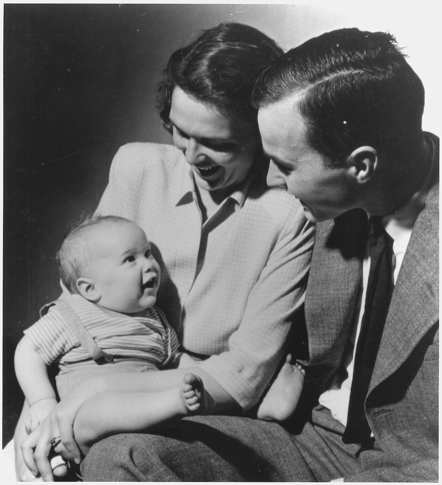
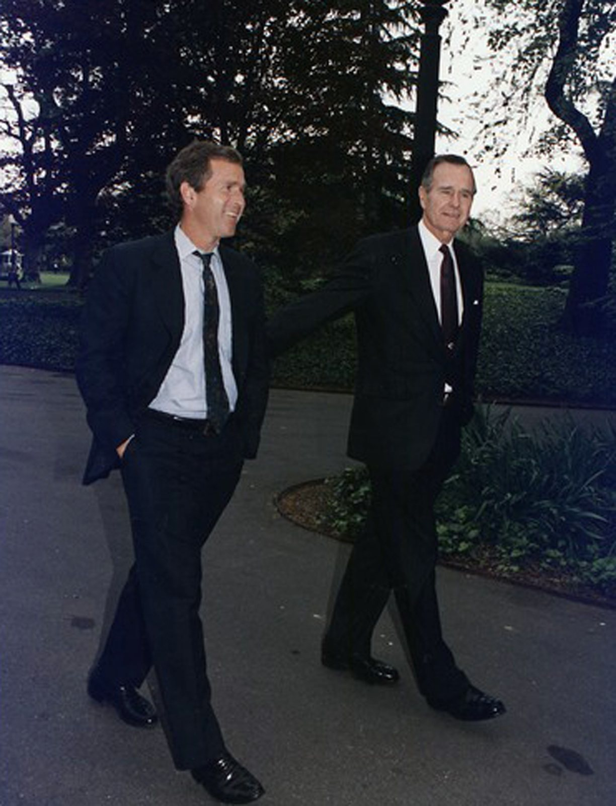
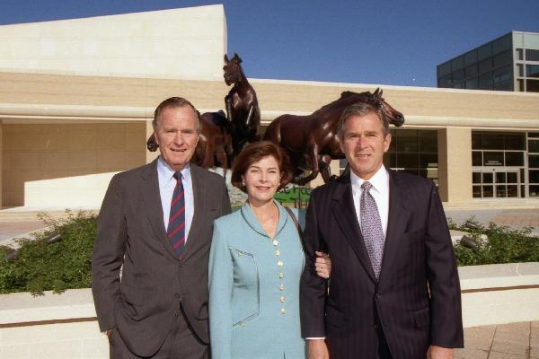

26年前の今日、2000年11月7日。アメリカ大統領選挙の一般投票が行われ、共和党のジョージ・Ｗ・ブッシュ候補と民主党のアル・ゴア候補による歴史的な大接戦が始まりました。全米を揺るがしたフロリダ州の開票劇は、前代未聞の混乱を引き起こしました。

## 二大政党の激突と注目された勝者総取り方式

クリントン政権の2期8年が満了を迎えた2000年の選挙は、現職副大統領のアル・ゴアと、テキサス州知事のジョージ・Ｗ・ブッシュの対決となりました。アメリカの大統領選挙は、各州に割り当てられた選挙人を勝者が原則として総取りする間接選挙の仕組みを採用しています。全米の有権者による投票総数で勝利しても、選挙人の獲得数で過半数の270人に届かなければ大統領にはなれません。この制度の下で、一般投票の次点候補が当選したのは1888年のベンジャミン・ハリソン以来112年間起きておらず、現代の選挙制度では前例のない緊張感が漂っていました。

## 深夜の開票速報で二転三転した「当確」

2000年11月7日の夜、全米の注目は25人の選挙人枠を持つフロリダ州に集中しました。その他の州の開票が進むなか、ゴアが255人、ブッシュが246人の選挙人を固め、フロリダを制した側が過半数に達してホワイトハウスを手に入れる情勢となったためです。アメリカ東部時間の夜8時ごろ、テレビ各社は一斉にゴアのフロリダ勝利確実を報じました。しかし間もなく各社はその当確を取り消します。さらに日付が変わった8日未明、今度はブッシュの当確が報じられました。

*George and Barbara Bush with their first born child George W. Bush, while Bush was a student at Yale — 写真: Unknown authorUnknown author / Public domain*

## 敗北宣言の電話と前代未聞の撤回劇

ブッシュ当確の速報を受け、慣行に則ってゴアはブッシュへ直接電話を入れ、勝利を祝福して自らの敗北を認めました。ところがその直後、フロリダ州での両者の票差が同州の法律で機械による再集計が義務づけられる0.5パーセント未満であることが明らかになります。情勢を把握したゴアは、再びブッシュに電話をかけ、先ほど伝えた敗北宣言を取り消すと告げました。メディア各社も当確を急きょ取り下げ、勝敗は「未確定（too close to call）」へと逆戻りしたのです。

*George W. Bush and President George H. W. Bush 1992 — 写真: David Valdez / Public domain*

## わずか1784票差とパンチカードの穴くず問題

フロリダ州当局が8日に発表した公式の開票結果は、ブッシュが290万9135票、ゴアが290万7351票で、その差はわずか1784票でした。さらに、パームビーチ郡などで使われていた「バタフライ方式」と呼ばれるパンチカード投票用紙に構造的な欠陥があることが判明します。有権者が穴を開けた際に紙くず（穿孔くず）が完全に切り落とされずぶら下がったまま残り、読み取り機械が無効票として処理してしまう問題が多発していたのです。ゴア陣営は民主党支持者が多い4つの郡で手作業による再集計を要求し、ブッシュ陣営は手作業の中止を求めて提訴に踏み切りました。

*George H. W. Bush, Laura Bush, George W. Bush 1997 — 写真: Unknown authorUnknown author / Public domain*

## 連邦最高裁判決による決着と現代への教訓

選挙の確定を巡る争いは「ブッシュ対ゴア事件」として連邦最高裁判所にまで持ち込まれました。保守派の判事が優位を占めていた最高裁は再集計の停止を命じ、フロリダ州の選挙人25人全員をブッシュが獲得することが確定しました。最終的な選挙人獲得数はブッシュが271人、ゴアが266人という極めて僅差の決着でした。一般投票の全国総数ではゴアが上回っていながら、選挙人投票でブッシュが第43代大統領に就任したこの出来事は、1票の重みと選挙制度のあり方を問う象徴的な事件として今も語り継がれています。

### 参考資料

- <https://ja.wikipedia.org/wiki/11%E6%9C%887%E6%97%A5>
- <https://commons.wikimedia.org/wiki/File:John_Edwards,_official_Senate_photo_portrait.jpg>
- <https://commons.wikimedia.org/wiki/File:George_and_Barbara_Bush_with_their_first_born_child_George_W._Bush,_while_Bush_was_a_student_at_Yale.jpg>
- <https://commons.wikimedia.org/wiki/File:George_W._Bush_and_President_George_H._W._Bush_1992.jpg>
- <https://commons.wikimedia.org/wiki/File:George_H._W._Bush,_Laura_Bush,_George_W._Bush_1997.jpg>
