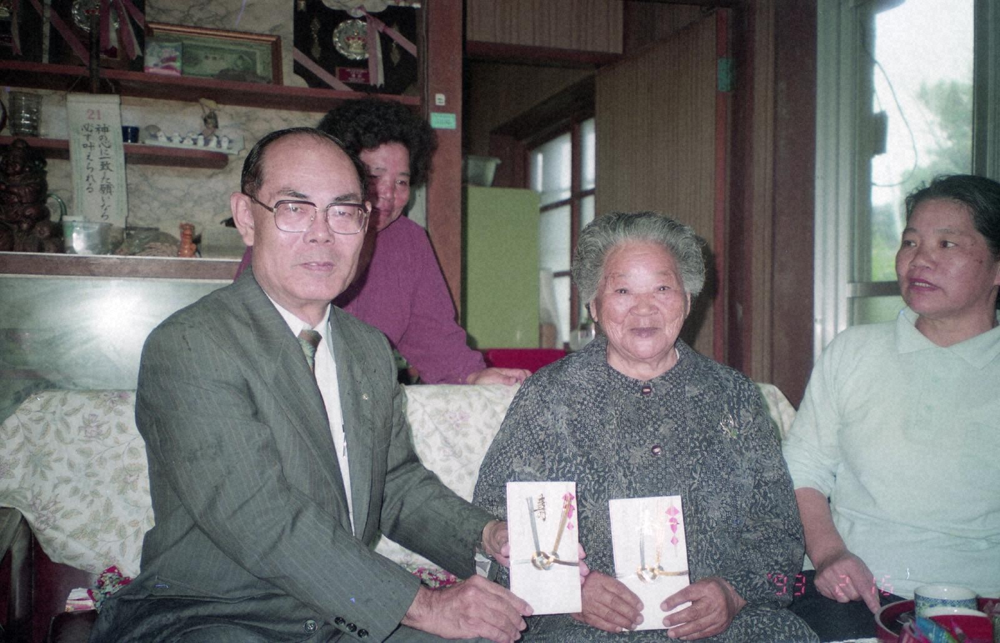
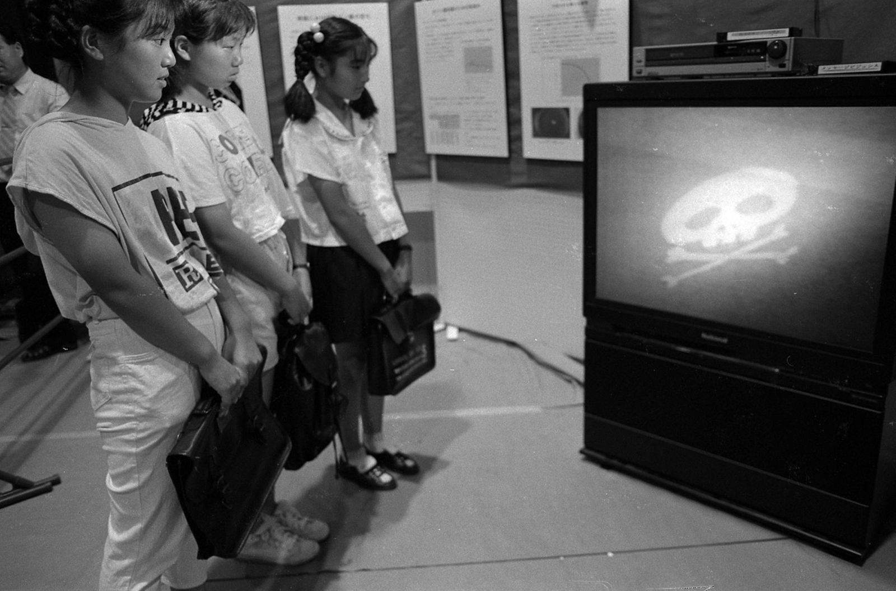
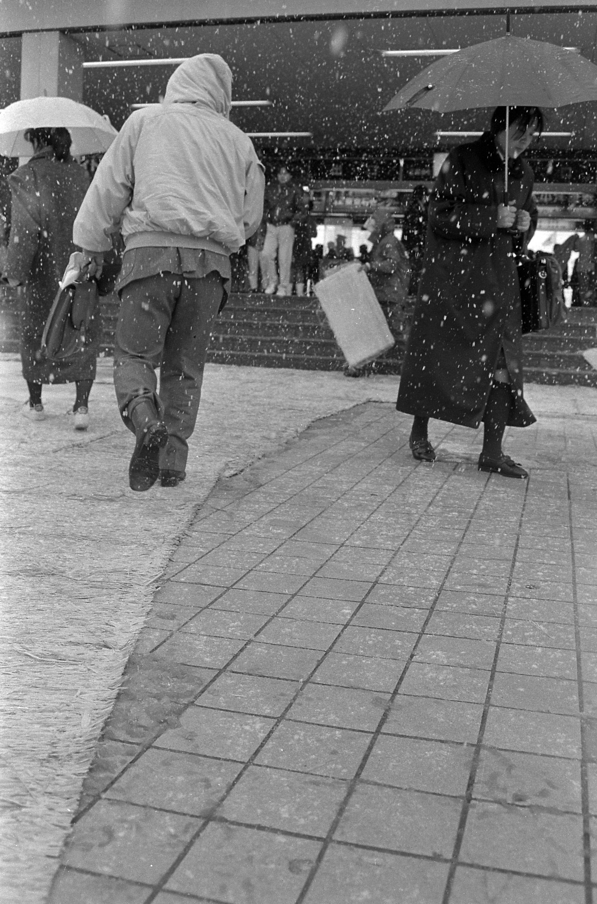

32年前の今日、1994年11月7日。東京都品川区に本店を置く城南信用金庫が、日本初となる懸賞金付きの定期預金「スーパードリーム」を発売しました。定期預金に懸賞金がつくという前代未聞の商品は、護送船団方式と呼ばれた当時の金融行政に大きな衝撃を与えました。

## 大蔵省の反対を覆した「スーパードリーム」の誕生

1994年、金融自由化の波が押し寄せる中、城南信用金庫は預金者に夢と楽しみを提供しようと「スーパードリーム」を企画しました。しかし、前例のない懸賞金付き預金の開発に対し、監督官庁である大蔵省は強く反対の姿勢を示しました。金融秩序の混乱や射幸心をあおる懸念などを理由にブレーキをかけようとしたのです。これに対し、国民や多くの識者が信金側の新しい挑戦を熱狂的に支持しました。世論の後押しを受けた城南信用金庫は発売に踏み切り、この商品は一気に社会現象へと発展していきました。

## バブルに踊らなかった「信用金庫の神様」の哲学

城南信用金庫がこうした大胆な独自商品を打ち出せた背景には、確固たる経営理念がありました。3代目理事長を務め「信用金庫の神様」と呼ばれた小原鐵五郎は、1918年の米騒動を目の当たりにし、「貧富の差をなくして安定した社会を作りたい」と志して信金運動に身を投じた人物です。小原が残した「裾野金融」「貸すも親切、貸さぬも親切」「カードは麻薬」といった哲学は、深く金庫に根づいていました。1980年代後半のバブル景気において、多くの金融機関が不動産や株式の投機融資に走る中、城南信用金庫は投機的な貸し出しを一切行いませんでした。その健全な経営基盤があったからこそ、当時全国の信用金庫で預金量・貸出金量ともに第1位の実績を誇り、堂々と行政に意見を通すことができたのです。

*玉城村写真 — 写真: 南城市教育委員会 / CC BY (Japan Search)*

## 世界メディアも注目、日経最優秀賞の受賞へ

1994年11月7日の発売当日、このユニークな挑戦は日本全国の注目を集めました。『日本経済新聞』『読売新聞』『朝日新聞』『毎日新聞』『産経新聞』『東京新聞』といった主要各紙やテレビニュースがこぞって取り上げただけでなく、イギリスの経済紙『フィナンシャル・タイムズ』までもが報道しました。庶民の預金に宝くじのような夢を与える試みは大きな共感を呼び、翌1995年2月には『日本経済新聞』優秀製品・サービス賞の最優秀賞を受賞しました。城南信金の成功を皮切りに、それまで静観していた大手銀行や地方銀行、他の信用金庫も次々と懸賞金付き定期預金の発売に追随していきました。

*児童館コスモス 夏休み特別イベント「地球を守る科学技術」 — 写真: ndl / CC BY (Japan Search)*

## 自由化に先駆けて連発された独自商品

城南信用金庫の先進的な取り組みは、懸賞金付き預金だけにとどまりません。1991年4月には金融界で初めて独自の短期・長期プライムレート制度を導入し、1992年4月には大手銀行に先駆けて不良債権のディスクロージャー（情報開示）を実施しました。さらに1993年6月には毎年地方の特産品が届く定期積金を開発し、同年10月には郵便局の定額貯金に対抗する「スーパートップ」を打ち出しています。その後も「ハイパートップ」や「超優貯」など、利用者の目線に立った独自商品を次々と世に送り出していきました。

*2/1 除雪作業 — 写真: ndl / CC BY (Japan Search)*

## 明治の産業組合から続く「相互扶助」の原点

信用金庫の歴史は、明治時代に遡ります。1902年7月、旧一宮藩主で鹿児島県知事を務めた加納久宜子爵が、イギリスの協同組合を手本として大森山王の私邸に設立した「入新井信用組合」が城南信用金庫の源流です。加納は「一に公益事業、二に公益事業、ただ公益事業に尽くせ」と説き、地域住民の福祉向上を目指しました。戦後の1951年6月には信用金庫法に基づき「城南信用金庫」へと改組されました。当時、利益至上主義の銀行と一線を画すため「信用銀行」という名称を拒否し、当時の舟山正吉大蔵省銀行局長から「金は銀よりも上」として政府機関にのみ使われていた「金庫」の名称を与えられたという誇り高き歴史を持っています。

## 金融の常識を覆したあの日を振り返る

「スーパードリーム」の登場から32年が経過しました。お上の認可や横並び意識が支配していた1990年代半ばの金融界において、一地方の信用金庫が起こしたイノベーションは、金融機関が顧客に寄り添う姿勢を世に示しました。預金通帳を開くたびに「当たるかもしれない」と胸を躍らせたあの冬の記憶は、バブル崩壊後の沈んだ空気に確かな明るい光を灯しました。

### 参考資料

- <https://ja.wikipedia.org/wiki/11%E6%9C%887%E6%97%A5>
- <https://commons.wikimedia.org/wiki/File:Manhole.cover.in.shinagawa.tokyo.jpg>
- <https://nanjo-archive.jp/document/?detail=9702&genre=6>
- <https://adeac.jp/koshigaya-city-digital-archives/catalog/mp237512-200020>
- <https://adeac.jp/koshigaya-city-digital-archives/catalog/mp233091-200020>
