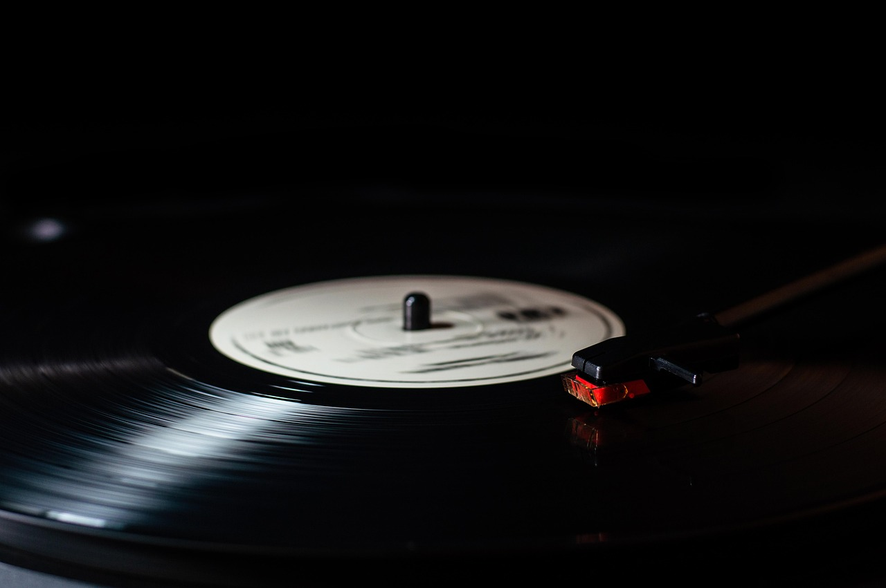
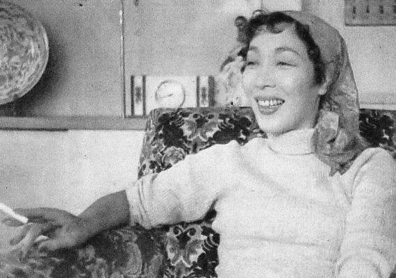

46年前の今日、1980年11月7日。「シャンソンの女王」として昭和の日本を熱狂させた歌手で女優の越路吹雪さんが、胃がんのため56歳の若さで亡くなりました。宝塚歌劇団の男役トップスターから、日本のミュージカル女優第1号、そして唯一無二のエンターテイナーとして駆け抜けた生涯でした。突然の訃報は、日本中に深い悲しみと衝撃をもたらしました。

## 宝塚の「不良少女」から花組トップスターへ

1924年に東京で生まれた越路さんは、歌が大好きな一方で勉強が嫌いで、父の勧めで宝塚音楽歌劇学校に入学しました。入団時の成績は93人中73位。規律の厳しい劇団内で喫煙や門限破りをするなど破天荒な一面を見せ、「不良少女」というあだ名を付けられる異色の存在でした。

転機となったのは戦時中でした。1943年の公演で浪曲師のものまねを披露して注目を集め、若手の台頭とともに花組のトップスターへと上り詰めます。終戦直後の1946年には主演舞台「ミモザの花」や「ブギウギ巴里」を大ヒットさせ、戦後の宝塚の復興を力強く牽引しました。

## 岩谷時子との絆と「シャンソンの女王」の誕生

1951年に宝塚を退団した越路さんは、帝国劇場で上演された「モルガンお雪」の主演を務め、国産ミュージカル女優第1号となりました。その後、東宝の専属女優として活躍する傍ら、生涯の盟友となる作詞家・翻訳家の岩谷時子さんと出会います。

岩谷さんが日本語詞を手がけた「愛の讃歌」をはじめ、数々の海外のシャンソンを情熱的に歌い上げ、日本全国にシャンソンブームを巻き起こしました。1965年からは日生劇場で1か月に及ぶ「ロングリサイタル」をスタートさせ、越路さんの洗練されたステージとドラマチックな歌唱は不動の名声を確立しました。

*当日の写真ではありません · 事件当時の写真ではありません · イメージ写真 — 写真: niro9 / Pixabay Content License*

## 胃の激痛に耐えて立った最後の舞台

1980年3月、恒例の日生劇場ロングリサイタルを終えた越路さんは、新たな挑戦として芝居の世界へと踏み出しました。5月下旬から始まった2人芝居「古風なコメディ」では、劇団民藝の重鎮である宇野重吉さんの演出のもと、米倉斉加年さんと共演を果たします。

東京公演は連日満員の大盛況となり、追加公演が行われるほどの評判を呼びました。しかし、この時すでに越路さんの体は病魔に蝕まれていました。胃の激しい痛みに襲われながらも、それを観客に悟られることなく舞台を務め上げました。劇中で夫の内藤法美さんが作曲した「サーカスの唄」を歌ったのが、越路さんにとって生涯最後の歌唱となりました。

*当日の写真ではありません · 事件当時の写真ではありません · イメージ写真 — 写真: padrinan / Pixabay Content License*

## 本人に知らされなかった本当の病名

6月26日に千秋楽を迎えた直後、越路さんは激痛のため緊急入院を余儀なくされました。7月8日、東京都目黒区の東京共済病院で胃の5分の4を切除する大手術を受けます。当時、本人には「重度の胃潰瘍」と説明されていましたが、実際の病名は腹膜にまで転移していた末期の胃がんでした。

越路さんは家族をがんで亡くしていたことから日頃から検診を欠かさず受けていましたが、前年だけは多忙のために受診を先延ばしにしてしまっていたといいます。病床にあっても舞台への復帰を信じてリハビリに励み、入退院を繰り返しながら再起を目指しました。

*Fubuki Koshiji 01 — 写真: Unknown authorUnknown author / Public domain*

## 最期の言葉「法美さんにコーヒーを」

懸命の闘病もむなしく、千秋楽からわずか4か月余りが過ぎた11月7日午後3時2分、越路吹雪さんは56歳で静かに息を引き取りました。意識が朦朧とする中で最後に絞り出したのは、看病を続ける最愛の夫を気遣う「法美さんにコーヒーを」という言葉でした。

親友の淡路恵子さんによって美しい死に化粧が施され、出棺の際には越路さんが幼少期から好んでいた中野区の原っぱのそばを霊柩車が静かに通り過ぎました。旅立ちの日まで、周囲への温かい愛情を失わない人でした。

## 今も人々の胸に生き続ける圧倒的な歌声

越路吹雪さんが遺した足跡は、今も色あせることはありません。2014年には創立100周年を迎えた宝塚歌劇団の「宝塚歌劇の殿堂」において、最初の100人の一人として殿堂入りを果たしました。また、麻布山善福寺に建てられた石碑には、代表曲「愛の讃歌」の歌詞が刻まれています。

舞台に全身全霊を捧げ、華麗に力強く生き抜いた稀代のエンターテイナー。越路吹雪さんが情熱を込めて歌い上げた数々の名曲は、今も人々の記憶の中で鮮やかに響き続けています。

### 参考資料

- <https://ja.wikipedia.org/wiki/11%E6%9C%887%E6%97%A5>
- <https://pixabay.com/photos/music-player-record-player-7792956/>
- <https://pixabay.com/photos/record-shop-vinyl-records-music-9180482/>
- <https://pixabay.com/photos/music-recording-vinyl-retro-disk-5705801/>
- <https://commons.wikimedia.org/wiki/File:Fubuki_Koshiji_01.jpg>
