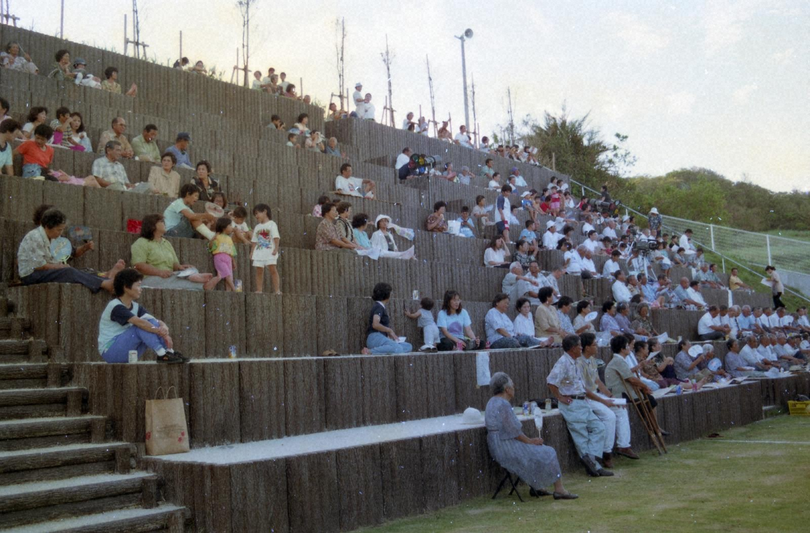
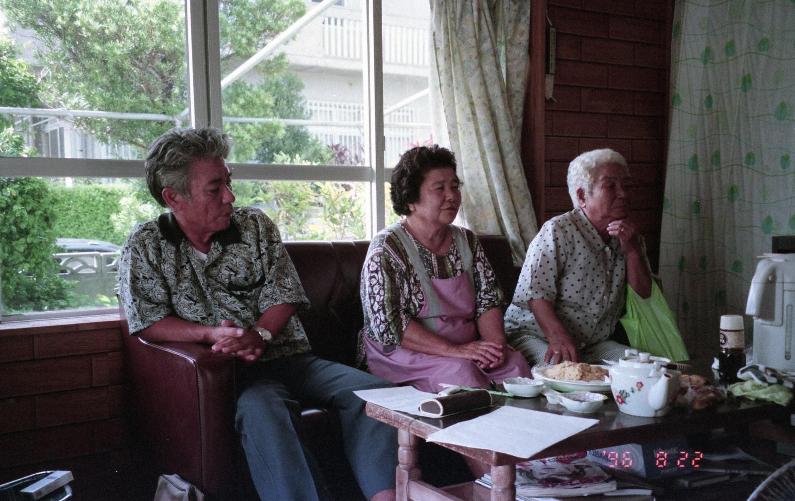
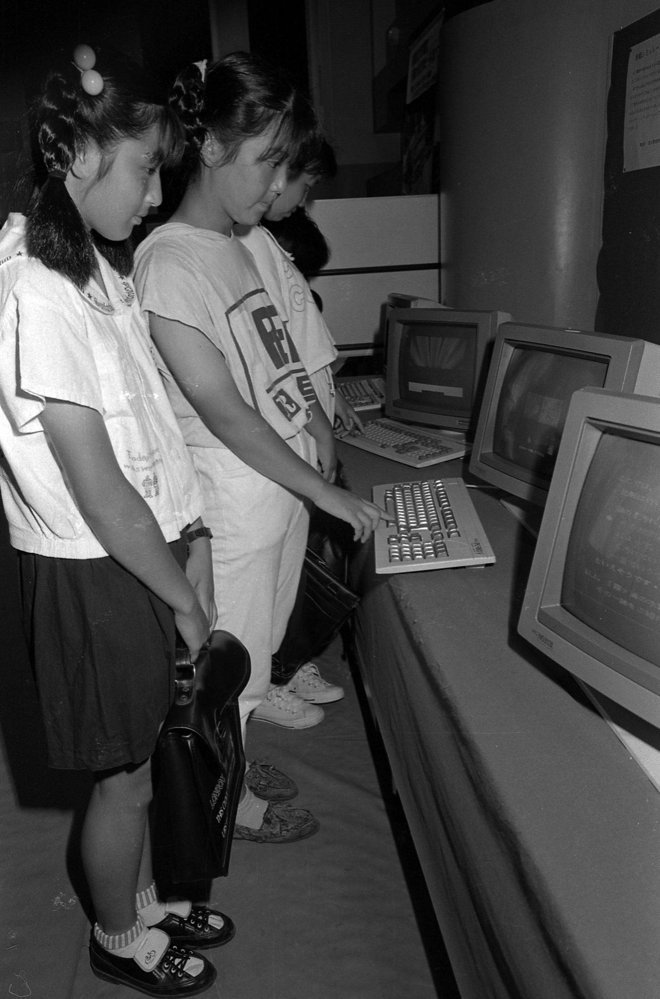

1996年11月7日、数々の大ヒット曲を生み出し、日本の音楽シーンに独自のエンターテインメントを築き上げたバンド「米米CLUB」が、公式に解散を発表しました。「浪漫飛行」や「君がいるだけで」などの国民的ヒット曲で知られた彼らの一報は、当時の音楽界とファンに大きな衝撃を与えました。奇抜なパフォーマンスと確かな演奏技術で時代を彩ったバンドは、なぜ解散という決断に至ったのでしょうか。

## 映画研究会から生まれた型破りなバンド

米米CLUBの原点は、1979年から1981年にかけて活動していた映画研究会「A-Ken」にありました。文化学院のサークル仲間であった石井竜也（カールスモーキー石井）さん、小野田安秀（ジェームス小野田）さん、大久保謙作（BON）さんらによって、1982年秋に結成されました。バンド名はアメリカのバンド「トム・トム・クラブ」に由来しています。

結成直後の1982年11月23日、慶應義塾大学の三田祭で初ステージを踏みました。その場限りのパロディバンドのつもりでしたが、観客から大きな好評を得たことで本格的なライブ活動を開始します。そして1985年10月21日、シングル『I・CAN・BE』とアルバム『シャリ・シャリズム』でメジャーデビューを果たしました。デビュー当初は奇抜な衣装やメイク、コントのような演出から「色物」として扱われることもありましたが、ファンクを基調とした高い演奏力で徐々に注目を集めていきました。

## 「浪漫飛行」から「君がいるだけで」へ、社会現象の時代

米米CLUBの魅力は、単なる音楽演奏にとどまらない総合エンターテインメントショーにありました。ダンサーチーム「シュークリームシュ」やホーンセクション「ビッグ・ホーンズ・ビー」を擁する大所帯バンドとして、舞台セットや寸劇にも徹底してこだわりました。観客がダンサーの振り付けを真似て踊り、メンバーの衣装を自作して会場に訪れるスタイルは、現在のライブにおける一体感やコスプレ文化の先駆けでもありました。

1990年、日本航空の沖縄キャンペーンCMソングに起用された「浪漫飛行」がシングルカットされてミリオンセラーを達成します。さらに1992年には、フジテレビ系月9ドラマ『素顔のままで』の主題歌となった「君がいるだけで」が累計売上289.5万枚というメガヒットを記録しました。同年の第34回日本レコード大賞を受賞し、米米CLUBの名は名実ともに日本全国へと浸透していきました。

*知名のヌーバレー（1997年） — 写真: 南城市教育委員会 / CC BY (Japan Search)*

## 巨大化したバンドが直面した葛藤と解散発表

しかし、大ヒットによる知名度の急上昇は、バンドの内部に少しずつ変化をもたらしました。広いファン層に向けた楽曲作りが求められるようになり、初期の持ち味であったコミカルな要素や自由な空気感が薄れていきました。フロントマンのひとりであったジェームス小野田さんの出番が減少し、石井竜也さんひとりがメインボーカルを務める場面が増加していきました。

そうした方向性の変化や軋轢のなか、1995年には結成当初からのメンバーであったドラムの坂口良治さんとギターの得能律郎さんがバンドを脱退します。さらにダンサーチームのマリさんも脱退し、バンドは急速に求心力を失っていきました。加えて1996年に公開された石井竜也さん監督の映画『ACRI』が興行的に振るわず、石井さんが10億円を超える借金を背負うことになったこともバンド維持に大きな打撃となりました。1996年は一切のライブ活動を行えない状況が続いた末、1996年11月7日、米米CLUBはついに解散を発表したのです。

*町史関係資料 — 写真: 南城市教育委員会 / CC BY (Japan Search)*

## 東京ドームに響いた88,888人の別れ

解散発表の翌年、1997年3月5日と6日の2日間にわたり、東京ドームでラストライブ「THE LAST SYMPOSIUM」が開催されました。巨大なキャパシティを誇る会場であったにもかかわらず、入場チケットは即日完売となりました。

この公演の動員数は1公演につき44,444人、2日間の合計で88,888人という数字を記録しました。こだわり抜いたエンターテインメントを貫いてきた米米CLUBらしく、最後まで熱気とユーモア、そして感動に満ちたステージを繰り広げ、10年以上に及ぶ活動に華々しく幕を下ろしました。メンバーはそれぞれのソロ活動へと歩みを進めることになります。

*児童館コスモス 夏休み特別イベント「地球を守る科学技術」 — 写真: ndl / CC BY (Japan Search)*

## 奇跡の再結成と今も歌い継がれる名曲

解散から長い年月が流れた2005年、親交の深かったミュージシャンCharさんのバースデーパーティーでメンバーが集まり、久々に演奏を披露したことが転機となりました。これがきっかけとなり、デビュー20周年を経て、2006年4月に米米CLUBは再結成を果たしました。

当初は2006年10月までの期間限定と発表されていましたが、ファンの熱烈な歓迎を受け、10月22日の横浜アリーナ公演の最終日に石井さんが期間限定の撤回を宣言しました。脱退していたメンバーも復帰し、バンドとしての活動を正式に継続することになったのです。2007年には第58回NHK紅白歌合戦に11年ぶりの出場を果たしました。「君がいるだけで」や「浪漫飛行」といった名曲は、今も色あせることなく、日本の音楽史の中で愛され続けています。

### 参考資料

- <https://ja.wikipedia.org/wiki/11%E6%9C%887%E6%97%A5>
- <https://www.flickr.com/photos/27485522@N04/3205607755>
- <https://nanjo-archive.jp/document/?detail=30665&genre=6>
- <https://nanjo-archive.jp/document/?detail=11199&genre=6>
- <https://adeac.jp/koshigaya-city-digital-archives/catalog/mp237519-200020>
