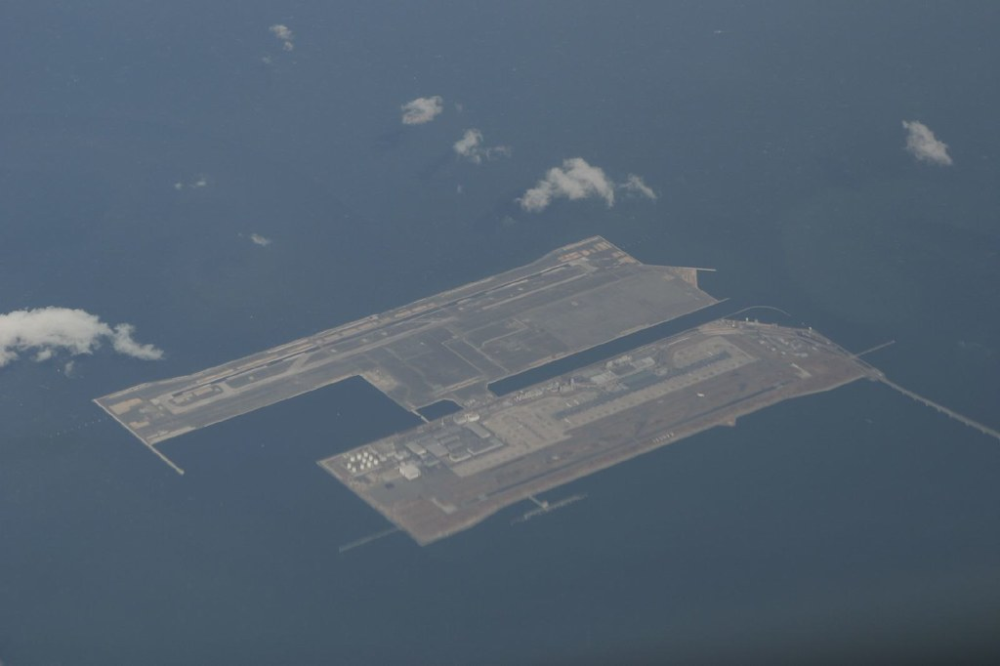
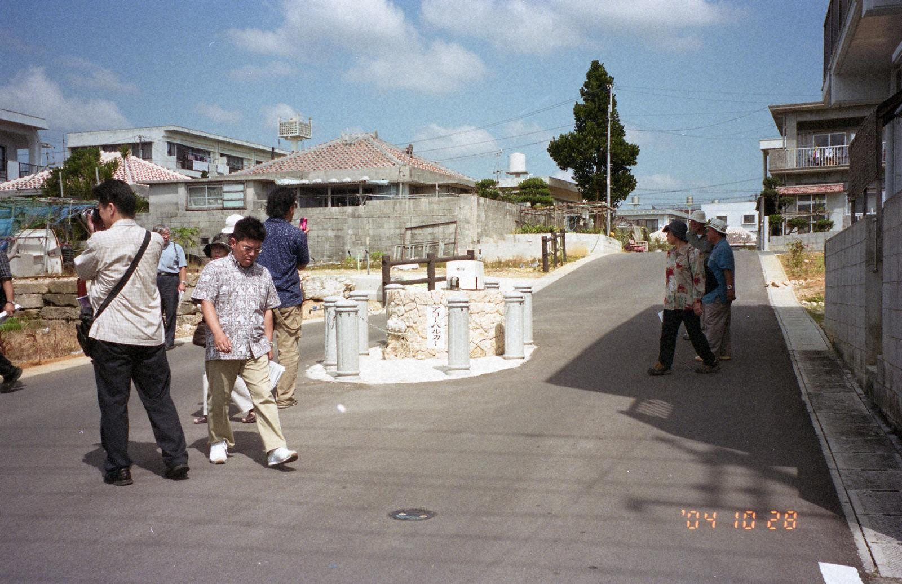
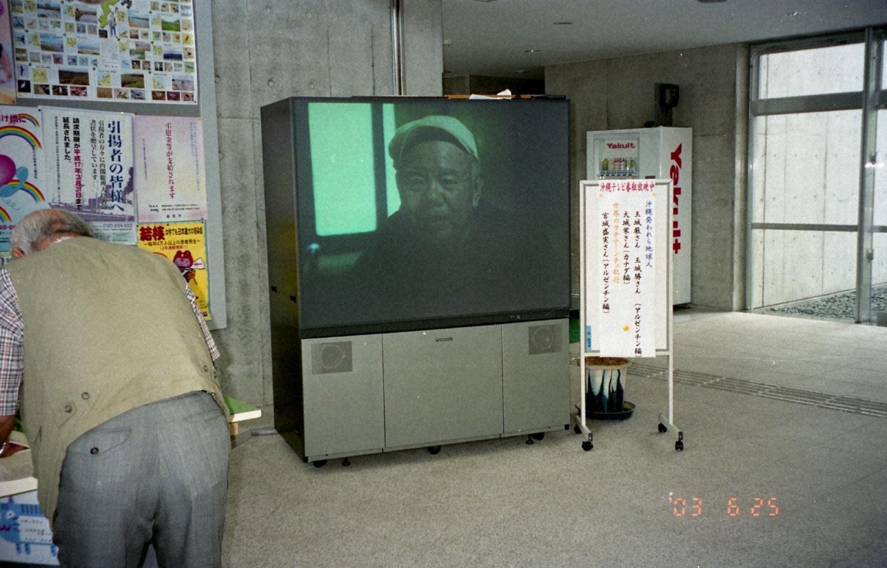

26年前の今日、2000年11月8日。世界各地で武装闘争を展開し、長年にわたり国際手配されていた日本赤軍の元最高幹部・重信房子が、大阪府高槻市内で大阪府警に逮捕されました。中東に拠点を置き、数々の国際テロに関与したと恐れられた指導者が、国内の一般住宅地に潜伏していたニュースは、日本中に驚きをもたらしました。

## 中東へ渡り結成された「日本赤軍」

重信房子は東京都出身で、高校卒業後に働きながら明治大学の夜間部に通い、学生運動に関わるようになりました。共産主義者同盟赤軍派の結成に加わった後、海外に拠点を設けて武装闘争を進めるという「国際根拠地論」に基づき、1971年2月に「京都パルチザン」の奥平剛士と偽装結婚して出国。パレスチナへと渡りました。

現地でパレスチナ解放人民戦線（PFLP）に国際義勇兵として参加したグループは、当初「アラブ赤軍」などと名乗っていました。しかし、同様に義勇兵として参加していたドイツの過激派組織と区別するため、1974年頃から公式に「日本赤軍」を名乗るようになります。重信はその最高幹部として、世界的な共産主義革命を掲げ、組織を牽引していきました。

## 大使館を占拠した1974年の「ハーグ事件」

日本赤軍の名が欧州を震撼させた代表的な事件が、1974年9月に起きた「ハーグ事件」です。同年7月にパリの空港で偽造旅券所持などにより逮捕されたメンバーの山田義昭を奪還するため、日本赤軍はオランダのハーグにある在蘭フランス大使館の襲撃を企てました。

9月14日未明、拳銃や手榴弾で武装した実行犯3人が大使館へ侵入し、フランス大使ら11人を大使室に監禁しました。駆けつけたオランダ警察と銃撃戦になり警察官2名が重傷を負う中、犯人側は仲間の釈放と脱出用航空機、慰謝料100万ドルを要求。最終的にオランダ政府が30万ドルを支払い、フランス政府が山田を釈放して用意したボーイング707型機でシリアのダマスカスへ逃亡しました。重信はこの事件で武器調達などを担い共謀したとされ、国際手配されることになりました。

*Kansai International Airport — 写真: mrhayata / CC BY-SA 2.0*

## 缶コーヒーの指紋と独特の仕草が生んだ特定

国際刑事警察機構（ICPO）を通じて手配され、海外を転々としているとみられていた重信でしたが、実際には偽造旅券を用いて日本に不法入国し、大阪市西成区のマンションなどに潜伏していました。1997年12月から2000年9月にかけて、他人になりすまして取得した旅券を使い、関西国際空港から計16回も中国などへ出入国を繰り返していたとされています。

捜査の手が伸びたのは、日本赤軍の支援者を追っていた大阪府警警備部公安第三課の活動がきっかけでした。視察対象者が接触した女性が重信に似ていることが浮上。女性は顔の特徴であったホクロを化粧で隠していましたが、タバコの吸い方に独特の癖があり、さらに立ち寄った場所で飲んだ缶コーヒーから採取された指紋が、警察の保管していた重信の指紋と完全に一致しました。2000年11月8日、大阪府高槻市内で警察官が職務質問を行い、旅券法違反容疑で逮捕に踏み切りました。

*沖地協研修会 — 写真: 南城市教育委員会 / CC BY (Japan Search)*

## 新幹線の個室移送と支援者網の摘発

逮捕後、身柄は大阪から東京の警視庁へと移送されました。万全を期した逃亡防止措置として東海道新幹線が使われ、当時設置されていたグリーン車の個室に重信を収容して運ばれるという物々しい警備が敷かれました。

逮捕時に押収された膨大な資料からは、重信が日本国内で「人民革命党」やその公然組織を立ち上げていた実態が判明しました。さらに、重信の長年にわたる潜伏を支援していた会社経営者、医師、教諭、病院職員らが次々と犯人隠避の疑いで検挙され、過激派の地下ネットワークが国内の日常社会に深く根を張っていた現実が浮き彫りとなりました。

*大里村史移民編展示 — 写真: 南城市教育委員会 / CC BY (Japan Search)*

## 懲役20年の判決と組織の終焉

逮捕後の2001年、重信は拘置所の中から「日本赤軍」の解散を公式に表明しました。かつて世界各地でハイジャックや人質事件を起こした過激派組織は、指導者の逮捕によって名実ともに活動に幕を下ろすことになりました。

裁判では、ハーグ事件における逮捕監禁罪や殺人未遂罪などの共謀共同正犯に問われました。重信側は無罪を主張したものの、裁判所は武器調達や逃亡先の確保といった中核的な役割を果たしたと認定。2006年に東京地裁で懲役20年の判決が言い渡され、2010年に最高裁判所で確定しました。服役中には病の治療を受けながら刑期を過ごし、2022年5月28日、刑期満了により医療刑務所から出所しました。

## 26年を経て終わった逃亡劇が残したもの

出所時の取材で重信は「闘いの中で無辜の人たちに被害を与えた。おわびします」と謝罪の言葉を述べました。1970年代から80年代にかけて吹き荒れた過激派による武装闘争は、多くの市民を巻き込み、社会に深い恐怖と傷跡を残しました。

中東のゲリラ組織と結びつき、世界中を逃亡し続けた最高幹部が、大阪のありふれた街角で捜査員に取り押さえられたあの日。冷戦期から続いた激動の過激派闘争の時代が完全に過去のものとなった瞬間として、2000年11月8日の逮捕劇は今も記憶されています。

### 参考資料

- <https://ja.wikipedia.org/wiki/%E3%83%8F%E3%83%BC%E3%82%B0%E4%BA%8B%E4%BB%B6>
- <https://commons.wikimedia.org/wiki/File:Junz%C5%8D_Okudaira_1998.png>
- <https://www.flickr.com/photos/36516818@N00/101499461>
- <https://nanjo-archive.jp/document/?detail=9829&genre=6>
- <https://nanjo-archive.jp/document/?detail=8996&genre=6>
