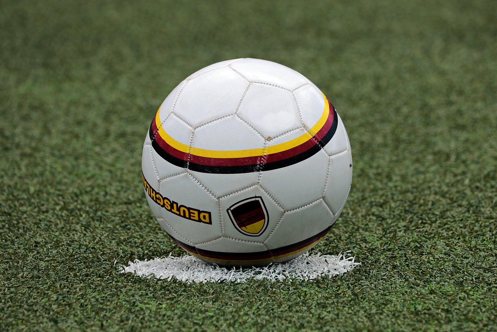
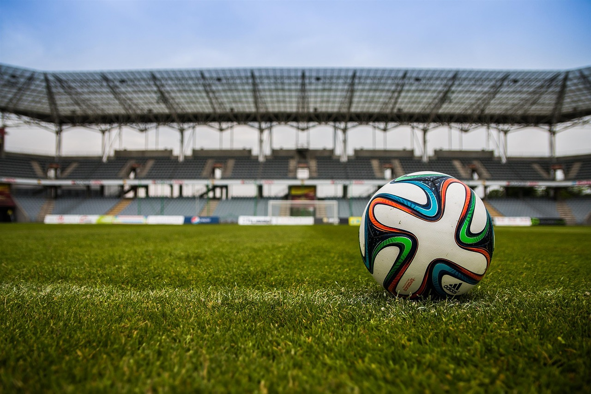
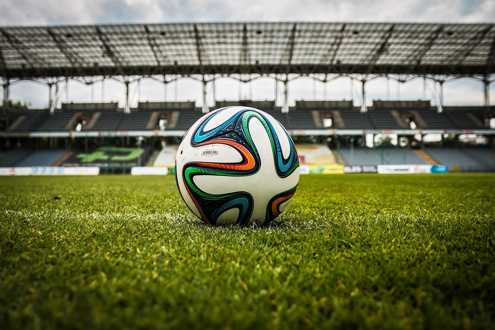

34年前の今日、1992年11月8日。広島県で開催された第10回サッカーアジアカップの決勝で、日本代表がサウジアラビアを破り、見事に大会初優勝を飾りました。翌年1993年5月のJリーグ開幕を控え、まさに日本サッカーがプロ化へと大きく舵を切る中で成し遂げられたこの快挙は、日本がアジアの強豪、そして世界へと羽ばたく決定的な足がかりとなりました。

## 広島で掴んだアジア初制覇の栄冠

1992年秋、広島県を舞台に開催された第10回アジアカップ。自国開催のプレッシャーを受けながら勝ち進んだ日本代表は、11月8日の決勝戦でアジア屈指の強豪サウジアラビアと激突しました。緊迫した攻防の中、選手たちは一丸となって戦い抜き、悲願のアジア制覇を達成。スタジアムは大きな歓喜と興奮に包まれました。それまで国際舞台で苦戦が続いていた日本サッカーにとって、公式大会でのアジアの頂点は歴史を塗り替える瞬間でした。

## 初の外国人プロ監督ハンス・オフトと「オフト・ジャパン」

この躍進を率いたのが、日本代表初のプロ監督であり、初の外国人監督でもあったオランダ人のハンス・オフト氏でした。年俸約7000万円で就任したオフト監督は、選手たちに明確な戦術眼とプロフェッショナリズムを植え付けました。マスメディアでは「オフト・ジャパン」という呼称が定着し、以後の代表チームでも監督名に「ジャパン」を冠する呼び方が広く浸透するきっかけとなりました。規律と組織力を重視した指導は、代表チームの意識を根底から変革しました。

*当日の写真ではありません · 事件当時の写真ではありません · イメージ写真 — 写真: pixel2013 / Pixabay Content License*

## 「赤」から伝統の「青」へ戻ったユニフォーム

この1992年、日本代表のユニフォームにも象徴的な変化がありました。1988年に就任した横山謙三監督の意向で日の丸の「赤」に変更されていたユニフォームが、1992年に本来の「青」を基調とするデザインへと戻されたのです。青は「日本の国土を象徴する海と空の青」を表し、胸には三本足の八咫烏のエンブレムが刻まれました。1930年の全日本選抜や1936年のベルリンオリンピックから受け継がれてきた青い戦闘服が、広島のピッチで再び鮮やかに躍動しました。

*当日の写真ではありません · 事件当時の写真ではありません · イメージ写真 — 写真: jarmoluk / Pixabay Content License*

## 過酷なアマチュア時代と選手たちの待遇改善

かつての日本代表は長い財政難に苦しんでいました。日本リーグ所属の選手たちは企業の有給休暇を使って代表活動に参加し、遠征諸費用も自費で賄っていた時代がありました。1970年メキシコW杯予選後、無報酬の実態を知った顧問のデットマール・クラマー氏が選手たちに謝罪したという逸話も残されています。1982年に森孝慈監督のもとで1日3000円の手当てが実現し、その後ブラジルから帰国した三浦知良選手や日本に帰化したラモス瑠偉選手らがJFAに待遇改善を訴え、日当や勝利給が支給される環境へと進化を遂げていきました。

*当日の写真ではありません · 事件当時の写真ではありません · イメージ写真 — 写真: jarmoluk / Pixabay Content License*

## アジア最多4度の頂点、そして世界へ

1992年広島での初優勝を皮切りに、日本代表は2000年、2004年、2011年と大会最多となる通算4度のアジアカップ優勝を記録することになります。さらに1998年以降はワールドカップへの連続出場を続け、フェアプレー精神を保ちながら世界の強豪と渡り合うまでに成長しました。その輝かしい歩みのすべての始まりが、広島でサウジアラビアを破り、トロフィーを掲げた1992年のあの日だったのです。

### 参考資料

- <https://ja.wikipedia.org/wiki/%E3%82%B5%E3%83%83%E3%82%AB%E3%83%BC%E6%97%A5%E6%9C%AC%E4%BB%A3%E8%A1%A8>
- <https://pixabay.com/photos/football-grass-ball-green-grass-2778583/>
- <https://pixabay.com/photos/football-soccer-sport-ball-field-3471371/>
- <https://pixabay.com/photos/football-ball-soccer-field-stadium-488714/>
- <https://pixabay.com/photos/soccer-ball-stadium-field-488700/>
