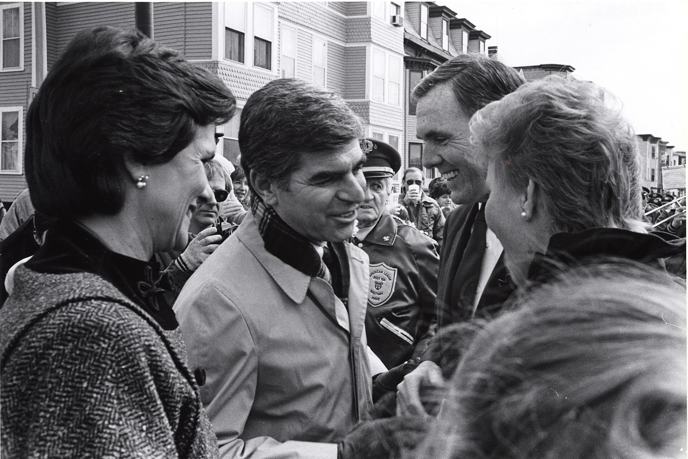
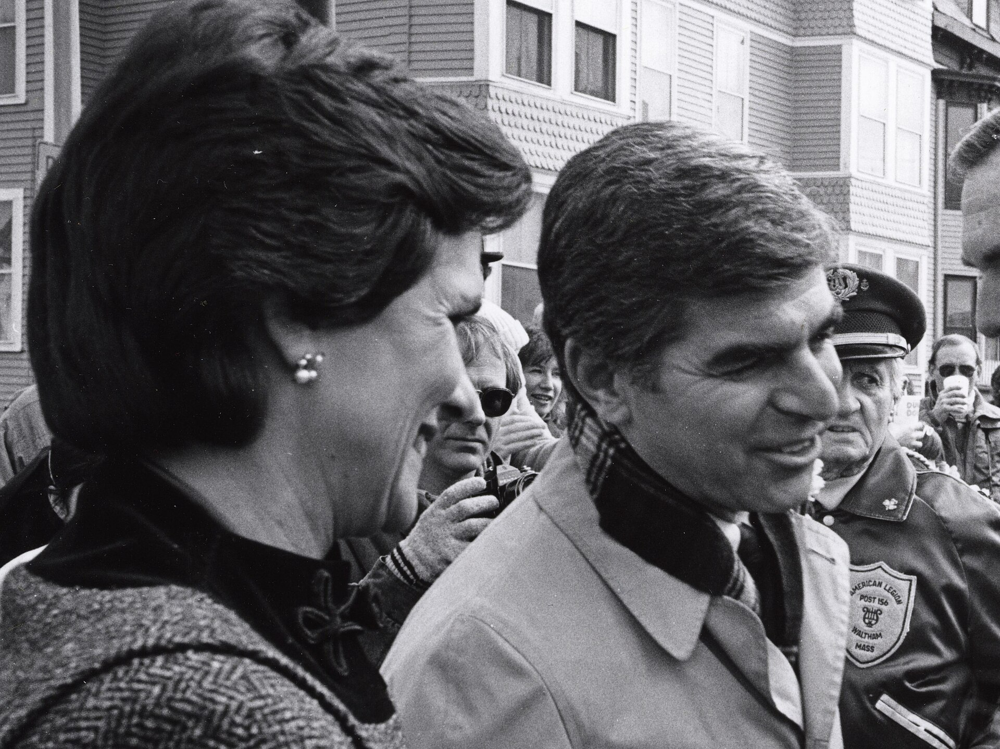
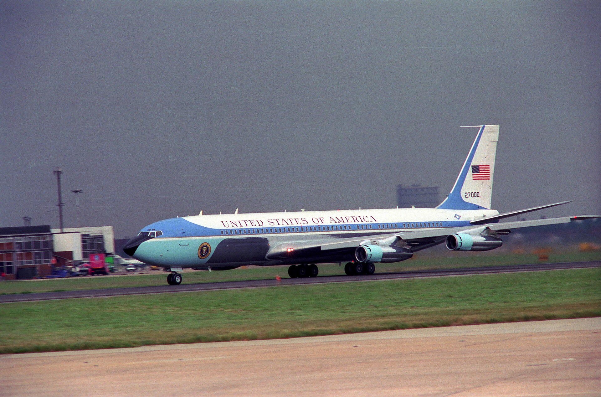

38年前の今日、1988年11月8日。アメリカ大統領選挙の一般投票が行われ、共和党のジョージ・H・W・ブッシュ副大統領が初当選を果たしました。ロナルド・レーガン政権を2期8年支えた現職副大統領が、152年ぶりとなる歴史的ジンクスを打ち破った瞬間でした。

## 1988年11月8日、ホワイトハウスを目指す決戦の日

1988年11月8日、アメリカ合衆国で第51回大統領選挙の一般投票が行われました。共和党の候補者として挑んだのは、現職副大統領のジョージ・H・W・ブッシュ氏です。対する民主党は、マサチューセッツ州知事のマイケル・デュカキス氏を擁立し、8年ぶりの政権奪還を狙っていました。開票が進むにつれ、ブッシュ氏が各地で優勢を伝えられ、最終的に大差をつけて初当選を確実にしました。全米が固唾をのんで見守ったこの日は、冷戦末期の世界のリーダーを決める歴史的な節目となったのです。

## レーガン政権の8年間と立ちふさがった「副大統領の壁」

ブッシュ氏は、1981年からロナルド・レーガン大統領のもとで副大統領を2期8年にわたり務め上げました。外交や安全保障の分野で重責を担い、レーガン氏の政策を継承することを掲げるとともに、穏健派の有権者を引きつけるため「優しいアメリカ」をスローガンに掲げました。しかし、アメリカの政治史には「現職の副大統領は長く務めるほど大統領選挙で勝てない」というジンクスが存在していました。現職副大統領が大統領に選出されたのはマーティン・ヴァンビューレン以来実に152年ぶりで、4人目。2期目を務めている現職副大統領としてはジョン・アダムズ以来192年ぶり2人目という極めて険しい関門だったのです。

*事件当時の写真ではありません · 1987年 — 写真: City of Boston Archives from West Roxbury, United States / CC BY 2.0*

## 予備選初戦の敗北から「増税なし」の逆転劇

指名獲得への道は波乱に満ちていました。ブッシュ氏は最有力と見られながらも、初戦のアイオワ州党員集会でボブ・ドール上院議員やパット・ロバートソン氏に敗れ、まさかの3位に沈みます。陣営は強い危機感を抱き、対立候補への対抗措置を徹底してニューハンプシャー州で逆転勝利を収めました。勢いに乗ったブッシュ氏は全国大会で全会一致の指名を獲得します。大会演説で放った「よく聞いてください。もう増税はなしです」という強烈なフレーズは、全米の有権者の心を掴み、本選挙に向けた決定的な弾みとなりました。

*事件当時の写真ではありません · 1987年 — 写真: City of Boston Archives from West Roxbury, United States / CC BY 2.0*

## デュカキス候補との激戦と地滑り的勝利

本選で争った民主党のデュカキス候補は、ロイド・ベンツェン上院議員を副大統領候補に据え、序盤は世論調査でリードするなどブッシュ氏を脅かしました。しかし選挙戦が進むにつれ、ブッシュ陣営の巧みな戦略と堅実な訴えが支持を広げていきます。迎えた11月8日の投票では、カリフォルニア州やペンシルベニア州などの大票田をはじめとする多くの州でブッシュ氏が勝利を収めました。結果は選挙人獲得数で大差をつける地滑り的勝利となり、152年ぶりとなる現職副大統領からのホワイトハウス入りを堂々と果たしたのです。

*Air Force One Departing Heathrow Airport in London United Kingdom - DPLA - 41d78b7dd831019e71368f0db8f019eb — 写真: President (1981-1989 : Reagan). White House Photographic Off / Public domain*

## 日本でも高まった大統領選フィーバー

この1988年のアメリカ大統領選挙は、太平洋を越えた日本でも大きな注目を集めました。投開票直前の10月28日には、ファミリーコンピュータ用のシミュレーションゲームソフト『アメリカ大統領選挙』が日本で発売されるほどの過熱ぶりでした。このソフトは、テレビの報道番組『CNNデイウォッチ』のメインキャスターで大統領選を担当していた伊藤信太郎氏が監修を務めたもので、当時の日本のゲームファンや一般の関心の高さを物語っています。米国の政治リーダーが誰になるのかは、当時の日本にとっても日々のニュースで追う身近で重大な関心事でした。

## 冷戦終結の立役者と現代へと続く歴史

1989年1月20日に第41代大統領に就任したブッシュ氏は、ソ連のゴルバチョフ書記長とマルタ会談を行って冷戦の終結を宣言し、1991年の湾岸戦争では多国籍軍を率いるなど激動の国際秩序を主導しました。また、長男のジョージ・W・ブッシュ氏が後に第43代大統領に就任し、アメリカ史上2組目となる親子大統領の歴史を築いています。1988年11月8日の勝利は、単なる一政党の勝利にとどまらず、その後の冷戦後の世界秩序を形づくる起点となりました。

### 参考資料

- <https://ja.wikipedia.org/wiki/1988%E5%B9%B4%E3%82%A2%E3%83%A1%E3%83%AA%E3%82%AB%E5%90%88%E8%A1%86%E5%9B%BD%E5%A4%A7%E7%B5%B1%E9%A0%98%E9%81%B8%E6%8C%99>
- <https://commons.wikimedia.org/wiki/File:President_George_H._W._Bush_and_John_Murtha.jpg>
- <https://commons.wikimedia.org/wiki/File:Kitty_Dukakis,_Governor_Michael_Dukakis,_Mayor_Raymond_L._Flynn_and_Kathy_Flynn_at_Evacuation_-_St._Patrick%27s_Day_parade_(1987).jpg>
- <https://commons.wikimedia.org/wiki/File:Kitty_Dukakis,_Michael_Dukakis_-_St._Patrick%27s_Day_parade_(1987)_(cropped).jpg>
- <https://commons.wikimedia.org/wiki/File:Air_Force_One_Departing_Heathrow_Airport_in_London_United_Kingdom_-_DPLA_-_41d78b7dd831019e71368f0db8f019eb.jpg>
