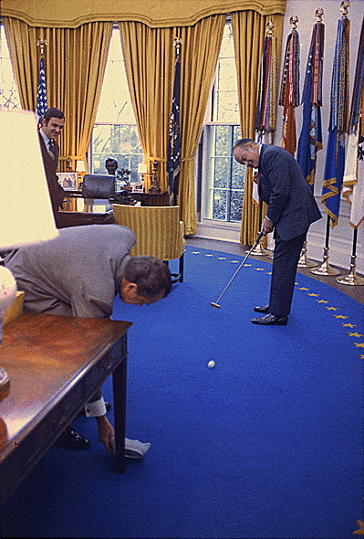
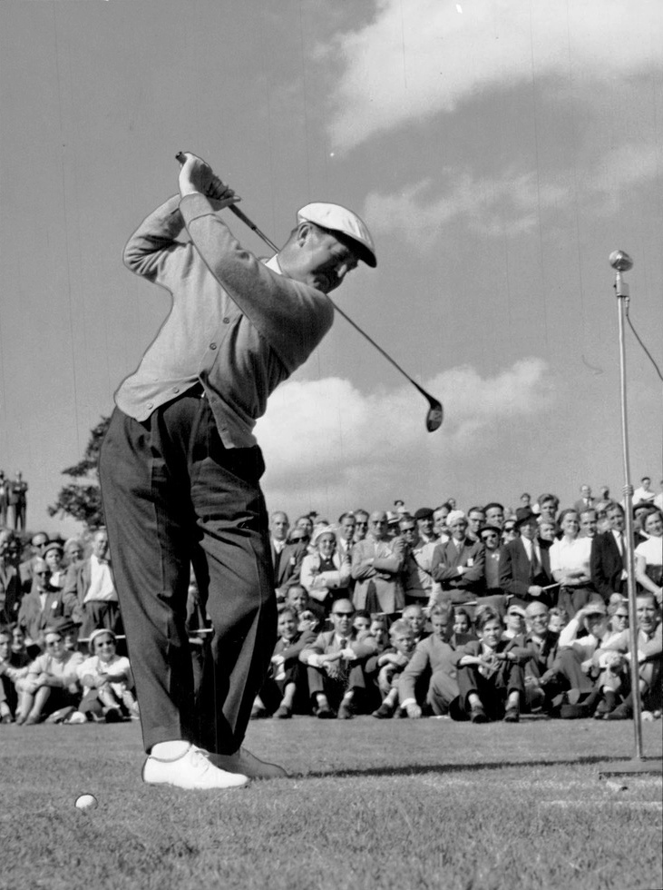
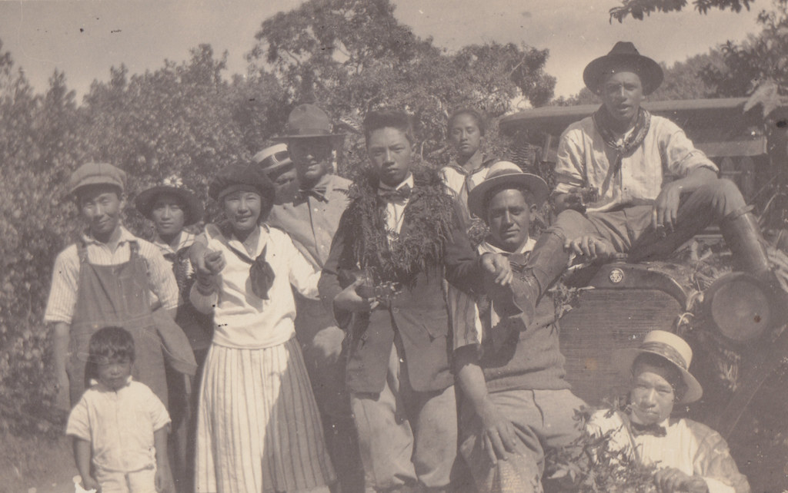

39年前の今日、1987年11月8日。日本の女子プロゴルフ界のパイオニアである岡本綾子さんが、アメリカ女子プロゴルフ協会（LPGA）ツアーにおいて、アメリカ人以外の選手として史上初となる賞金女王の座をつかみ取りました。同年には年間最優秀選手（プレーヤー・オブ・ザ・イヤー）も獲得し、世界のゴルフ史にその名を刻みました。

## ソフトボールのエースからゴルフの世界へ

広島県豊田郡安芸津町（現・東広島市）の農家に生まれた岡本さんは、実家の農作業を手伝うことで強靭な足腰を培いました。高校、実業団の大和紡績福井工場ではソフトボールのサウスポーのエース兼4番打者として活躍し、1971年の和歌山国体で優勝を果たします。転機となったのは、国体優勝の褒美として訪れたハワイ旅行でした。現地のゴルフ場を見学した際、「ゴルフをやればアメリカに行けるかもしれない」と直感したことが、競技転向のきっかけでした。

## 月給3万円からの貯金とプロテスト合格

大和紡績を退職した岡本さんはゴルフ場に就職し、プロテストに挑戦します。当時の月給3万円の中からアメリカ挑戦を見据えてコツコツと貯金を重ねました。1974年10月に2度目の挑戦でプロテストに合格した際、「将来の夢はアメリカに行ってプレーすること」と公言して周囲を驚かせました。デビュー翌年の1975年に美津濃トーナメントで初優勝。当時の女子プロの平均飛距離が210ヤードから220ヤードだった時代に、240ヤードから250ヤードを飛ばす豪快なショットで女子プロ界にパワーの時代をもたらしました。

*Bob Hope playing golf in the Oval Office — 写真: Atkins, Oliver F., White House Photo Office / Public domain*

## 日本ツアーの頂点から世界の大舞台へ

1979年の日本女子プロゴルフ選手権では通算17アンダーという当時の世界最小スコア記録で優勝し、1981年には年間8勝を挙げて初の賞金女王に輝きます。そして1982年、本格的にアメリカLPGAツアーへの参戦を開始しました。1985年には重い腰痛に襲われて現役引退の危機に直面しますが、過酷なリハビリを経て1986年の復帰2戦目で見事に勝利を飾るなど、不屈の闘志で世界最高峰のツアーに挑み続けました。

*Golf-player-Bobby-Locke-in-the-upturn-with-his-driver-142464250431 — 写真: Unknown photographer / Public domain*

## 6日間の激闘と米ツアー年間4勝の快進撃

迎えた1987年、岡本さんは目覚ましいプレーを披露します。7月の女子メジャー最高峰「全米女子オープン」では、度重なる豪雨順延により6日間に及ぶ激闘となり、ローラ・デービース選手やジョアン・カーナー選手とのプレーオフを戦い抜きました。この激戦は全米オープンが真の世界一決定戦となった象徴として全米の歴史に刻まれました。岡本さんはこの年、アメリカツアーで4勝を記録し、上位10位入りを17回も果たす圧倒的な安定感を誇りました。

*Hawaii - Group — 写真: Drregor / CC BY-SA 2.0*

## 1987年11月8日、米国人以外の選手として初の戴冠

1987年11月8日、岡本さんはついに米女子ゴルフツアーでアメリカ人以外の選手として史上初となる賞金女王のタイトルを確定させました。同時にアメリカツアーの年間最優秀選手にも選出され、日本国内でも女性初となる日本プロスポーツ大賞、ゴルフ界で初となる内閣総理大臣顕彰を受賞しました。早朝や深夜のテレビ中継、スポーツ新聞の紙面を通じて、海を越えて活躍する「世界のアヤコ」の勇姿に日本中が沸き立ちました。

## 世界ゴルフ殿堂入りと後進への継承

岡本さんは日米ツアー通算で日本44勝、米国17勝という大記録を残し、2005年には世界ゴルフ殿堂入りを果たしました。現役引退後も多くの若手女子プロを指導し、ツアーを代表する選手たちを育て上げています。日本人アスリートが世界で戦う礎を築いた岡本さんの挑戦は、今もなお日本スポーツ界の誇るべき金字塔として輝き続けています。

### 参考資料

- <https://ja.wikipedia.org/wiki/%E5%B2%A1%E6%9C%AC%E7%B6%BE%E5%AD%90>
- <https://commons.wikimedia.org/wiki/File:Ford_A3467_NLGRF_photo_contact_sheet_(1975-02-26)(Gerald_Ford_Library).jpg>
- <https://commons.wikimedia.org/wiki/File:Bob_Hope_playing_golf_in_the_Oval_Office.png>
- <https://commons.wikimedia.org/wiki/File:Golf-player-Bobby-Locke-in-the-upturn-with-his-driver-142464250431.jpg>
- <https://www.flickr.com/photos/36616972@N02/4272952887>
