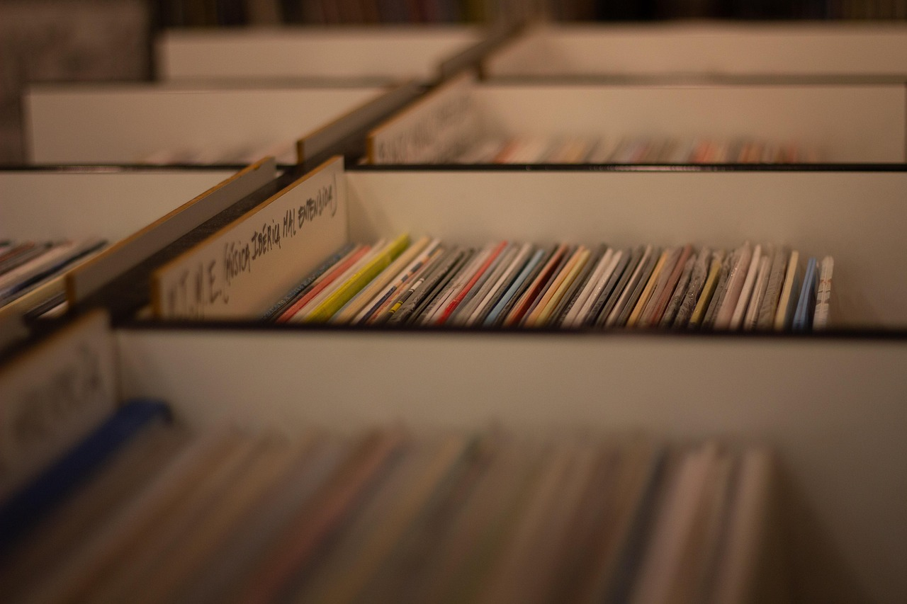
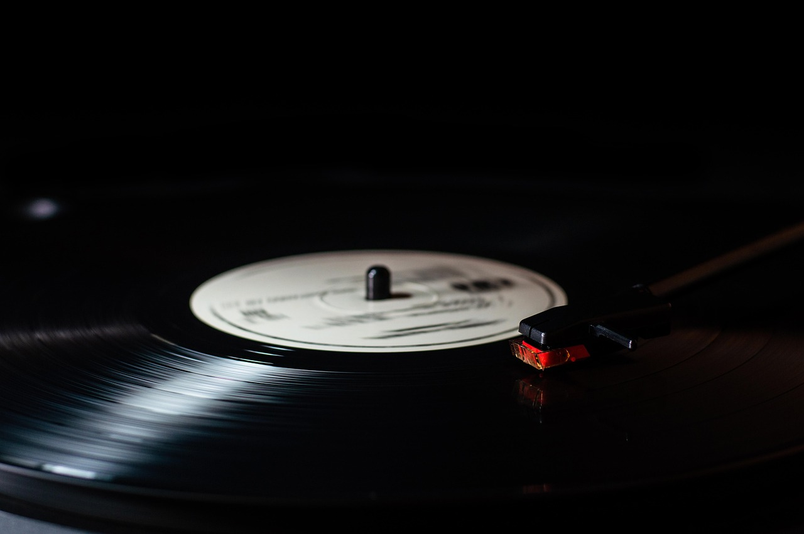
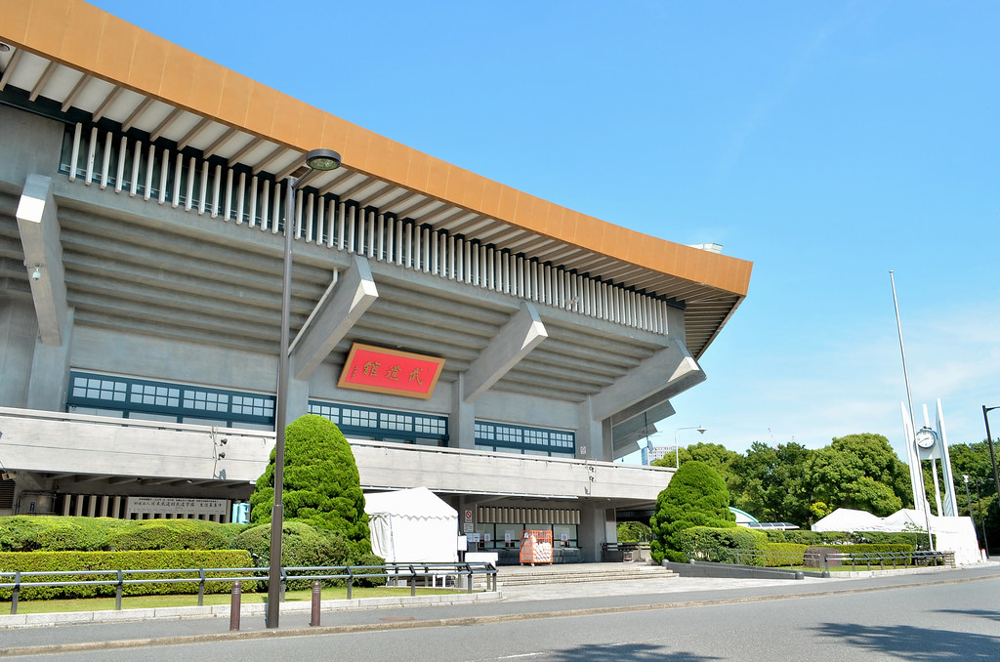

36年前の今日、1990年11月8日。吉川晃司さんと布袋寅泰さんによるロックユニット、コンプレックスが、東京ドームでのコンサートをもって無期限の活動休止に入りました。出す曲すべてがチャートの頂点を極めた人気絶頂のさなか、なぜ2人はわずか2年で歩みを止めたのでしょうか。

## 高輪のマンションで生まれた奇跡のタッグ

コンプレックス結成のきっかけは、何気ないプライベートの友情でした。当時、渡辺プロダクションから独立したばかりの吉川晃司さんと、ボウイを解散させたばかりの布袋寅泰さんは、東京・高輪の同じマンションに居住していました。夕飯のおかずを持ち寄って一緒に食事をし、プライベートでハワイ旅行に出かけるほどの親密な間柄でした。お酒の席で持ち上がった「一緒にやろうか」という一言に双方の事務所も賛同し、1988年12月にユニット結成が公表されました。

## デビュー曲「ビー・マイ・ベイビー」とチャート独占

1989年4月8日、ファーストシングル「ビー・マイ・ベイビー」で華々しくデビューを飾ります。ギタリストとしての確固たる地位を築いていた布袋さんの洗練されたサウンドと、アイドルから本格的なロックシンガーへと脱皮を遂げようとしていた吉川さんの力強いボーカルは、当時の音楽シーンに大きな衝撃を与えました。活動中にリリースされた作品はすべてオリコンチャートで1位を獲得し、デビューからわずか1か月余りで日本武道館公演を行うなど、異例の快進撃を続けました。

*当日の写真ではありません · 事件当時の写真ではありません · イメージ写真 — 写真: niro9 / Pixabay Content License*

## すれ違う美学と深まる確執

しかし、強烈な個性と才能を持つ2人の足並みは次第に乱れていきます。布袋さんはコンピューターを大胆に導入した緻密な音作りや、ビジュアルや演出を含めたトータルのプロデュースを重視していました。一方で吉川さんは、一流ミュージシャンによる生演奏のグルーヴの中で歌う喜びに目覚め、本能のままにシンガーソングライターとして急成長を遂げていました。音楽性の根本的な隔たりは飲み屋での殴り合いにまで発展し、お互いに「一緒にやらなければずっと友達でいられたかもしれない」と吐露するほど関係は冷え込んでいきました。

*当日の写真ではありません · 事件当時の写真ではありません · イメージ写真 — 写真: padrinan / Pixabay Content License*

## 1990年11月8日、東京ドームの幕引き

迎えた1990年11月8日、東京ドームで開催された公演「ロマンティック・エクストラ」。吉川さんにとっては念願の東京ドームの舞台であり、会場を埋め尽くした大観衆の前で2人は凄まじい熱量のパフォーマンスを繰り広げました。しかし、すでに修復の余地はなく、この日のステージをもってユニットは無期限の活動休止に入ります。布袋さんは翌日、ソロ活動の制作のためにロンドンへと旅立ち、わずか2年の伝説に区切りが打たれました。

*日本武道館 (Nippon Budokan) — 写真: Dakiny / CC BY 2.0*

## 21年ぶりの復活、東日本大震災への祈り

その後、二度と交わらないかに見えた2人の道は、2011年の東日本大震災によって再び交差します。宮城県石巻市で身元を伏せてボランティア活動を行っていた吉川さんが「今しかない」と布袋さんに呼びかけ、布袋さんも「願いは一つ。心は一つ。答えは一つ」と快諾しました。2011年7月、21年ぶりに東京ドームで「日本一心」と銘打った復興支援チャリティーライブを開催。2日間で延べ10万人を動員し、集まった約6億5431万円の全額が被災地へ寄付されました。

## 今なお響く「日本一心」の志

さらに2024年1月、能登半島地震が発生した際にも、2人は再び「日本一心」を掲げて5月に東京ドームのステージに立ちました。同年に寄せられた復興支援の寄付金は10億円に達しました。若き日の激しいぶつかり合いの末に一度は離れた2つの魂が、未曾有の国難において誰よりも頼もしい希望となって立ち上がる姿は、多くのファンの胸を打ち続けています。

### 参考資料

- <https://ja.wikipedia.org/wiki/%E5%90%89%E5%B7%9D%E6%99%83%E5%8F%B8>
- <https://pixabay.com/photos/music-player-record-player-7792956/>
- <https://pixabay.com/photos/record-shop-vinyl-records-music-9180482/>
- <https://pixabay.com/photos/music-recording-vinyl-retro-disk-5705801/>
- <https://www.flickr.com/photos/55658968@N00/7692716700>
