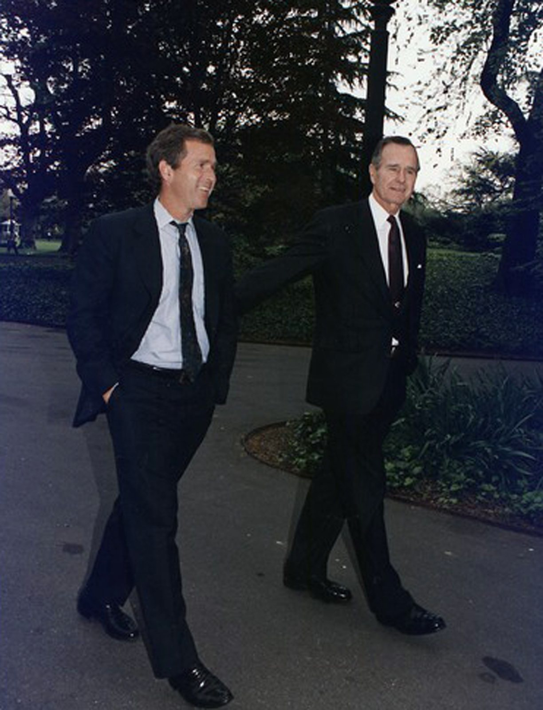
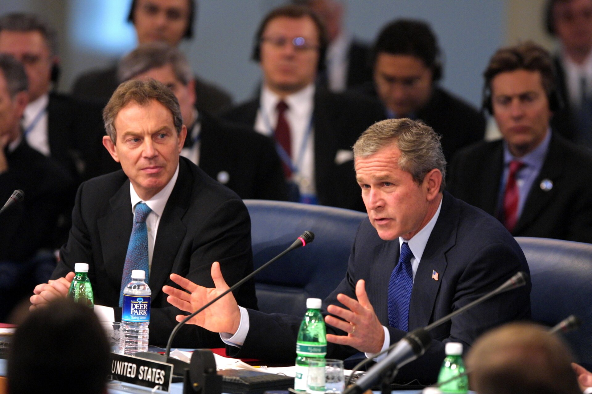
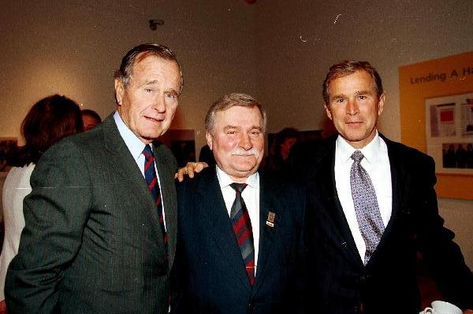

24年前の今日、2002年11月8日。国連安全保障理事会において、イラクのサッダーム・フセイン政権に対して大量破壊兵器の完全な武装解除を迫る安保理決議1441が、全会一致で採択されました。世界中が固唾をのんで見守るなか、戦争を回避するための「最後の機会」として国際社会が下した歴史的な決断でした。

## 湾岸戦争からの火種と「悪の枢軸」発言

イラクの武装解除問題は、1991年の湾岸戦争停戦協定（安保理決議687）に端を発します。イラクは核兵器、化学兵器、生物兵器といった大量破壊兵器の破棄を義務づけられ、国連の特別委員会（UNSCOM）や国際原子力機関（IAEA）による査察を受けていました。しかし、フセイン政権は査察への非協力や妨害を繰り返し、1998年には米英軍による空爆「砂漠の狐作戦」へと発展、査察活動は完全に停止してしまいました。

2001年にアメリカでジョージ・W・ブッシュ政権が誕生し、同年9月11日に同時多発テロ事件が発生すると緊張は一気に高まります。ブッシュ大統領は2002年1月の一般教書演説で、イラク、イラン、北朝鮮を「悪の枢軸」と名指しし、テロ組織への大量破壊兵器拡散を防ぐため政権転覆も辞さない構えを示しました。

## 全会一致で採択された「最後の機会」

軍事行動を辞さないアメリカに対し、国際社会は外交による平和的解決を模索しました。数か月にわたる外交交渉の末、2002年11月8日に採択されたのが安保理決議1441です。この決議は、イラクに対して過去の決議違反を指摘しつつ、武装解除義務を遵守するための「最後の機会」を与えるものでした。

決議は、採択から30日以内に保有するすべての兵器や関連計画を完全に申告すること、そして国連監視検証査察委員会（UNMOVIC）とIAEAによる査察を無条件かつ即座に受け入れることをイラクに義務づけました。常任理事国・非常任理事国を含む15か国すべてが賛成票を投じる全会一致での成立でした。

*George W. Bush and President George H. W. Bush 1992 — 写真: David Valdez / Public domain*

## 1万2000ページの申告書と再開された査察

イラク側はこの決議を「悪の集団による邪悪な決議」と激しく非難しました。しかし、軍事攻撃の現実的な脅威を前に決議の受け入れを表明し、およそ4年ぶりに国連査察団の国内立ち入りを認めました。12月7日、イラクは期限通りに兵器申告書を国連へ提出します。その分量は1万2000ページにもおよぶ膨大なものでした。

UNMOVICのハンス・ブリックス委員長率いる査察団は現地で調査を開始しました。しかし翌2003年1月の中間報告において、ブリックス委員長はイラクの協力が十全ではなく、提出された申告書には多くの疑問点や矛盾が残されていると指摘しました。一方、IAEAは核兵器開発の新たな証拠は見つかっていないと報告するなど、査察団内でも評価が分かれる展開となりました。

*President George W. Bush and Prime Minister Tony Blair of Great Britain at Meeting of the NATO-Russia Council — 写真: Paul Morse / Public domain*

## 深まる国際社会の亀裂と開戦へのカウントダウン

アメリカとイギリスは、イラクが義務を果たしておらず決議違反を犯していると断定し、攻撃の準備を本格化させました。2003年2月5日にはアメリカのコリン・パウエル国務長官が国連安保理の演説で、イラクが移動式施設で生物兵器を製造しているとする証拠を提示し、国際社会へ軍事行使の正当性を訴えました（後にこの情報は誤りであったことが判明します）。

これに対し、フランス、ドイツ、ロシアなどは査察を継続すべきだと主張し、新たな開戦決議の採択に強く反対しました。特にフランスのドミニク・ド＝ビルパン外相は安保理で堂々と反対論を展開し、アメリカとの間に深い溝が生まれました。外交交渉は決裂し、2003年3月20日、米英軍を中心とする有志連合は新たな国連決議のないまま「イラクの自由作戦」を開始し、イラク戦争が勃発しました。

*George H. W. Bush, George W. Bush, and Lech Wałęsa — 写真: Credit: George H.W. Bush Presidential Library and Museum / Public domain*

## 日本への影響と戦後初の自衛隊派遣

この一連の危機は、日本にも重大な外交的判断を迫る転換点となりました。日本政府は当時、国連安保理の非常任理事国ではなかったものの、中間派の理事国に対する根回しを行うなど米英支持の外交姿勢をとりました。

開戦後、バアス党政権が崩壊したイラクに対し、日本政府は2003年12月に自衛隊の派遣を決定します。これは日本にとって戦後初めてとなる、国連平和維持活動（PKO）の枠組み外での自衛隊海外派遣でした。陸上自衛隊はイラク南部のサマーワに駐留し、給水支援や学校・道路のインフラ整備などの人道復興支援活動にあたりました。

## 見つからなかった兵器と今に残る教訓

フセイン政権崩壊後、有志連合軍や専門組織によってイラク全土で徹底的な捜索が行われましたが、アメリカが開戦の最大の根拠としていた大量破壊兵器は最後まで発見されませんでした。パウエル元国務長官が後に「私の生涯の汚点」と振り返ったように、開戦の大義そのものが大きく揺らぐ結果となりました。

イラク戦争は2011年12月に米軍が完全撤退するまで長期化し、現地の治安悪化や中東情勢の混迷を招きました。あの日採択された決議1441は、戦争を押しとどめるための国際協調の極致でありながら、結果として避けられなかった衝突への分水嶺として、今も国際政治の歴史に重い教訓を刻んでいます。

### 参考資料

- <https://ja.wikipedia.org/wiki/%E3%82%A4%E3%83%A9%E3%82%AF%E6%88%A6%E4%BA%89>
- <https://commons.wikimedia.org/wiki/File:2.36_inch_rocket_Curtis_Bay_Depot_Maryland_1999.jpg>
- <https://commons.wikimedia.org/wiki/File:George_W._Bush_and_President_George_H._W._Bush_1992.jpg>
- <https://commons.wikimedia.org/wiki/File:President_George_W._Bush_and_Prime_Minister_Tony_Blair_of_Great_Britain_at_Meeting_of_the_NATO-Russia_Council.jpg>
- <https://commons.wikimedia.org/wiki/File:George_H._W._Bush,_George_W._Bush,_and_Lech_Wa%C5%82%C4%99sa.jpg>
