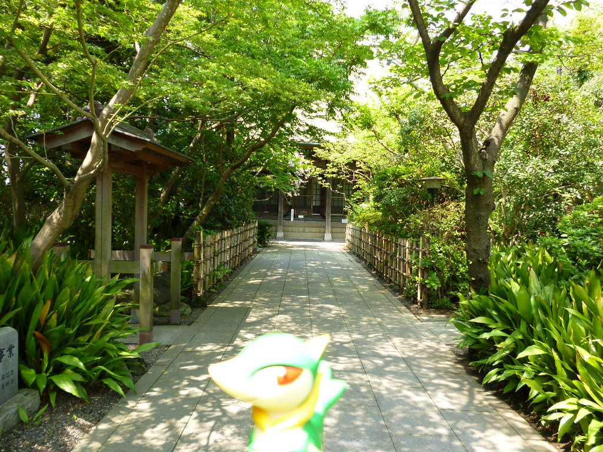
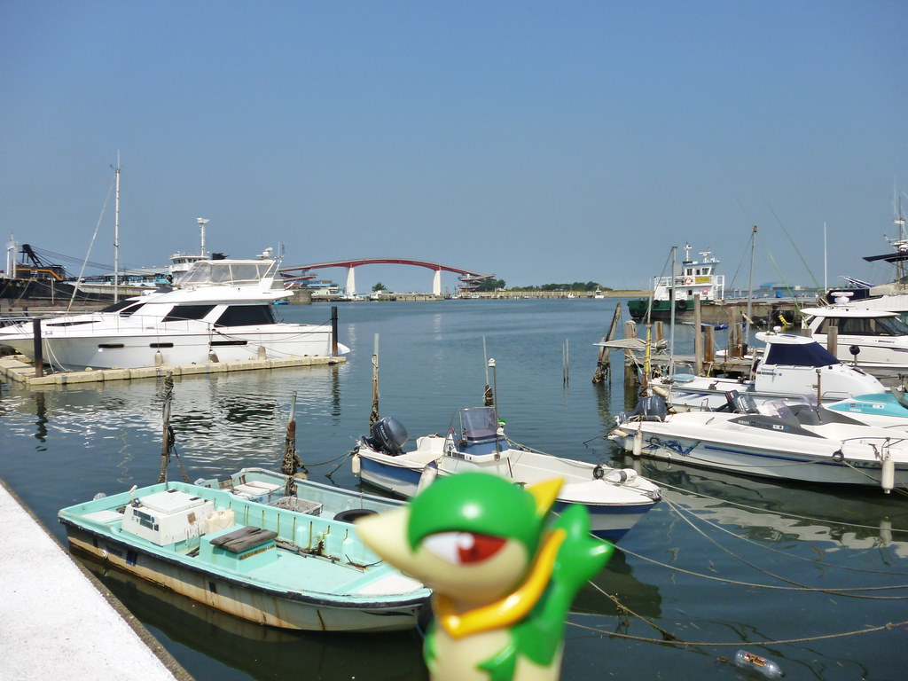
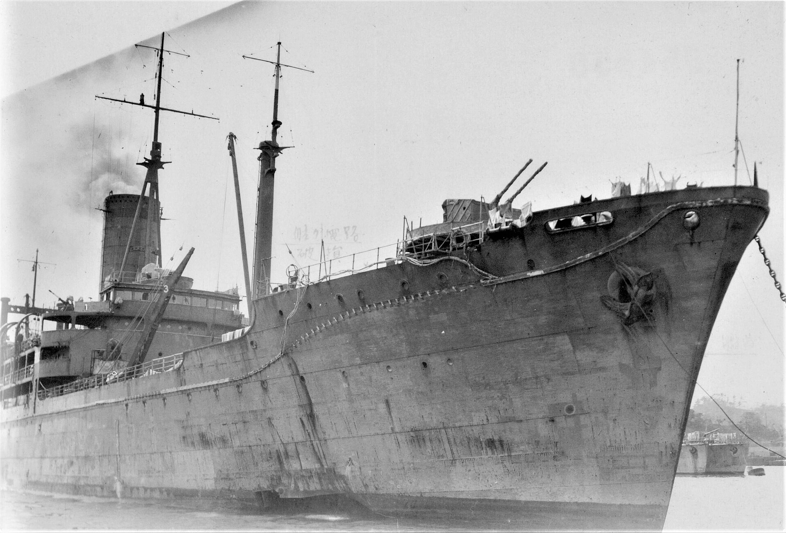

52年前の今日、1974年11月9日。千葉県木更津市沖の東京湾上で、サウジアラビアからの石油類を積んだ大型タンカー「第十雄洋丸」とリベリア船籍の貨物船「パシフィック・アレス」が衝突し、激しい爆発炎上事故が発生しました。黒煙と巨大な炎が首都圏の海を覆い、両船の乗員合わせて33名が尊い命を落としました。

## 過密な東京湾で起きた運命の交差

事故が起きたのは11月9日の午後1時37分頃でした。サウジアラビアから川崎へ向け、プロパン、ブタン、ナフサなど計4万7000トン（可燃物総量約5万7000トン）を積載していた日本船籍の「第十雄洋丸」（総トン数4万3723トン）は、東京湾の中ノ瀬航路を水先艇の先導で北上していました。そこへ、木更津港から鋼材1万5000トンを積んで出港したリベリア船籍の「パシフィック・アレス」（総トン数1万874トン）が接近します。

中ノ瀬航路は大型船舶がひしめく海の難所でした。両船の船長は互いに自船に進路の優先権があると思い込み、直前まで減速や回避行動を取らないまま、パシフィック・アレスが第十雄洋丸の右舷船首へ正面から衝突してしまいました。

## 瞬時の爆発と海面を焼き尽くす炎

激突の衝撃で第十雄洋丸のタンクが破壊され、漏れ出たナフサが摩擦火花によって一瞬で引火爆発しました。吹き上がった炎は船首に食い込んだままのパシフィック・アレスを一気に飲み込み、さらに海面に流出した油によって海上一面が紅蓮の炎に包まれました。

パシフィック・アレスは全船が瞬時に火炎に覆われたため脱出不能となり、船底の空間に退避していた二等機関士1名を除く船長以下28名が命を落としました。一方、第十雄洋丸では船長の迅速な退船命令により乗員たちが海への脱出や救命艇への移動を行い、38名中33名が救助されたものの、5名が犠牲となりました。

*Servine in Kisarazu, Chiba 14 (Shojoji Temple) — 写真: Kasadera / CC BY 2.0*

## 横須賀焦土化を阻んだ決死の曳航作戦

海上保安庁の消防船「ひりゆう」をはじめ、東京消防庁や沿岸自治体の消防艇が急行して消火に当たりましたが、大量の危険物を積んだ巨船の火勢は衰えず、午後4時40分頃には再び大爆発が発生しました。さらに深刻だったのは、炎上する第十雄洋丸が無人のまま横須賀市の市街地方面へと風と潮に乗って漂流を始めたことでした。

横須賀の防波堤までわずか1.8キロに迫り、万一市街地近くで大爆発を起こせば都市が焦土化しかねない極限状態でした。当時、海上保安庁には大型船を曳航できる機材がなかったため、民間の深田サルベージ建設と現場のタグボートが救援に立ち上がりました。船員たちは消防艇の放水支援を受けながら熱気渦巻く船尾へ飛び移り、命がけで曳航ワイヤーを固定。船を富津沖の浅瀬へと引っ張り、座礁させることで最悪の危機を回避しました。

*Servine in Kisarazu, Chiba 1 (Nakanoshima bridge) — 写真: Kasadera / CC BY 2.0*

## 前代未聞の撃沈処分――自衛隊の出動

その後、漁業被害を懸念する声などから船体は東京湾外へと引き出されましたが、残ったナフサの再燃により曳索を切り離さざるを得ず、黒潮に乗って炎上したまま太平洋上を漂流し始めました。消火の手段が完全に尽きたことから、日本政府は11月22日に閣議決定を行い、海上保安庁長官から防衛庁長官への災害派遣要請という形で、海上自衛隊による撃沈処分が決まりました。

11月27日から28日にかけ、護衛艦「はるな」「たかつき」「ゆきかぜ」などによる5インチ砲の射撃、対潜哨戒機による爆撃、そして潜水艦「なるしお」による魚雷攻撃が次々と実施されました。堅固な高張力鋼で造られた船体は激しい攻撃にも耐え続けましたが、28日午後6時47分、犬吠埼東南東約520キロの深海へと沈没しました。衝突から20日間に及んだ炎の漂流劇は、こうして幕を閉じました。

*Japanese supply ship Irako 1944 — 写真: unknown, （不明） / Public domain*

## 事故が遺した教訓と現代への備え

民間船が炎上したまま自衛隊の手で撃沈されるという前代未聞の結末は、当時の日本社会に大きな衝撃を与えました。この痛ましい事故は、その後の日本の海上保安体制を根本から変える契機となりました。

自力で大型船を曳航できなかった反省から、曳航能力と現場指揮能力を兼ね備えた巡視船「たかとり」型が建造され、消防船の増強も急速に進められました。そして何より、過酷な海上事故から人命を救うプロフェッショナル集団として、羽田特殊救難基地の前身となる「特殊救難隊」が1975年に創設される直接のきっかけとなったのです。50年以上が経過した今も、東京湾を行き交う船の安全と救助の最前線には、あの日の教訓が息づいています。

### 参考資料

- <https://ja.wikipedia.org/wiki/%E6%B6%B2%E5%8C%96%E7%9F%B3%E6%B2%B9%E3%82%AC%E3%82%B9>
- <https://commons.wikimedia.org/wiki/File:Found_Photo_-_Japan_-_Tokyo_-_View_from_Tokyo_Tower_2.tif_(33998942361).jpg>
- <https://www.flickr.com/photos/42160904@N08/11335612096>
- <https://www.flickr.com/photos/42160904@N08/11335856534>
- <https://commons.wikimedia.org/wiki/File:Japanese_supply_ship_Irako_1944.jpg>
