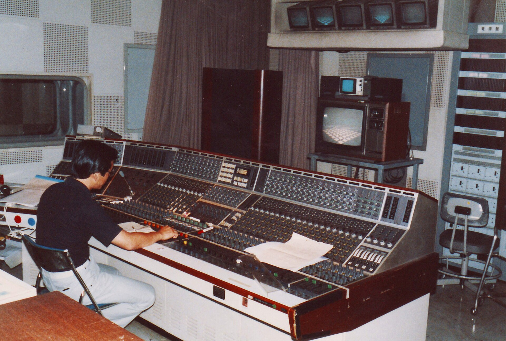
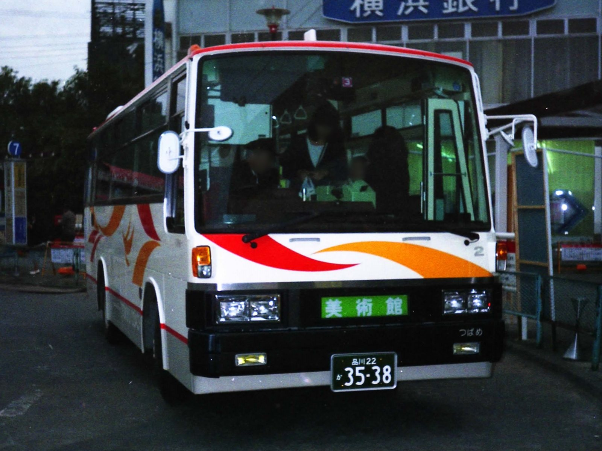
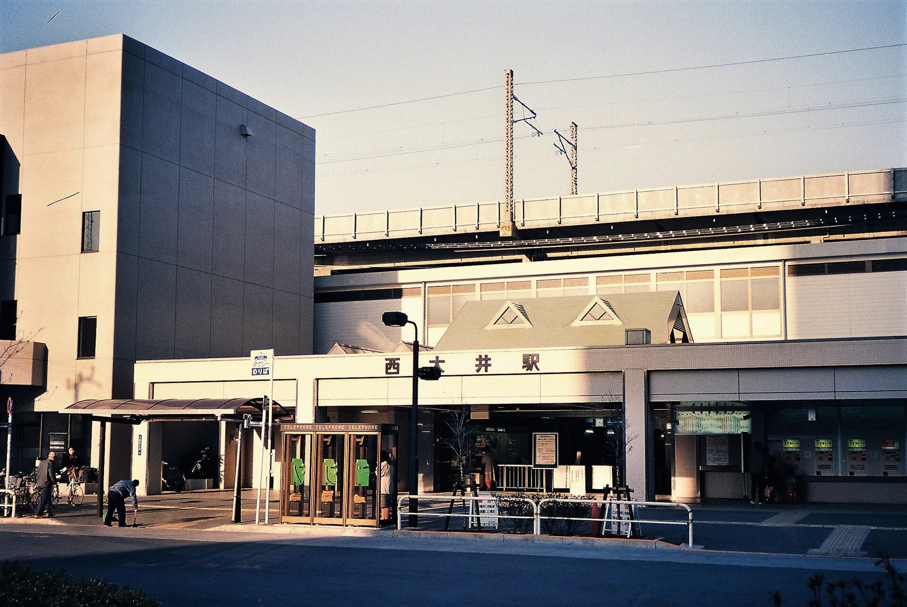

39年前の今日、1987年11月9日。日本のプロ野球の発展を支え、数々の歴史的瞬間を見届けてきた「後楽園球場」の解体工事が始まりました。前日までファンで埋め尽くされていたスタンドに重機が入り、開場から50年に及ぶ歴史がいよいよ幕を下ろした日でした。

## 昭和12年に誕生した職業野球のための新球場

後楽園球場の歴史は、日本の職業野球が本格化した1936年に始まります。当時、東京でプロの試合を開催できる専用球場が不足していたことから、河野安通志や押川清らが新球場建設を構想しました。読売新聞社の正力松太郎や阪急電鉄の小林一三らの出資を受け、株式会社後楽園スタヂアムが設立されます。

大日本帝国陸軍の砲兵工廠の跡地を取得し、内野2階建てスタンドを備えた野球場として1937年9月11日に開場しました。隣接する小石川後楽園にちなんで名付けられた球場は、両翼85メートル、中堅114メートル（開場時）の規模を誇り、本塁打が出やすい都市型球場として多くのファンを惹きつけました。

## 戦争の荒波とフランチャイズ制度の導入

太平洋戦争の末期には旧日本軍に接収され、グラウンドでジャガイモやトウモロコシが栽培され、スタンドには高射砲が設置される苦難を経験しました。終戦直後は兵器集積場となったものの野球はすぐに再開され、1946年の連合国軍総司令部（GHQ）による接収も関係者の直訴によってわずか6日間で解除されました。

1950年にはナイター照明設備が完成し、セ・パ2リーグに分かれたプロ野球の試合を一手に引き受けます。さらに1952年にフランチャイズ制が正式導入されると、読売ジャイアンツ、国鉄スワローズ、東急フライヤーズ、毎日オリオンズ、大映スターズの5球団が本拠地とする空前絶後の体制となり、「日本野球のメッカ」としての地位を不動のものにしました。

*NHKn äänitarkkaamo - Audio Control Room NHK, Tokyo — 写真: Takajarru / CC BY-SA 3.0*

## 王・長嶋が躍動した黄金期と不滅の歴代記録

後楽園球場を語る上で欠かせないのが、巨人軍の黄金期を築いた王貞治選手と長嶋茂雄選手の「ONコンビ」です。王選手と長嶋選手によるアベック本塁打は通算106回を数え、1974年の長嶋選手の引退試合でも放たれました。さらに1977年には王選手がハンク・アーロンのMLB記録を超える通算756号本塁打を達成し、試合後には盛大なセレモニーが行われました。

施設面でも1970年の電光掲示スコアボード、1976年の人工芝敷設など、常に日本の球場の最先端を走りました。後楽園球場で開催されたプロ野球公式戦は通算7,172試合、放たれた本塁打は通算1万416本にのぼり、このふたつの数字は現在も日本の球場別ランキングで第1位の座を保ち続けています。

*P-MK516Fkai Tokyu S6402 TokyuCoach — 写真: Cassiopeia sweet / Public domain*

## 東京ドームの登場と別れの1週間

施設の老朽化が進む中、隣接する後楽園競輪場跡地（当時はプールやゴルフ練習場として利用）に、日本初の全天候型ドーム球場「東京ドーム」を建設する計画が動き出しました。1987年シーズンをもって後楽園球場の役割を終えることが決まり、10月30日の日本シリーズ第5戦（巨人対西武）をもってNPB主催の公式戦全日程を終えました。

11月3日から8日にかけては「さようなら後楽園球場」と題した閉場記念イベントが連日開催されました。11月7日のOB戦では長嶋茂雄さんがユニフォーム姿でマウンドからファンに別れを告げ、最終日の8日には王貞治監督らが出席した巨人軍ファン感謝デーが開かれました。イベント終了後には、名残を惜しむファンがスタンドの座席などを記念に持ち帰る光景も見られました。

*Nishi-Ōi Station 19870211 — 写真: Suikotei / CC BY-SA 4.0*

## 11月9日の解体工事開始と今に受け継がれるもの

ファン感謝デーの熱狂から一夜明けた1987年11月9日、静まり返った球場に解体の重機が入りました。すぐ隣には、すでに白い膜屋根を膨らませた東京ドームが完成間近の偉容を誇っていました。解体工事は翌1988年2月にかけて行われ、半世紀にわたり歓声を受け止めてきたグラウンドやスタンドは完全に姿を消しました。

解体後の敷地にはプリズムホールや東京ドームホテルが建設されましたが、後楽園の記憶がすべて消えたわけではありません。後楽園球場の閉場時に王選手に1塁ベース、長嶋選手に3塁ベースが寄贈されたほか、1981年から親しまれていた後楽園の「王ゲート」「長嶋ゲート」という名称は、現在も東京ドームの1番ゲートと3番ゲートに受け継がれています。

### 参考資料

- <https://ja.wikipedia.org/wiki/11%E6%9C%889%E6%97%A5>
- <https://commons.wikimedia.org/wiki/File:NHKn_tv-studion_ohjaamo_-_Master_Control_Room_NHK,_Tokyo.jpg>
- <https://commons.wikimedia.org/wiki/File:NHKn_%C3%A4%C3%A4nitarkkaamo_-_Audio_Control_Room_NHK,_Tokyo.jpg>
- <https://commons.wikimedia.org/wiki/File:P-MK516Fkai_Tokyu_S6402_TokyuCoach.jpg>
- <https://commons.wikimedia.org/wiki/File:Nishi-%C5%8Ci_Station_19870211.jpg>
