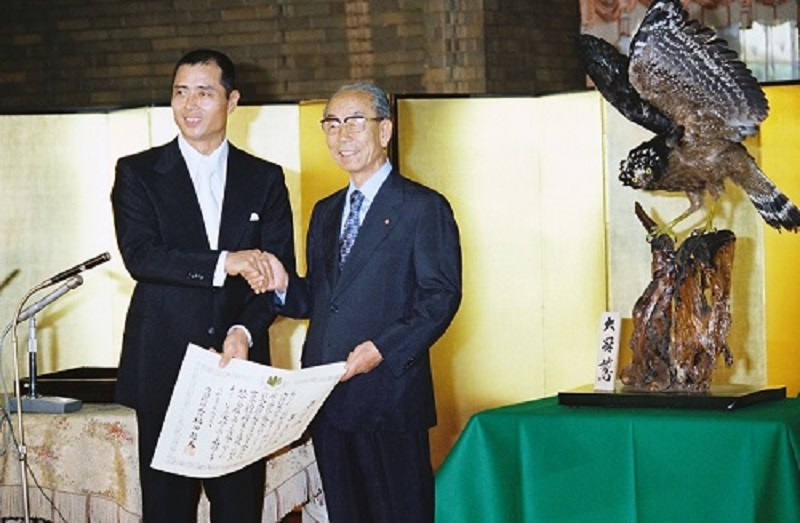
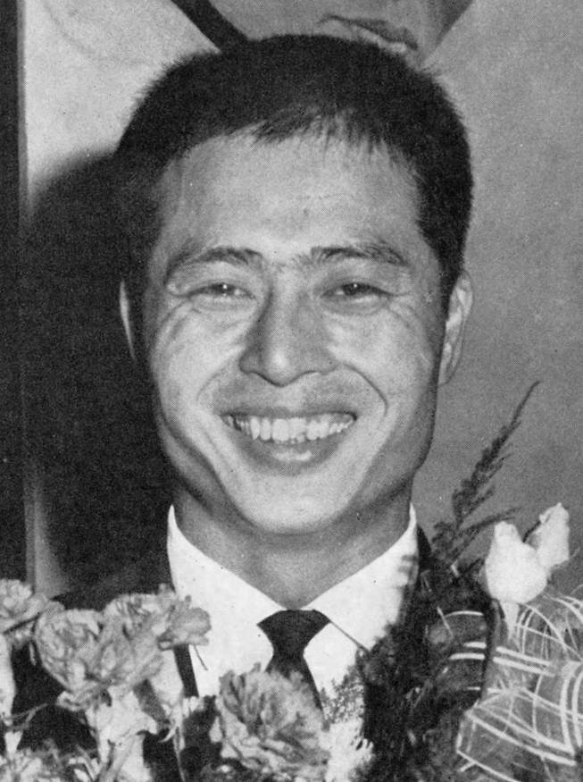
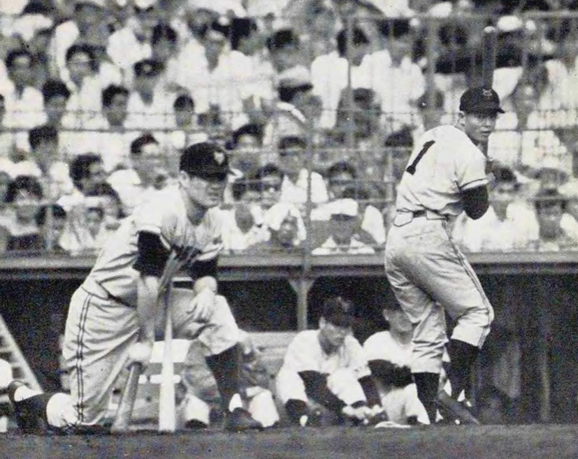

43年前の今日、1983年11月9日。読売ジャイアンツの藤田元司監督が勇退し、助監督を務めていた王貞治さんが新監督に昇格することが大きく報じられました。西武ライオンズとの激闘を終えた直後、球界の盟主の指揮官の座は「世界の王」へと託されました。

## 激動の中で誕生した「トロイカ体制」

藤田元司さんが巨人の第10代監督に就任したのは、1980年10月のことでした。絶大な人気を誇った長嶋茂雄監督の解任直後という極めて難しい局面での船出でした。藤田新監督は、参謀として牧野茂さんをヘッドコーチに迎え、同じ年に現役を引退したばかりの王貞治さんを助監督に据える「トロイカ体制」を敷きました。現役時代は「悲運のエース」と呼ばれながらも卓越した洞察力を持っていた藤田監督と、V9時代を知り尽くした首脳陣による再出発でした。

## 就任1年目の日本一と若手の抜擢

藤田監督率いる巨人は、就任初年度の1981年に見事セ・リーグ優勝を果たします。日本シリーズでも日本ハムファイターズを破り、V9最後の年であった1973年以来、8年ぶりとなる日本一の栄冠をチームにもたらしました。藤田監督はドラフトで原辰徳選手や駒田徳広選手を獲得し、投手だった駒田選手の野手転向を見守るなど、次代を担う戦力を着実に育て上げました。

*Sadaharu Oh and Takeo Fukuda 19770905 — 写真: 内閣官房内閣広報室 / CC BY 4.0*

## 1983年、西武との「世紀の死闘」

1983年、巨人は再びセ・リーグを制覇します。日本シリーズの相手は、元巨人OBの広岡達朗監督が率いる西武ライオンズでした。メディアから「球界の盟主の座を賭けた戦い」と大きく喧伝されたこのシリーズは、両者一歩も譲らぬ展開となり、決着は最終第7戦までもつれ込みました。巨人は3勝4敗で惜しくも日本一を逃したものの、両球団が死力を尽くした戦いは多くのプロ野球ファンの胸に刻まれました。

*Sadaharu-Oh-1-revised — 写真: Unknown authorUnknown author / Public domain*

## 勇退の決断と堀内恒夫への懇願

死闘を終えた直後の11月8日、藤田監督は勇退を表明しました。後任には、3年間にわたり助監督として支えてきた王貞治さんが昇格することになります。このとき、現役を退いてチームを離れる決意を固めていた大エース・堀内恒夫さんに対し、藤田監督は「王が監督になるんだ。本格的に一軍投手コーチとしてチームを支えてやってほしい」と頭を下げて強く懇願しました。恩師の熱い思いを受け止めた堀内さんは巨人に残り、王新監督を支えるピッチングコーチに就任しました。

*Sadaharu-Oh-2 — 写真: Unknown authorUnknown author / Public domain*

## 「世界の王」が背負った巨人の重責

選手として通算868本塁打という不滅の世界記録を樹立し、国民栄誉賞の第1号となった王貞治さん。背番号「1」を背負い続けた大スターが、今度は指揮官として巨人を率いることになりました。藤田監督が築いた土台を受け継いだ王監督は、現役時代とは異なる重圧と戦いながら、伝統球団の新たな時代を切り拓いていくことになります。

## 受け継がれた巨人の絆と遺産

藤田元司さんはその後、1988年秋に王監督の後を受けて再び巨人の第12代監督に復帰し、翌1989年には劇的な逆転で日本一を達成しました。一方の王貞治さんも巨人の監督退任後、福岡ダイエーホークスとソフトバンクを常勝軍団に育て上げ、2006年の第1回WBCでは日本代表監督として世界一の座をつかみました。紳士として選手に寄り添った藤田監督と、野球への情熱を燃やし続けた王監督の絆は、今も日本プロ野球の輝かしい歴史として語り継がれています。

### 参考資料

- <https://ja.wikipedia.org/wiki/%E8%97%A4%E7%94%B0%E5%85%83%E5%8F%B8>
- <https://commons.wikimedia.org/wiki/File:Korakuen_Stadium_Nighter_1951.jpg>
- <https://commons.wikimedia.org/wiki/File:Sadaharu_Oh_and_Takeo_Fukuda_19770905.jpg>
- <https://commons.wikimedia.org/wiki/File:Sadaharu-Oh-1-revised.png>
- <https://commons.wikimedia.org/wiki/File:Sadaharu-Oh-2.png>
