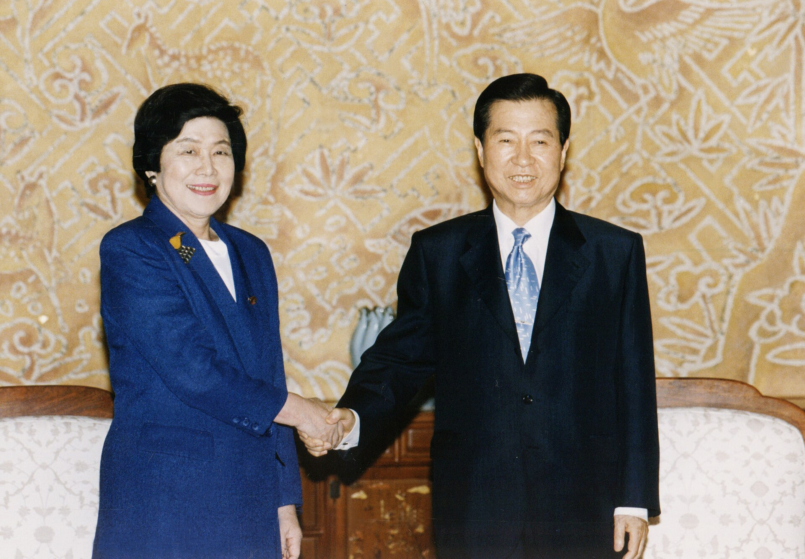
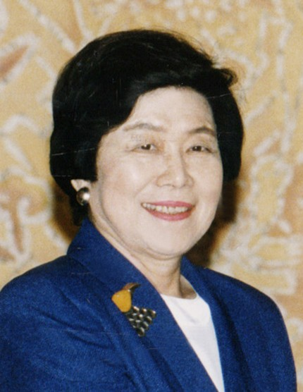
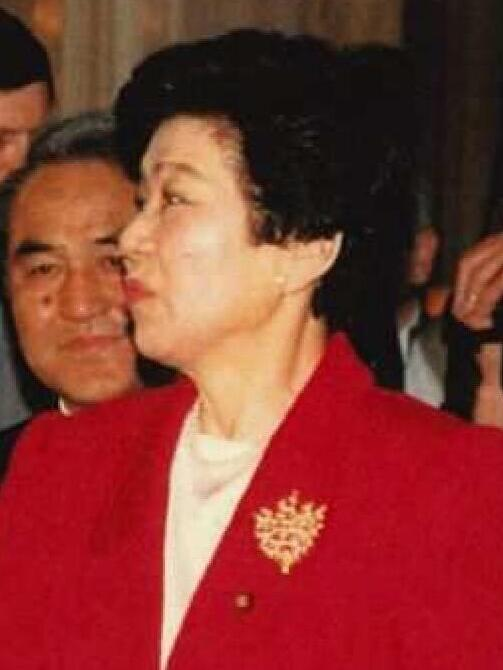

23年前の今日、2003年11月9日。21世紀最初となる第43回衆議院議員総選挙の投票が行われ、即日開票されました。小泉純一郎内閣のもとで行われたこの選挙は、各政党が政権公約を具体的に掲げる「マニフェスト選挙」の始まりであり、日本の政治史において二大政党制の足がかりを築いた転換点でした。

## 国政選挙初の「マニフェスト選挙」と解散の背景

小泉純一郎首相は2003年10月10日に衆議院を解散しました。この解散は「マニフェスト解散」「二大政党解散」「構造改革解散」などと呼ばれました。最大の注目点は、各政党が数値目標や実施時期を明記した政権公約「マニフェスト」を国政選挙として初めて掲げて戦ったことです。高速道路の無料化などの政策が論争となり、有権者は政策の選択肢を比較して一票を投じる新しい選挙戦を経験することになりました。

## 自民党内の激震と「73歳比例定年制」の波紋

公示前から政界を大きく揺るがしたのは、自民党内の世代交代をめぐる動きでした。小泉首相は比例代表における「73歳定年制」を原則どおり厳格に適用する方針を表明しました。これにより、過去に特例扱いとされていた首相経験者の中曽根康弘氏と宮澤喜一氏が対象となりました。84歳の宮澤氏は要請を受け入れて政界を引退した一方、85歳の中曽根氏はかつて党から与えられていた比例北関東ブロックの「終身1位」の保証を根拠に激しく抵抗しました。最終的に中曽根氏も立候補を断念し、55年体制以前から議席を保っていた重鎮の退場は大きな話題を呼びました。

*Kim Dae-jung and Takako Doi — 写真: 대한민국 국가기록원 / KOGL Type 1*

## 投開票の結果：与党は絶対安定多数を維持

11月9日の投開票の結果、連立与党は枠組みを維持しました。自民党は公示前勢力から10議席減らして237議席となり、小泉総裁・安倍晋三幹事長の人気をもってしても単独過半数（241議席）には届きませんでした。山崎拓副総裁らベテラン議員の落選も相次ぎました。連立相手の公明党は3議席増やして34議席を獲得しましたが、民主党離党者らと結党した保守新党は熊谷弘代表が落選するなど4議席に惨敗しました。しかし、与党3党を合わせた議席数は275議席となり、すべての常任委員会で過半数を占める「絶対安定多数」を確保しました。

*Takako Doi — 写真: 대한민국 국가기록원 / KOGL Type 1*

## 民主党が177議席へ大躍進、社民・共産は後退

この総選挙で最も勢いを見せたのは、小沢一郎氏率いる自由党と合流（民由合併）して選挙戦に臨んだ野党第1党の民主党でした。菅直人代表のもとで明確に「政権交代」を訴えた民主党は、都市部を中心に支持を広げ、公示前の137議席から40議席増の177議席へと大幅に躍進しました。自民党以外の政党が獲得した議席数としては、1958年の第28回総選挙における日本社会党の166議席を45年ぶりに塗り替える過去最多記録となりました。比例代表の総得票数では自民党を上回り、全国11ブロック中5ブロックで自民党の議席数を凌駕しました。その一方で、社会民主党は土井たか子党首が小選挙区で落選して比例復活にとどまり、公示前の18議席から6議席へと激減して土井党首が引責辞任。日本共産党も公示前から11議席減の9議席に落ち込み、36年ぶりに1桁台へ後退しました。

*Takako Doi 19910417 — 写真: 外務省大臣官房儀典官室 / CC BY 4.0*

## 選挙後の政界再編と二大政党制の定着

選挙後、議席を大幅に減らした保守新党は解党して自民党へ合流し、自民党は単独過半数を回復しました。これにより与党の枠組みは自公連立政権へと再編されます。11月19日に召集された第158特別国会において、衆議院の内閣総理大臣指名選挙では小泉純一郎氏が281票、民主党の菅直人氏が186票を獲得し、第2次小泉内閣が発足しました。自民党と民主党が国会で対峙し、政権選択を競い合う「二大政党制」の構図が決定づけられた瞬間でした。

## 今に続く選挙のあり方

2003年の第43回衆院選は、公約集としての「マニフェスト」という言葉を有権者に広く定着させました。政党が期限や財源を示して政策を有権者に約束し、その達成度を有権者が評価するという政治スタイルは、この選挙を契機に日本社会へ根を下ろしました。政権選択をめぐる熱気と、政治の世代交代を強烈に印象づけた投開票の夜でした。

### 参考資料

- <https://ja.wikipedia.org/wiki/%E8%87%AA%E7%94%B1%E6%B0%91%E4%B8%BB%E5%85%9A_(%E6%97%A5%E6%9C%AC)>
- <https://commons.wikimedia.org/wiki/File:Junichir%C5%8D_Koizumi_Cabinet_20031119.jpg>
- <https://commons.wikimedia.org/wiki/File:Kim_Dae-jung_and_Takako_Doi.jpg>
- <https://commons.wikimedia.org/wiki/File:Takako_Doi.jpg>
- <https://commons.wikimedia.org/wiki/File:Takako_Doi_19910417.jpg>
