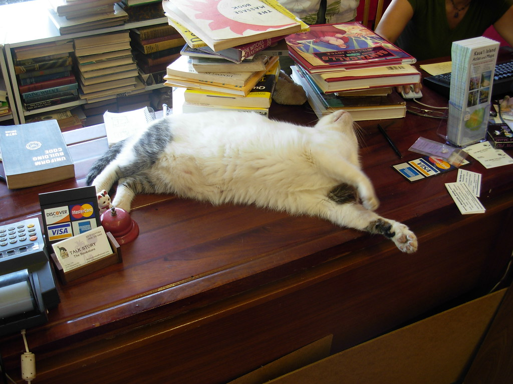
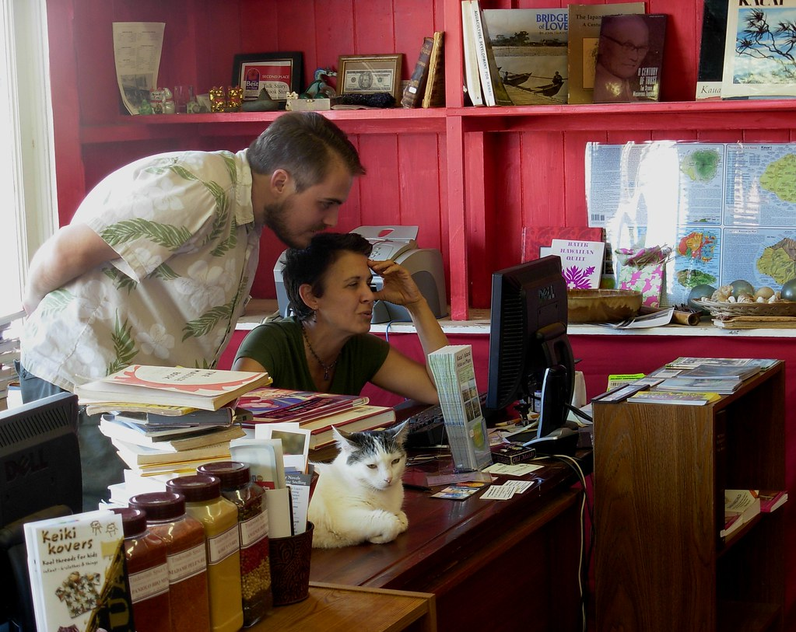

42年前の今日、1984年11月9日。講談社から写真週刊誌『FRIDAY（フライデー）』が創刊されました。文字を読ませる従来の週刊誌とは異なり、決定的な「現場写真」を全面に打ち出したスタイルは、昭和末期の日本社会に強烈な視覚的衝撃を与えました。

## 1枚の写真が語る時代の幕開け

それまでの写真を主体とした出版物といえば、『アサヒグラフ』や『毎日グラフ』といった新聞社系のグラフ雑誌が中心でした。これらは報道カメラマンによる重厚な社会派写真や戦争の記録などを丁寧に掘り下げた硬派な媒体でした。

しかし1981年、新潮社が創刊した『FOCUS（フォーカス）』が雑誌の常識を一変させます。大事件の現場だけでなく、芸能人のプライベートや街の珍現象までを鮮烈なスナップ写真と短いキャプションで切り取る手法は、活字離れが進みつつあった若い世代を中心に爆発的な支持を集めました。

## 講談社が放った刺客と「FF時代」の到来

フォーカスの独走を前に、出版大手である講談社が総力を挙げて立ち上げた対抗誌が『FRIDAY』でした。発売曜日である金曜日にちなんで名付けられた同誌は、1984年11月9日に創刊号を発売しました。

創刊号から中江滋樹氏の写真をはじめとする話題のスクープを連発し、駅の売店や書店の店頭を賑わせました。先行するフォーカスとフライデーは激しい販売合戦を繰り広げ、翌1985年には2誌合わせた発行部数が300万部を突破します。この2強の頭文字を取って、メディア界では「FF時代」と呼ばれる熱狂が始まりました。

*Solar Kiosk at Metro-North Station — 写真: MTAPhotos / CC BY 2.0*

## 大手5誌が激突した「3FET」の過当競争

写真週刊誌の爆発的なヒットを受け、他の大手出版社も雪崩を打って参入しました。1985年には文藝春秋が『Emma（エマ）』を、1986年には小学館が『TOUCH（タッチ）』、光文社が『FLASH（フラッシュ）』を相次いで創刊します。

各誌の頭文字を並べた「3FET時代」に突入し、最盛期には大手5誌が毎週のスクープを競い合う過当競争へと突入しました。特ダネ写真を持ち込むフリーのカメラマンや「パパラッチ」が台頭し、少しでも過激で人目を引く写真を掲載することが部数拡大の至上命題となっていきました。

*Cat at Talk Story Bookstore — 写真: brewbooks / CC BY-SA 2.0*

## 社会問題化と襲撃事件の激震

部数を追い求めるあまり、取材手法の過熱は次第に社会規範との摩擦を生んでいきました。事件現場への立ち入りや遺族・被害者の心情を無視した報道、さらには隠し撮りによるプライバシー侵害などが相次ぎ、世間から厳しい批判を浴びるようになります。

その象徴となったのが、1986年12月に起きた「フライデー襲撃事件」でした。取材手法に激怒したビートたけしさんとたけし軍団が講談社の編集部に乗り込み、負傷者を出す事態へと発展します。この事件を機に過熱報道に対する世論の反発が一気に高まり、写真週刊誌業界全体のイメージは大きく失速することになりました。

*Ed and Cynthia - Talk Story Bookstore — 写真: brewbooks / CC BY-SA 2.0*

## ブームの終焉と「フライデーされる」の定着

過当競争と読者の批判、さらに芸能事務所との関係悪化や訴訟リスクの高まりにより、ブームは急速に冷え込んでいきました。競争に敗れたエマやタッチは1980年代のうちに姿を消し、先駆者であったフォーカスも2001年に休刊へ追い込まれます。

しかし、最盛期に毎号200万部を売り上げたフライデーは、時代とともに編集方針を調整しながら生き残りを果たしました。有名人がスクープされることを「フライデーされる」と表現する文化を生み出し、創刊から40年以上が過ぎた今も、写真報道の歴史に刻まれた大きな存在として刊行を続けています。

### 参考資料

- <https://ja.wikipedia.org/wiki/11%E6%9C%889%E6%97%A5>
- <https://www.flickr.com/photos/35959771@N07/3479621398>
- <https://www.flickr.com/photos/61135621@N03/13971309832>
- <https://www.flickr.com/photos/93452909@N00/2483911006>
- <https://www.flickr.com/photos/93452909@N00/2483909486>
