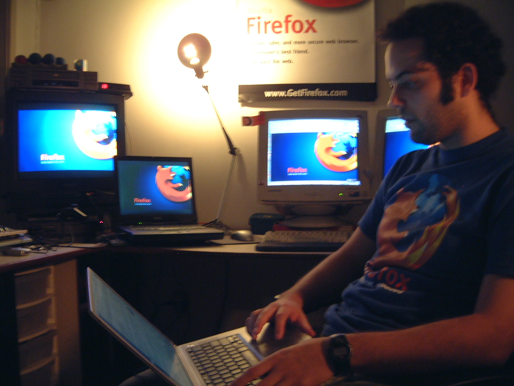
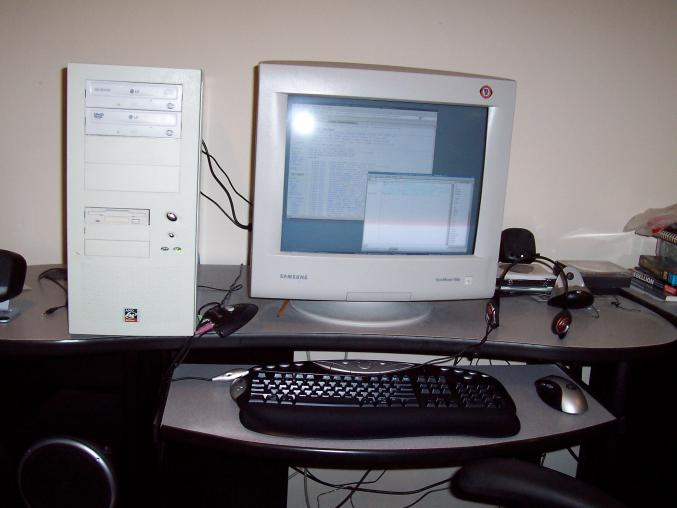
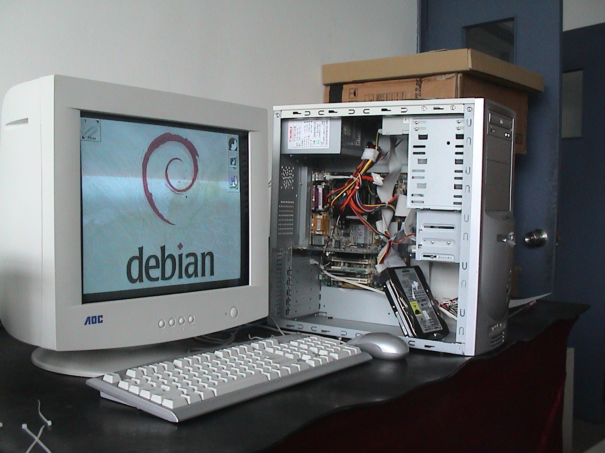

22年前の今日、2004年11月9日。無料で使える新しいウェブブラウザ、「モジラ・ファイアーフォックス」の最初の正式版、バージョン1.0が世界に向けて公開されました。青い地球を丸いキツネが抱きしめるようなアイコンとともに登場したこのブラウザは、瞬く間に世界中のパソコン利用者を虜にしていきました。

## インターネット・エクスプローラー独占の時代

2000年代初頭、パソコンでウェブサイトを閲覧するためのソフトウェアといえば、マイクロソフトの「インターネット・エクスプローラー（IE）」一色でした。ウィンドウズに標準で組み込まれていたこともあり、一時は市場の9割以上を占める圧倒的な独占状態にありました。

しかし、多くの機能を取り込んだことで動作が重くなり、利用者の間ではより軽快で快適に動作するブラウザを求める声が高まっていました。かつてインターネット初期に大きなシェアを持っていたネットスケープの血脈を受け継ぐオープンソースコミュニティは、この巨大な独占に風穴を開けるべく立ち上がりました。

## 「フェニックス」から始まった名乗り

開発が始まった2002年当初、この軽量ブラウザは不死鳥を意味する「フェニックス」という開発名で呼ばれていました。メール機能など様々な機能が一つにまとまっていた従来の総合型ソフトウェアから、ウェブの閲覧機能だけを独立させて高速化を目指したのです。

ところが、既存の商標との衝突が判明し、名称の変更を余儀なくされます。一度は「ファイヤーバード」と改名されましたが、これもオープンソースのデータベースプロジェクトと名称が重なってしまい強い抗議を受けることになりました。念入りな調査を経て、レッサーパンダの別名でもある「ファイアーフォックス」という正式名称に落ち着いたのは、正式公開を控えた時期のことでした。

*事件当時の写真ではありません · 2000年 — 写真: Fabricio Zuardi from São Carlos, Brazil / CC BY 2.0*

## 2004年11月9日、バージョン1.0の衝撃

そして2004年11月9日、満を持して「モジラ・ファイアーフォックス 1.0」が正式に公開されました。利用者を惹きつけたのは、当時の標準的なブラウザにはなかった革新的な使い心地でした。

一つのウィンドウの中にいくつものページを並べて切り替えられる「タブブラウジング」や、勝手に開く邪魔な広告を遮断する機能が標準で備わっていました。さらに、利用者が自分の使いやすいように機能を追加できる「アドオン（拡張機能）」の仕組みが熱狂的な支持を集めました。公開からわずか9か月間でダウンロード数は6000万回を突破し、ネット界の歴史を塗り替える大ヒットとなったのです。

*Centcom20040818 — 写真: Grunt at English Wikipedia / Public domain*

## 非営利組織が守ったオープンな精神

ファイアーフォックスの成功の背景には、開発を担うモジラが非営利組織であるという点も大きく関係していました。企業の利益追求ではなく、誰にとっても自由で安全なインターネット環境を提供することを目的に掲げ、ソースコードをすべて一般に公開するオープンソース方式をとっていました。

世界中の有志プログラマーが開発に参加し、不具合の発見や修正が素早く行われる体制は、多くの利用者に安心感を与えました。ウェブ標準に準拠した表示技術も、その後のウェブデザイナーや技術者たちから高く評価される要因となりました。

*20020730083218 - Debian — 写真: Yaohua2000 / CC BY-SA 3.0*

## シェア3割への躍進と今に残る足跡

バージョン1.0の成功を皮切りに、ファイアーフォックスは快進撃を続けました。2009年12月には全世界でのシェアが32パーセントに達し、バージョン別の集計ではインターネット・エクスプローラーの各バージョンを抑えて最も使われるブラウザにまで上り詰めました。

その後、スマートフォンの普及やグーグル・クロームの登場などによってブラウザを巡る勢力図は大きく変化しましたが、ファイアーフォックスは今もプライバシー保護や利用者の自由を重視する選択肢として存在感を放ち続けています。あの秋の日、新しいブラウザをわくわくしながらダウンロードした記憶は、多くのパソコン愛好家の心に鮮やかに残っています。

### 参考資料

- <https://ja.wikipedia.org/wiki/Mozilla_Firefox>
- <https://commons.wikimedia.org/wiki/File:Firefox_bullets_overlap_image.png>
- <https://commons.wikimedia.org/wiki/File:Firefox_everywhere_-_Flickr_-_fczuardi.jpg>
- <https://commons.wikimedia.org/wiki/File:Centcom20040818.jpg>
- <https://commons.wikimedia.org/wiki/File:20020730083218_-_Debian.jpg>
