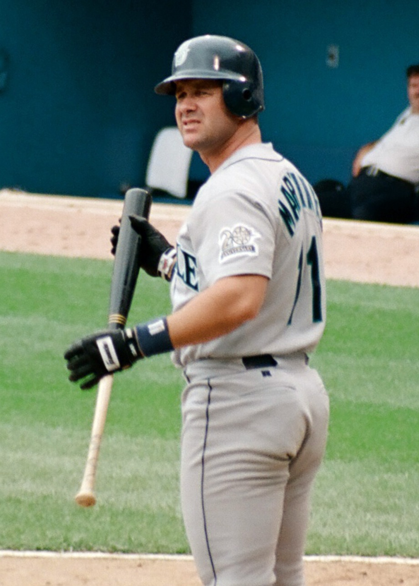
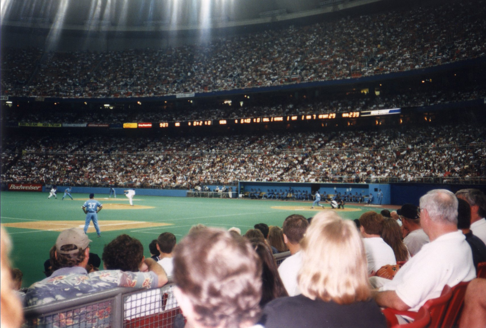
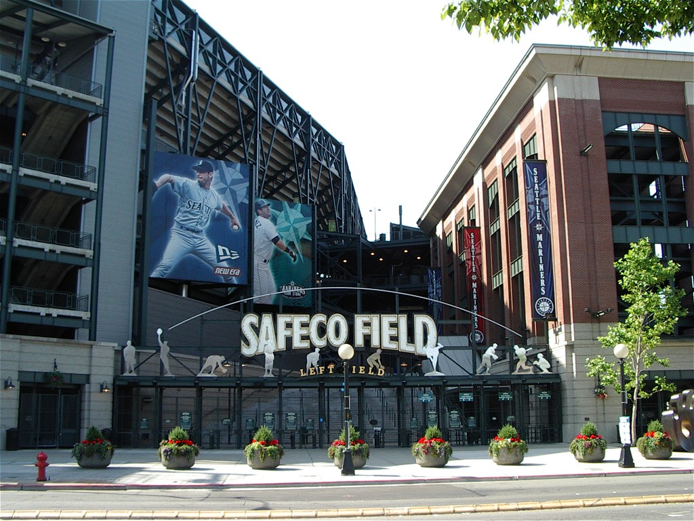

26年前の今日、2000年11月10日。アメリカ・メジャーリーグのシアトル・マリナーズが、オリックス・ブルーウェーブのイチロー選手の独占交渉権を1300万ドル余りで獲得しました。日本人野手として初となるメジャー移籍への大きな扉が開かれた瞬間でした。

## 日本球界で前人未到の記録を打ち立てた天才打者

イチロー選手は愛工大名電高校から1991年ドラフト4位でオリックス・ブルーウェーブに入団しました。登録名を「イチロー」に変更した1994年に日本プロ野球史上初となるシーズン200安打を達成し、一躍スター選手となります。卓越したバットコントロールと俊足、強肩を武器に、日本球界で7年連続の首位打者を獲得し、パ・リーグ最多安打も5回記録しました。日本国内ではこれ以上証明するものがないほどの圧倒的な実績を残し、2000年のシーズン終了後、メジャーリーグ挑戦を表明しました。

## アメリカに根強く存在した「日本人野手不要論」

当時、日本人投手の評価は着実に上がっていました。1995年にロサンゼルス・ドジャースへ移籍した野茂英雄投手が新人王を獲得し、2000年にはマリナーズに入団した佐々木主浩投手がア・リーグ新人王に輝くなど、投手の通用性は証明されつつありました。しかし野手に関しては、アメリカの強打者たちとの体格差や150キロを超える剛速球への対応力に対する疑念が根強く残っていました。「日本人野手はメジャーでは通用しない」という懐疑的な見方が、アメリカ球界やメディアの主流だったのです。

*1997年の資料 — 写真: clare_and_ben / CC BY-SA 2.0*

## 1300万ドル余りの落札額が示したマリナーズの情熱

そうした懐疑論を打ち破るきっかけとなったのが、2000年11月10日の独占交渉権獲得でした。ポスティングシステムにかけられたイチロー選手に対し、シアトル・マリナーズは1300万ドル余りという巨額の入札額を提示して落札しました。当時任天堂の山内溥氏らが出資していたマリナーズは日本との縁が深く、早くからイチロー選手の才能を高く評価していました。交渉権獲得後、両者は順調に話し合いを進め、11月19日には3年契約で合意に達しました。

*1996年の資料 — 写真: marbla123 / CC BY 2.0*

## 渡米と正式契約、日本人野手初のメジャーリーガー誕生

11月28日にアメリカへ渡ったイチロー選手は、メディカルチェックなどを経て、11月30日に3年総額1400万ドルで正式に契約を結びました。この瞬間、日本人野手として史上初のメジャーリーガーが誕生しました。入団会見では背番号「51」のユニフォームが披露され、日本だけでなくアメリカのベースボール界全体が、東洋からやってきた希代の安打製造機がどのようなプレーを見せるのかに注目しました。

*Seattle Safeco Field 01 — 写真: Mikano / CC BY-SA 3.0*

## 常識を覆した2001年の衝撃と球史に残る金字塔

迎えた2001年シーズン、イチロー選手は開幕から周囲の懸念を完全に吹き飛ばしました。打率.350で首位打者を獲得し、56盗塁で盗塁王に輝き、シーズン242安打はメジャー新人最多安打記録を打ち立てました。MVP、新人王、シルバースラッガー賞、ゴールドグラブ賞を同時に受賞するという史上稀に見る快挙を成し遂げ、マリナーズをアメリカンリーグ史上最多勝利タイとなるシーズン116勝へと導きました。体格やパワーだけが野球のすべてではないことを、自身のバットと足と守備で証明してみせたのです。

## 世界記録を打ち立て永久欠番となった背番号51

その後もイチロー選手の進化は止まりませんでした。2004年には84年ぶりにメジャーのシーズン最多安打記録を更新する262安打を記録。10年連続200安打やメジャー通算3000安打、日米通算4367安打というギネス世界記録を樹立し、アジア人選手として初のアメリカ野球殿堂入りも果たしました。マリナーズで背番号「51」は永久欠番となり、現在は球団の会長付特別補佐兼インストラクターを務めています。すべては2000年11月10日、1300万ドル余りで交渉権が獲得されたあの一日から始まりました。

### 参考資料

- <https://ja.wikipedia.org/wiki/%E3%82%A4%E3%83%81%E3%83%AD%E3%83%BC>
- <https://commons.wikimedia.org/wiki/File:Pat_Murphy_Netherlands_August_2000.jpg>
- <https://commons.wikimedia.org/wiki/File:Edgar_Martinez_1997.jpg>
- <https://commons.wikimedia.org/wiki/File:10_inside_kindome.jpg>
- <https://commons.wikimedia.org/wiki/File:Seattle_Safeco_Field_01.jpg>
