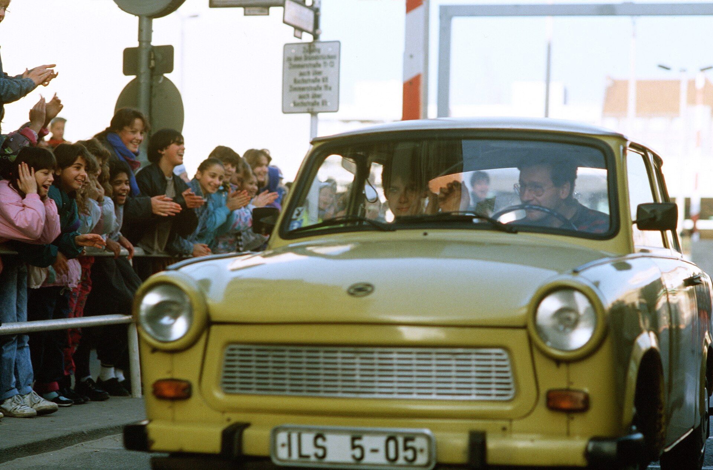
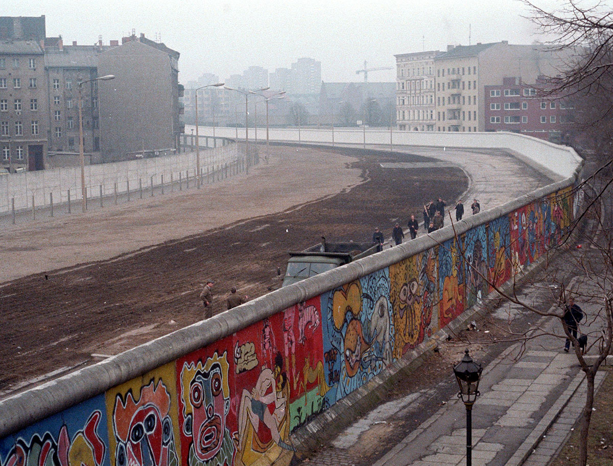
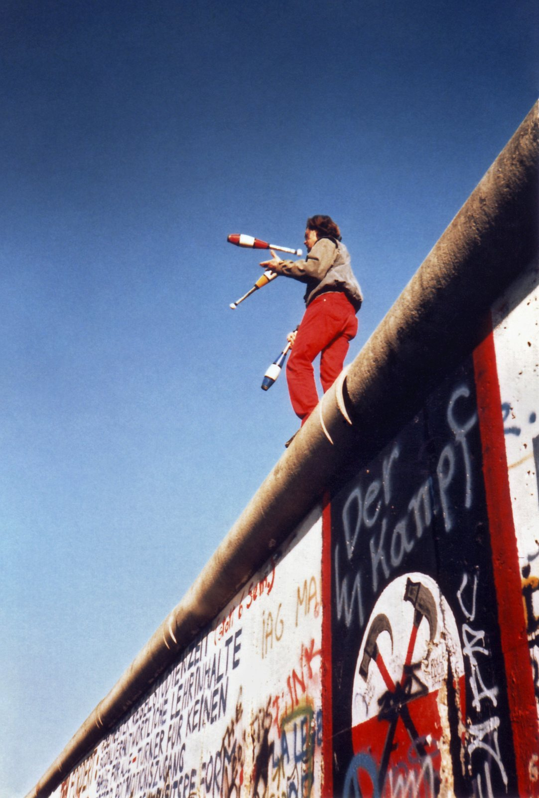

37年前の今日、1989年11月10日。東西冷戦の象徴として28年間にわたり世界を分断してきた「ベルリンの壁」で、本格的な撤去作業が始まりました。前夜の混乱から一夜明け、重機がコンクリートを砕き、市民たち自らも槌を振るって壁を打ち壊し始めたのです。

## 一夜にして出現した有刺鉄線とコンクリート

第二次世界大戦後、敗戦国となったドイツはアメリカ、イギリス、フランス、ソビエト連邦の戦勝4か国によって分割統治されました。首都ベルリンも同様に4か国の管理地区に分断されました。1949年には西側にドイツ連邦共和国（西ドイツ）、東側にドイツ民主共和国（東ドイツ）が成立し、東西冷戦の最前線となります。

当初、ベルリン市内での東西の往来は比較的自由でした。しかし、自由と経済的繁栄を求めて東ドイツから西側へ脱出する人々が後を絶たず、1945年から1961年までに移住した市民は約300万人に達しました。労働力と人口の深刻な流出に危機感を抱いた東ドイツ当局は、1961年8月13日未明、突如として東西ベルリンの往来を遮断し、西ベルリンの周囲を取り囲む有刺鉄線と壁の建設を開始したのです。

## 28年間で刻まれた悲劇の記録

築かれたベルリンの壁は、東西ベルリンを隔てる48キロを含め、西ベルリンを取り囲む全長155キロあまりに及びました。東ドイツ政府はこれを「反ファシズム防壁」と呼び、武装した国境警備兵を配置して厳重に監視しました。

壁の建設により、家族や友人は予告もなく引き裂かれました。1961年8月から1989年11月までの28年間で、5000人以上が危険を冒して壁を越え西側へ脱出しました。しかし、越境を試みて失敗し命を落とした人は200人以上にのぼり、その多くは警備兵による銃撃や川での溺死でした。さらに約3000人以上が逮捕され、逃亡未遂として平均4年の禁固刑に処されるなど、分断は多くの悲劇を生み続けました。

*1989年の資料 — 写真: DoD photo by: STAFF SERGEANT F. LEE COCKRAN / Public domain*

## 記者会見の失言が生んだ歴史的開放

1980年代後半、ソ連のミハイル・ゴルバチョフ書記長が進めたペレストロイカを背景に、東欧諸国で民主化の波が高まりました。1989年夏以降、ハンガリー経由などで東ドイツ市民の大量出国が相次ぎ、国内各地でも大規模な抗議デモが頻発します。追いつめられた東ドイツ指導部は、旅行規制の大幅な緩和を決めました。

1989年11月9日夕方、ドイツ社会主義統一党の政治局員ギュンター・シャボフスキー氏が記者会見を開きました。シャボフスキー氏は準備不足のまま、自国民の西側への旅行自由化を認める政令を読み上げました。外国人記者から「いつから発効するのか」と問われた際、書類を慌てて確認しながら「私の認識では……即刻、遅滞なくです」と答えたのです。この発言がテレビやラジオで世界中に速報されました。

*Berlinermauer — 写真: Noir / CC BY-SA 3.0*

## 1989年11月10日、撤去の槌音が響く

報道を耳にした東ベルリン市民は、夜遅くにかけて壁の国境検問所へ大挙して押し寄せました。現場の国境警備隊には上層部からの明確な指示が届いておらず、殺到する数万人の市民を前にして発砲を断念し、検問所のゲートを開放しました。東西ベルリンの市民は抱き合い、壁の上によじ登って歓喜の声を上げました。

そして翌11月10日、ベルリンの壁の本格的な撤去作業が始まりました。当局の重機が壁の一部を撤去して新たな通路を切り開くだけでなく、市民たちもハンマーやタガネを手にしてコンクリートの壁を打ち砕き始めました。分断の象徴だった巨大な壁は、市民の手と機械の力によって物理的に解体されていったのです。

*Juggling on the Berlin Wall 1a — 写真: Juggling_on_the_Berlin_Wall_1.jpg: Yann Forget derivative wo / CC BY-SA 3.0*

## 日本が目撃した東西冷戦の幕引き

ベルリンの壁崩壊の一報は、日本国内でもテレビの臨時ニュースや新聞の号外を通じて速報されました。地球の反対側で起きた劇的な出来事は、日本国民にも大きな驚きと感動を与えました。第二次世界大戦後の国際秩序を長年規定してきた「東西冷戦」が音を立てて崩れ去る瞬間として、多くの人々の記憶に刻まれることになります。

この壁の崩壊は東欧革命を決定づけ、翌1990年10月3日には東西ドイツが41年ぶりに正式に統一されました。日本政府もこの歴史的変化を歓迎し、統一ドイツとの新たな外交関係の構築を進めていくことになりました。

## 今に生きる分断の記憶

現在、ベルリン市内にはかつての壁の跡地が遊歩道として整備され、地面には壁が通っていた位置を示す二重の敷石が埋め込まれています。また、シュプレー川沿いの「イーストサイドギャラリー」など、あえて残された壁の一部には世界各国のアーティストによる壁画が描かれ、平和と自由の尊さを伝える記念碑となっています。

力で人々を閉じ込めることはできないという歴史の教訓を刻んだベルリンの壁。1989年11月10日に始まった撤去の槌音は、自由を求めた市民たちの意思の響きとして、今も語り継がれています。

### 参考資料

- <https://ja.wikipedia.org/wiki/%E3%83%99%E3%83%AB%E3%83%AA%E3%83%B3%E3%81%AE%E5%A3%81%E5%B4%A9%E5%A3%8A>
- <https://commons.wikimedia.org/wiki/File:Checkpoint_Charlie_Nov._1989,_Ostberliner_%C3%BCberqueren_zum_ersten_Mal_die_Grenze_nach_Westberlin_ohne_Grenzkontrolle._DF-ST-91-01394.jpg>
- <https://commons.wikimedia.org/wiki/File:Checkpoint_Charlie_Nov._1989,_Ostberliner_%C3%BCberqueren_zum_ersten_Mal_die_Grenze_nach_Westberlin_ohne_Grenzkontrolle._DF-ST-91-01399.jpg>
- <https://commons.wikimedia.org/wiki/File:Berlinermauer.jpg>
- <https://commons.wikimedia.org/wiki/File:Juggling_on_the_Berlin_Wall_1a.jpg>
