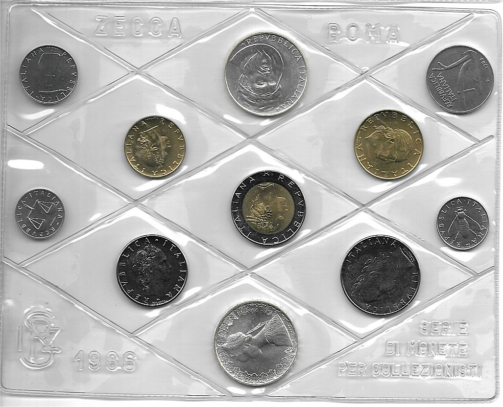
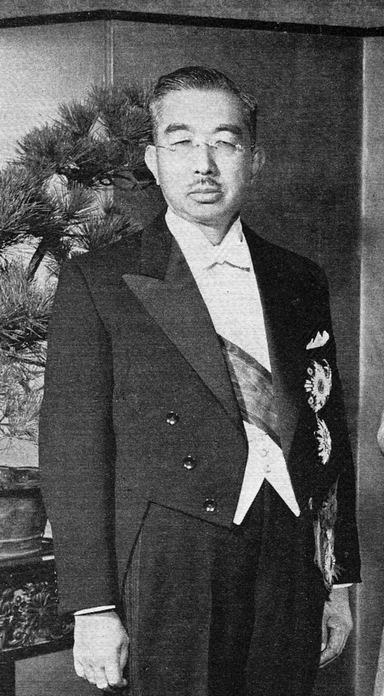
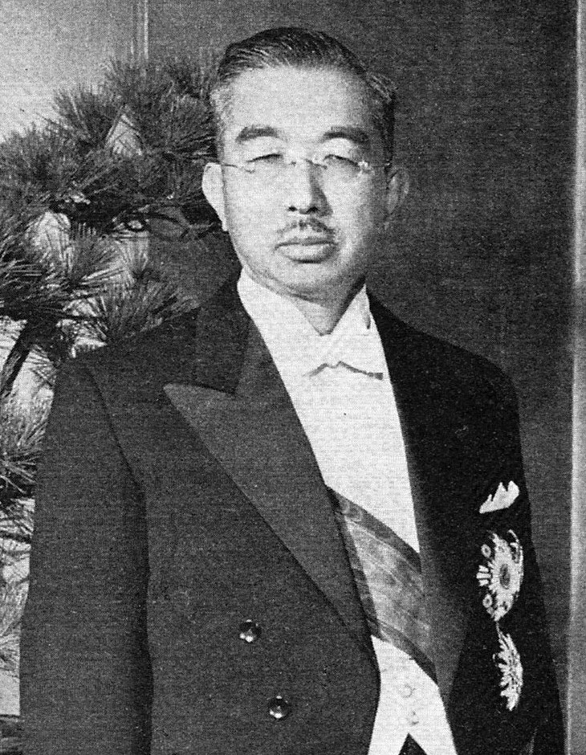

40年前の今日、1986年11月10日。昭和天皇の在位60年を祝う「天皇陛下御在位六十年記念硬貨」が発行され、全国の金融機関で両替の受付が始まりました。日本で初めての記念金貨であり、戦後初となる金貨の発行でした。

## 前代未聞の「10万円」硬貨が生まれた背景

1985年11月18日、第3次中曽根内閣の大蔵大臣であった竹下登が、昭和天皇の在位60年を祝う記念金貨の発行方針を発表しました。当時、臨時通貨法のもとで定められていた補助貨幣の額面上限は500円でした。1万円を超える貨幣を硬貨として発行することは、日本の貨幣史において前例のない試みでした。

政府は特別法「天皇陛下御在位六十年記念のための十万円及び一万円の臨時補助貨幣の発行に関する法律」を制定し、法的根拠を整えました。金貨発行の背景には、次年度の国の財源を確保することに加え、当時深刻化していたアメリカとの貿易摩擦を緩和するため、鋳造に必要な大量の金（223トン）をアメリカから購入するという国際的な思惑も絡んでいました。

## 純金20グラム、額面と原価の大きな差

発行された10万円金貨は、品位.9999の純金で、重さは1枚あたり20グラムありました。しかし、当時の金相場は1グラムあたり約1900円であり、製造コストを含めても原価は額面の半分以下でした。この金貨は流通せず国民に大切に保管されると見込まれ、差益の約5500億円が国庫に入る見込みとされました。

図柄には、戦前のように天皇の肖像を用いる案も最後まで検討されましたが、最終的には日本画家・平山郁夫による瑞祥画が採用されました。金貨と同時に1万円銀貨、500円白銅貨も用意され、金貨と銀貨は透明なプラスチックパッケージに封入されたまま金融機関の窓口で引き渡されることになりました。

*事件当時の写真ではありません · 1986年 — 写真: Albertomos / CC BY-SA 4.0*

## 抽選券を巡る熱狂と、一転した引き換え初日

発行前から世間の関心は沸騰しました。当初の発行予定枚数は1000万枚、総額1兆円という途方もない規模でしたが、入手を希望する人々が殺到することを見越して事前に抽選券が配布されました。金融機関の店頭には前夜から長い行列ができ、一部では手に入れた抽選券が高値で転売される事態まで起きました。

ところが、この過熱ぶりを見た関係筋から「昭和62年銘での追加発行」の意向が報じられると、希少価値を期待していた人々の熱は一気に冷え込みます。迎えた1986年11月10日の引き換え初日、銀行窓口の混雑は予想を大きく下回り、両替に訪れる人はまばらでした。結局、用意された1000万枚のうち実際に市中に出回ったのは910万枚にとどまり、引き換えられなかった残りの90万枚は鋳潰されることとなりました。

*Emperor Showa 1956-11-face — 写真: 投稿者が編集 / Public domain*

## 1990年に発覚した10万枚の大量偽造事件

騒動は発行だけで終わりませんでした。発行から4年が過ぎた1990年1月29日、日本の貨幣史上最大規模となる金貨偽造事件が明るみに出ます。国内大手の貨幣商がスイスから輸入した1000枚の10万円金貨を東京の都市銀行に預けた際、銀行員がパッケージのわずかな違和感に気づいたことがきっかけでした。

日本銀行や警視庁科学捜査研究所の鑑定により、持ち込まれた1000枚すべてが偽造品と判明しました。さらに捜査が進むと、すでに2年前から偽造金貨が日本国内に流入しており、確認された偽造金貨は10万7946枚、被害額は107億円余りに達していることが分かりました。本物の金貨から型を取り、当時の円高差益と額面保証の仕組みを突いて巨額の利益を狙った国際的な犯行でした。

*Emperor Showa 1956 — 写真: 投稿者が編集 / Public domain*

## 事件が変えた現代の記念硬貨のかたち

この大規模な偽造事件は、その後の日本の貨幣行政を大きく変える転換点となりました。額面通りの金額で引き換える「通貨型金貨」の危うさが浮き彫りとなり、以後に発行される記念金貨には高度な偽造防止技術が次々と導入されることになります。

さらに近年では、額面を素材価格よりも低く設定し、金の地金価格を上回るプレミアム価格で販売する「収集型金貨」が主流となりました。昭和の終わりに起きた10万円金貨の熱狂と偽造事件は、日本の記念貨幣の歴史に消えない教訓を刻んだ出来事でした。

### 参考資料

- <https://ja.wikipedia.org/wiki/%E5%A4%A9%E7%9A%87%E9%99%9B%E4%B8%8B%E5%BE%A1%E5%9C%A8%E4%BD%8D%E5%85%AD%E5%8D%81%E5%B9%B4%E8%A8%98%E5%BF%B5%E7%A1%AC%E8%B2%A8>
- <https://commons.wikimedia.org/wiki/File:RR3009-0025R_USSR-1986-1ruble-CuNi-PeaceYear-b.jpg>
- <https://commons.wikimedia.org/wiki/File:IT-1986-serie-dritto.jpg>
- <https://commons.wikimedia.org/wiki/File:Emperor_Showa_1956-11-face.jpg>
- <https://commons.wikimedia.org/wiki/File:Emperor_Showa_1956.jpg>
