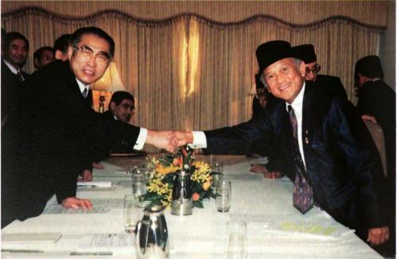
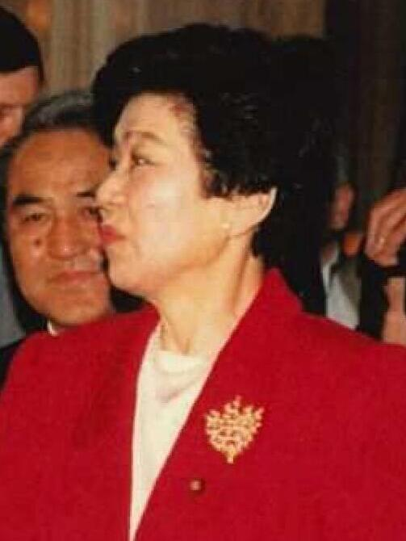
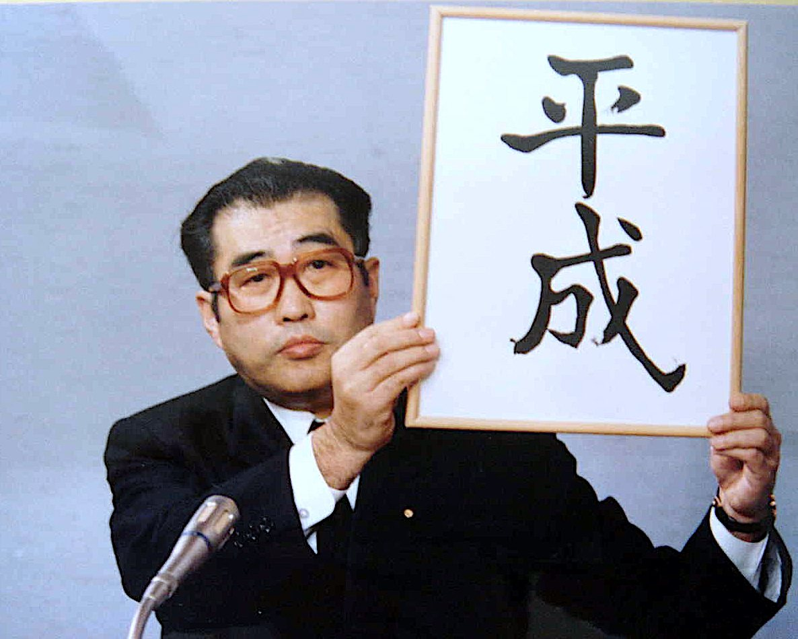

27年前の今日、1999年11月10日。日本の国会で、内閣総理大臣と野党各党の代表が直接言葉をぶつけ合う初めての「党首討論」が行われました。官僚が用意した答弁書を読むだけの従来の国会審議を改め、政治家自らが国家の針路を語り合う新しい試みとして、全国の有権者がテレビ中継を見守りました。

## イギリスを手本にした国会審議の活性化

党首討論が日本の国会に導入された背景には、1990年代末に高まった政治改革の機運がありました。イギリス議会下院で行われている「クエスチョンタイム」をモデルとし、政権与党の一角を担っていた自由党の小沢一郎党首が強く主張したことで制度設計が進みます。1999年7月には「国会審議活性化法」が成立し、衆参両院に国家基本政策委員会を設置することが決まりました。

予算委員会などの従来の審議では、野党議員が質問し、首相や閣僚の背後に控える官僚が作った答弁書を読み上げる光景が日常茶飯事でした。これに対して党首討論は、首相と野党党首が一対一で向き合い、首相側からも野党へ逆質問ができるという画期的な仕組みでした。国家百年の大計を踏まえた骨太な政策論議を行い、誰が国の指導者にふさわしいかを国民に直接提示する場として、大きな期待が寄せられたのです。

## 1999年11月10日、初の論戦に臨んだリーダーたち

記念すべき第1回の党首討論は、1999年11月10日の第146回国会において、衆参両院の予算委員会合同審査会の形式で開かれました。参加したのは、自由民主党の内閣総理大臣である小渕恵三首相と、野党を代表する3人の党首たちでした。民主党代表の鳩山由紀夫、日本共産党中央委員会幹部会委員長の不破哲三、そして社会民主党党首の土井たか子です。

当時は参加基準がまだ厳密に固まっておらず、参加を希望した無所属系の二院クラブが拒否されるなど、運用の手探り感も残る中での船出でした。それでも、与野党のトップ同士が直接マイクを挟んで対峙する光景は極めて新鮮で、議場には独特の緊張感が漂っていました。

*事件当時の写真ではありません · 1998年 — 写真: Departemen Penerangan Republik Indonesia / Public domain*

## 議場が沸いた「温かいピザ」と「冷めたピザ」の応酬

歴史的な第1回党首討論の幕開けを飾ったのは、民主党の鳩山由紀夫代表による意外な切り出しでした。鳩山代表は「これは官僚の皆様方に助けは要らない話でございますから」と前置きした上で、「きょう総理は朝何を召し上がったでしょうか。私は、けさはピザを食べてまいりました。特に、温かい、非常に熱いピザをおいしくいただいてまいりました」と首相に尋ねたのです。

このユニークな問いかけには、明確な意図がありました。かつてアメリカの新聞ニューヨーク・タイムズが、地味で決断力に欠けると批判する文脈で小渕首相を「冷めたピザ」と評したことがあったのです。さらに、本場イギリスのクエスチョンタイムが首相のその日の公務予定を尋ねることから始まる慣例も踏まえた皮肉混じりの牽制でした。

これに対し、小渕首相も即座にウィットに富んだ返しを見せました。「いつものとおり日本食の食事をいたしてまいりました。温かいピザを食べられたということでありますが、アメリカのオルブライト国務長官から以前、冷たいピザもまたおいしいと言われたことがあります」と応じ、議場を大きく沸かせたのです。

*Takako Doi 19910417 — 写真: 外務省大臣官房儀典官室 / CC BY 4.0*

## 明確化されたルールと参加要件の壁

初回の試行を経て、2000年2月23日には本来の舞台である国家基本政策委員会の合同審査会として初めての党首討論が開催されました。この直前の申し合わせにより、参加資格は「衆院または参院において10人以上の議員で構成される院内交渉団体の資格を有する野党党首」かつ「党首が国家基本政策委員会に所属していること」と厳格に定められました。

この厳格なルールは、後に各党の参加状況を大きく左右することになります。例えば公明党は、連立政権下で首相を出していなかったため長年参加できず、野党に転じた2010年2月に初めて席に着きました。また、日本共産党は2004年に議席減で資格を失い、2013年に議員数を回復させた後、委員会所属の手続きを経て2015年に11年ぶりの復帰を果たすなど、政党の浮沈がそのまま討論の舞台に反映されていきました。

*Keizo Obuchi cropped Keizo Obuchi 19890107 — 写真: 人事院 / CC BY 4.0*

## 首相と野党党首の両方を経験した政治家たち

その後、党首討論は数々の名場面を生み出し、日本の政治史の節目に立ち会ってきました。特に興味深いのは、野党党首として首相を追及した人物が、後に首相として野党党首を迎え撃つ立場を経験した点です。鳩山由紀夫、菅直人、安倍晋三、野田佳彦の4人は、攻守両方の席に座った歴史を持っています。

また、通称「党首討論」と呼ばれながらも、参加者の実際の役職名が「党首」だったのは、社会民主党の土井たか子、自由党の小沢一郎などごく一部に限られていました。多くの政党トップは総裁や代表、委員長を名乗っており、肩書一つを取っても各党の性格がにじみ出ていました。

## 激減する開催回数と国会改革の現在地

四半世紀以上の歴史を重ねてきた党首討論ですが、近年はその存在意義が改めて問われています。導入初年の2000年には年間8回も開催されていましたが、近年は激減しました。岸田文雄内閣では就任から約2年8か月後の2024年6月にようやく初の党首討論が開かれましたが、これは菅義偉内閣時代の2021年6月以来、実に3年ぶりの開催でした。

討論時間が全体で45分間と短く、複数の野党で時間を分け合うと1人あたりの持ち時間が数分から十数分しか取れないため、「実のある政策論争にならない」と野党側も積極的な開催を求めなくなっていきました。2023年12月には、舞台となる国家基本政策委員会の廃止法案が提出される事態にまで発展しています。政治家同士が生の声で国の進路を激論するという理想を掲げて始まったあの日から、日本の議会論戦がどこへ向かうのかが今も問い続けられています。

### 参考資料

- <https://ja.wikipedia.org/wiki/%E5%9B%BD%E4%BC%9A_(%E6%97%A5%E6%9C%AC)>
- <https://commons.wikimedia.org/wiki/File:Keiz%C5%8D_Obuchi_Cabinet_19990114.jpg>
- <https://commons.wikimedia.org/wiki/File:Presiden_Indonesia_B._J._Habibie_%26_Perdana_Menteri_Jepang_Obuchi_Keiz%C5%8D_%E5%B0%8F%E6%B8%95_%E6%81%B5%E4%B8%89_pada_KTT_VI_APEC_1998_di_Malaysia.jpg>
- <https://commons.wikimedia.org/wiki/File:Takako_Doi_19910417.jpg>
- <https://commons.wikimedia.org/wiki/File:Keizo_Obuchi_cropped_Keizo_Obuchi_19890107.jpg>
