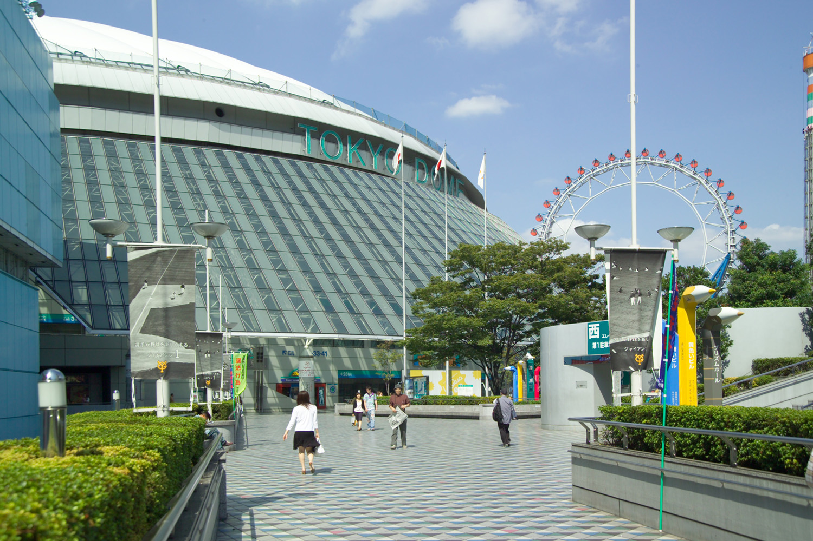
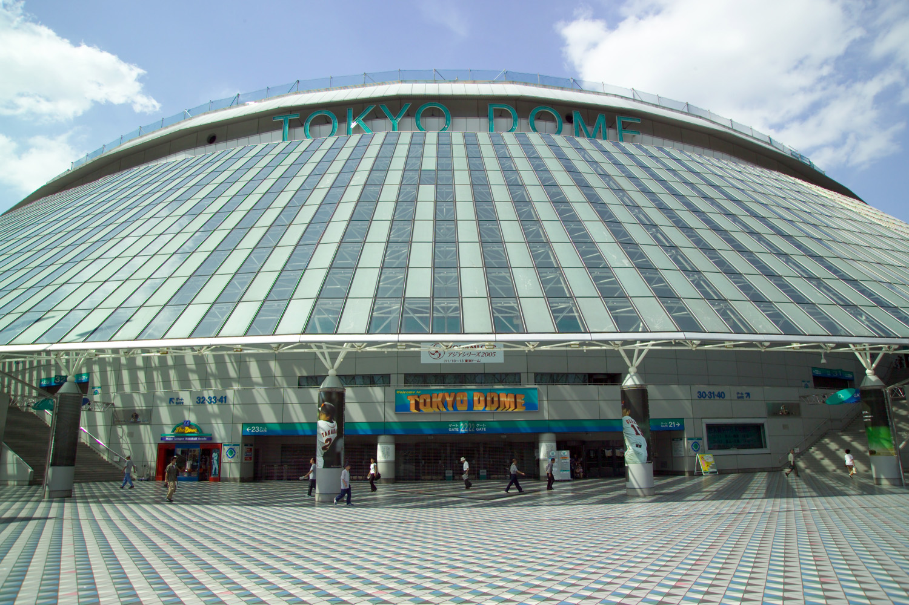
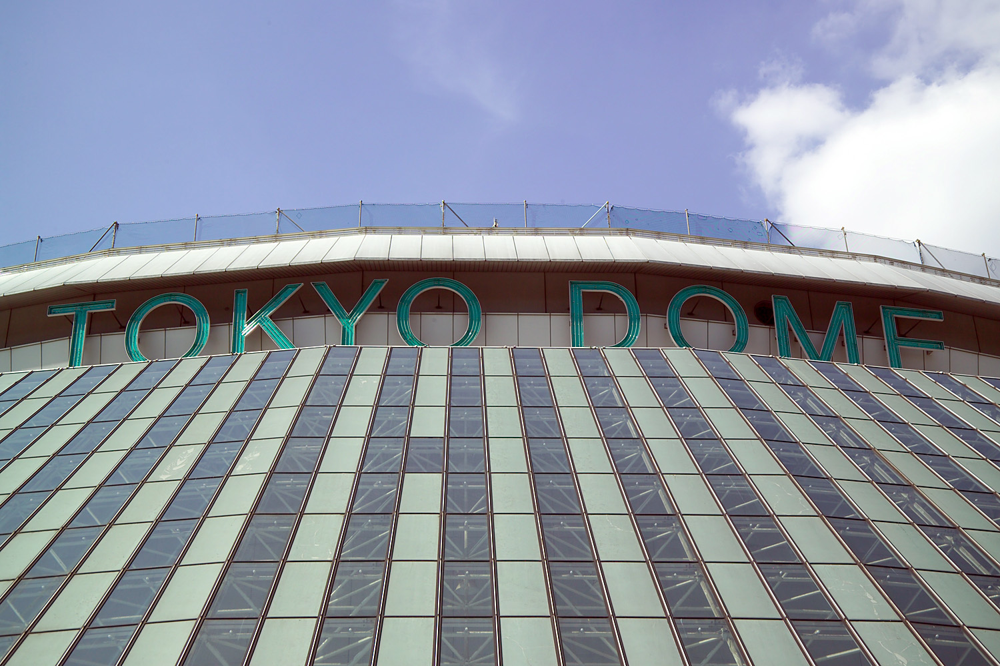

21年前の今日、2005年11月10日。プロ野球のアジアナンバーワンを決める初の国際公式戦、第1回「アジアシリーズ」が東京ドームで幕を開けました。各国のリーグ覇者がプライドをぶつけ合った熱い戦いの記憶です。

## 国別対抗からクラブ決戦へ：大会創設の背景

野球の国際対抗戦といえば、各国から選抜されたナショナルチームによる大会が主流でした。しかし、サッカーのクラブワールドカップのように、「各国リーグの年間王者が集まり、真の最強クラブを決める大会を作りたい」という構想が長年温められていました。

公式の位置づけは「アジアナンバーワン決定戦」であり、「野球の国際化の第一歩」でした。さらには将来、アメリカ・メジャーリーグのワールドシリーズ覇者と戦う「真のワールドシリーズ」の実現をも視野に入れた壮大な試みとしてスタートしたのです。

## 東京ドームに集結した4つの王者

記念すべき第1回大会には、アジアを代表する4つの国と地域から代表チームが集まりました。日本プロ野球（NPB）の日本シリーズ優勝チームをはじめ、韓国（KBO）の韓国シリーズ王者、チャイニーズタイペイ（CPBL）の年間王者、そして発展途上であった中国からは国内リーグの選抜チーム「チャイナスターズ」が参戦しました。

会場となったのは、1988年に開場した日本初の全天候型スタジアムである東京ドームです。日本シリーズ終了直後の11月、木曜日から日曜日までの4日間にわたり、アジアの頂点を巡る過密な日程が組まれました。

*2005年の資料 — 写真: No machine-readable author provided. Fg2 assumed (based on c / Public domain*

## 巨額の賞金と厳格な国際ルール

大会には特別協賛としてコナミがつき、正式名称は「KONAMI CUP アジアシリーズ2005」と銘打たれました。優勝チームには5000万円、準優勝には3000万円、3位と4位にもそれぞれ1000万円という、クラブの強化費としても極めて破格の賞金が用意されました。

大会運営にも公平性を徹底する工夫が凝らされました。審判員には不公平が生じないよう、対戦する両国以外の第三国から派遣された国際審判員がジャッジを担当しました。全試合で指名打者制（DH制）が採用され、予選リーグでは7回または8回で10点差がついた場合のコールドゲーム規定や、試合時間4時間を超えて新しいイニングに入らない時間制限など、国際大会ならではの特別ルールが適用されました。

*TokyoDome8946 — 写真: No machine-readable author provided. Fg2 assumed (based on c / Public domain*

## 地上波生中継とアジアのファンの熱気

日本代表チームの試合は、日本テレビ、TBS、テレビ朝日といった地上波キー局で生中継され、BS放送のJ SPORTSでも全試合が放映されました。ラジオでもニッポン放送やTBSラジオで中継が行われ、海を越えた真剣勝負に多くの野球ファンが耳を傾けました。

予選は4チームによる1回戦総当たりのリーグ戦形式で行われ、上位2チームが決勝へ進出するシステムでした。東京ドームのスタンドには、各国から駆けつけた熱心なファンが自国の応援スタイルを持ち込み、独特の国際色豊かな声援がドーム内に響き渡りました。

*TokyoDome8947 — 写真: No machine-readable author provided. Fg2 assumed (based on c / Public domain*

## 台湾・韓国への展開と大会の終幕

第1回から第4回（2008年）まで東京ドームで開催されたアジアシリーズでしたが、スポンサー撤退による赤字計上などを理由に、2009年と2010年は開催が一時見送られ、代替として日韓クラブチャンピオンシップなどが開催されました。

その後、大会は海外開催へと舵を切ります。2011年には台湾で復活開催され、オーストラリアの強豪パース・ヒートが初参戦。2012年には韓国・釜山で開催され、読売ジャイアンツが初優勝を飾りました。2013年には再び台湾で開催され、イタリア王者が招待出場するなど広がりを見せましたが、国際大会日程の過密化などもあり、2013年大会をもって発展的に終了しました。

## 今へと続く野球国際化の礎

アジアシリーズは、のちに世界野球ソフトボール連盟（WBSC）公認大会となるなど、アジア野球の競技力向上に決定的な役割を果たしました。各国リーグの野球スタイルや応援文化が直接交わった経験は、現在のWBSCプレミア12や各国の国際交流戦へと脈々と受け継がれています。

東京ドームのグラウンドで初めてアジア最強を争ったあの日の熱気は、今も多くの野球ファンの記憶に刻まれています。

### 参考資料

- <https://ja.wikipedia.org/wiki/%E3%82%A2%E3%82%B8%E3%82%A2%E3%82%B7%E3%83%AA%E3%83%BC%E3%82%BA>
- <https://commons.wikimedia.org/wiki/File:TokyoDome8941.jpg>
- <https://commons.wikimedia.org/wiki/File:TokyoDome8942.jpg>
- <https://commons.wikimedia.org/wiki/File:TokyoDome8946.jpg>
- <https://commons.wikimedia.org/wiki/File:TokyoDome8947.jpg>
