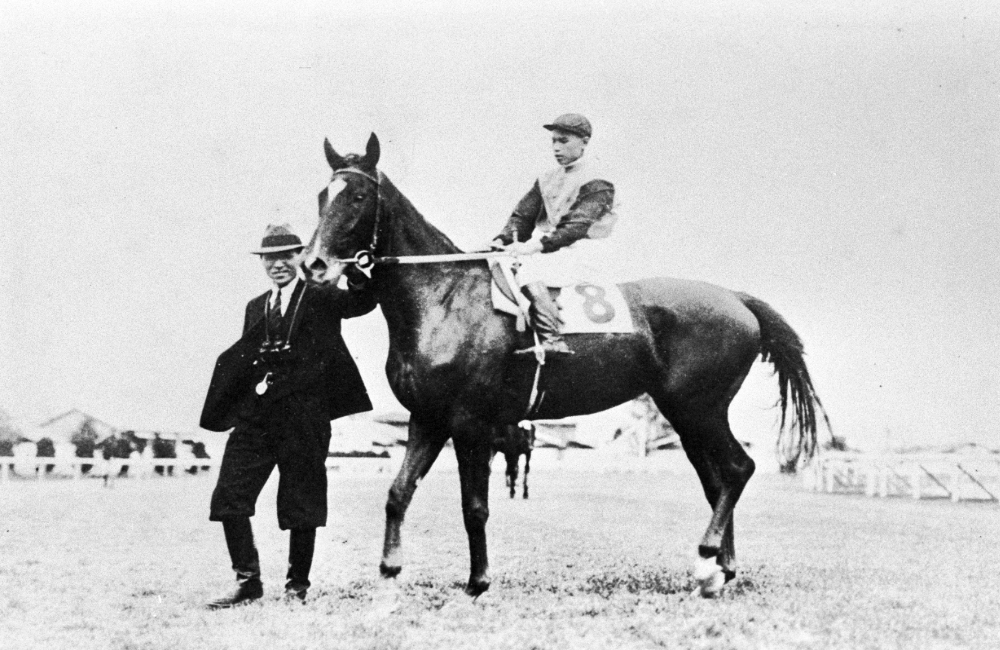
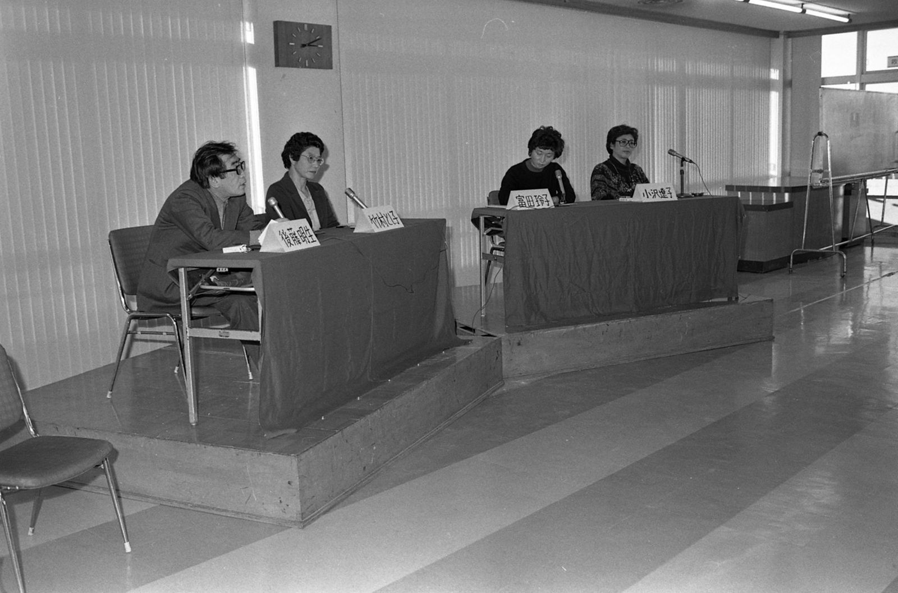
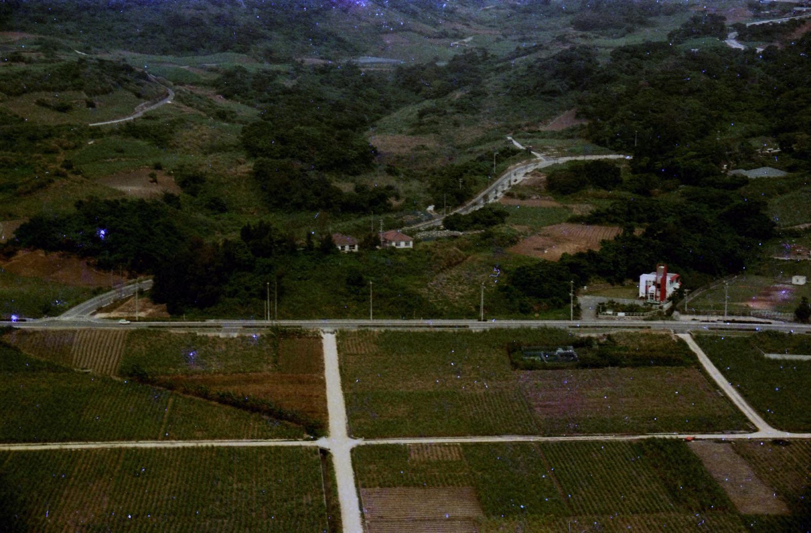

42年前の今日、1984年11月11日。京都競馬場で行われた菊花賞でシンボリルドルフが優勝し、日本中央競馬史上初となる「無敗のクラシック三冠」を達成しました。グレード制が導入された記念すべき年に達成されたこの大記録は、史上4頭目の三冠馬誕生でもありました。額に三日月の模様を持ち「皇帝」と称された名馬が成し遂げた、競馬史に残る歴史的偉業でした。

## 名馬の血を受け継ぎ「皇帝」と名づけられた出自

シンボリルドルフは1981年3月13日、北海道のシンボリ牧場で生まれました。父は名種牡馬パーソロン、母はスピードシンボリの産駒であるスイートルナという血統でした。母の過去の産駒は気性難から大成できませんでしたが、牧場主の和田共弘は再びパーソロンを交配しました。

生まれた牡馬は額に三日月の形を持ち、名馬の相とされる左後脚の一白を備えていました。立ち上がるまでにかかった時間はわずか20分ほどでした。牧場では「ルナ」と呼ばれていましたが、競走馬として登録される際、神聖ローマ帝国の君主ルドルフ1世にちなんで名づけられました。

## 宿敵との対決と「競馬を教えてもらった」ダービー

1983年7月に新潟競馬場の芝1000メートルでデビュー勝ちを収めたシンボリルドルフは、野平祐二調教師と主戦騎手の岡部幸雄のもとで連勝を重ねます。

1984年、クラシック戦線でビゼンニシキとの2強対決を迎えます。一冠目の皐月賞では激しい競り合いを制して優勝し、岡部は表彰式で三冠を意識して1本指を掲げました。続く東京優駿（日本ダービー）では、向こう正面で岡部の指示に反応しない場面がありながらも、直線で先頭集団を差し切って二冠を達成します。岡部が「ルドルフに競馬を教えてもらった」と語ったレースで、表彰式では2本指が立てられました。

*事件当時の写真ではありません · 1943年 — 写真: Japan Racing Association (JRA) / Public domain*

## 遠征中止とセントライト記念での異例の余波

ダービー後、オーナーの和田は海外遠征を計画し、アメリカのレースを経てフランスの凱旋門賞へ挑むプランが報道されました。しかし、右肩の故障や検疫条件の問題が重なり、7月に遠征の中止が発表されました。

故障から回復したシンボリルドルフは、秋初戦のセントライト記念をレコードタイムで快勝します。その圧倒的な走りに、2着に入った馬の調教師が「偉大な馬が1頭いる」と菊花賞への出走を辞退し、他馬の騎手が「あの馬はバケモノだ」と叫ぶなど、周囲に大きな衝撃を与えました。

*市民文化講座・パネルディスカッション — 写真: ndl / CC BY (Japan Search)*

## 1984年11月11日、淀の3000メートルで無敗三冠へ

迎えた1984年11月11日、京都競馬場で行われた菊花賞。スピードと運に加え、3000メートルの長丁場を克服するスタミナが求められる大一番です。

シンボリルドルフは道中中団を進み、第3コーナーで前の馬が壁になる場面もありましたが、直線に入ると鋭く抜け出しました。外から追いすがるゴールドウェイを4分の3馬身抑えて先頭でゴール板を駆け抜け、日本競馬史上初となる無敗でのクラシック三冠を成し遂げました。表彰式で岡部騎手は、誇らしげに3本の指を掲げました。

*佐敷町空撮写真 — 写真: 南城市教育委員会 / CC BY (Japan Search)*

## 三冠馬対決の敗戦と「4歳四冠」の達成

菊花賞のあと、中1週で挑んだジャパンカップでは、前年の三冠馬ミスターシービーとの史上初となる三冠馬対決が実現しました。しかし体調不良も重なり、大逃げしたカツラギエースの3着に敗れ、連勝記録は8で止まります。

それでも年末の有馬記念では、ミスターシービーとカツラギエースとの「3強対決」を制し、2馬身差のレコード勝ちを収めます。中央競馬史上初となる「4歳四冠」を達成し、表彰式で岡部は4本指を立てました。この年、シンボリルドルフは年度代表馬に選出されました。

## GI競走7勝と今なお語り継がれる皇帝の記憶

古馬になってからも天皇賞（春）やジャパンカップ、有馬記念を制したシンボリルドルフは、日本調教馬として史上初となるGI競走7勝を達成し「七冠馬」と称されました。1987年には顕彰馬にも選出されています。

中央競馬の歴史の中で無敗のまま三冠を制した馬は数頭しかおらず、関東馬によるクラシック三冠はシンボリルドルフを最後に出ていません。どんな局面でも揺るがなかったその圧倒的な強さは、「皇帝」の走りをリアルタイムで見守ったファンにとって、今も色あせない記憶となっています。

### 参考資料

- <https://ja.wikipedia.org/wiki/%E4%B8%89%E5%86%A0_(%E7%AB%B6%E9%A6%AC)>
- <https://commons.wikimedia.org/wiki/File:Kyoto_Daishogai53S.jpg>
- <https://commons.wikimedia.org/wiki/File:Kurifuji_at_Kyoto_Racecourse_3_October_1943.png>
- <https://adeac.jp/koshigaya-city-digital-archives/catalog/mp190917-200020>
- <https://nanjo-archive.jp/document/?detail=28673&genre=6>
