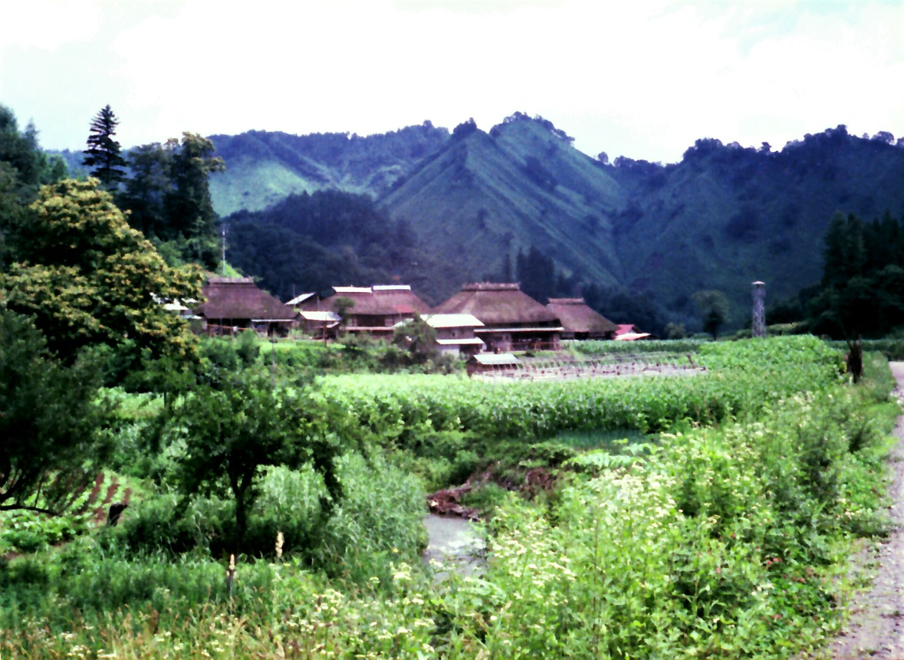
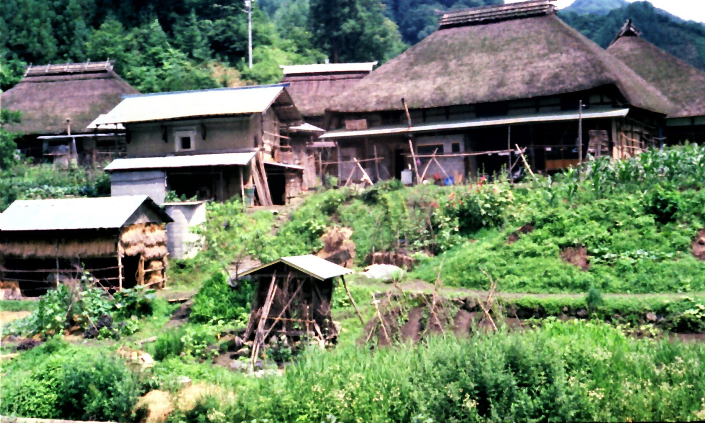
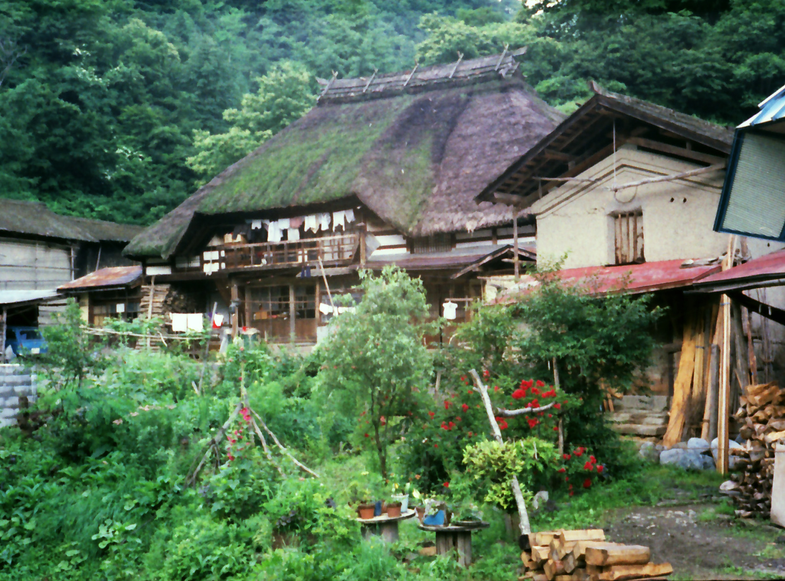

55年前の今日、1971年11月11日。神奈川県川崎市の生田緑地において、国の研究機関が合同で実施していた斜面崩壊の防災実験中に大規模な崖崩れが発生しました。防災のための基礎データを集める実験のはずが、想定を超えるスピードと規模で土砂が崩落し、実験関係者や取材にあたっていた報道陣ら15人が生き埋めとなって命を落とす前代未聞の事故となりました。

## 崖崩れの解明を目指した国家プロジェクト

昭和40年代、関東一円に広がる関東ローム層の台地では、大雨による崖崩れが相次ぎ、都市部における深刻な災害として懸念されていました。この崩壊の仕組みを科学的に解明し、災害予測や防災対策に役立てるため、科学技術庁は1969年度から3カ年計画、総予算5500万円を投じた大規模な研究計画を進めていました。

この研究には、科学技術庁国立防災科学技術センターを中心に、通商産業省工業技術院地質調査所、自治省消防庁消防研究所、建設省土木研究所という4つの省庁の研究機関が結集しました。試験地としては横浜市磯子地区や南多摩の造成地なども候補に挙がりましたが、川崎市長の許可を得て、川崎市生田緑地公園内の斜面が選ばれました。

## 散水による人工降雨と実験の準備

実験の内容は、自然の斜面に大量の水を散水して人工的に豪雨を再現し、どの程度の雨量で斜面が崩壊に至るかを観測するというものでした。対象となった斜面は傾斜角度30度、崩壊予定部分の底辺は幅100メートルに及びました。

計測機器や観測用カメラは斜面の最下部から約50メートル離れた場所に設置され、斜面下には高さ1メートルの丸太で防護柵が設けられました。斜面の両側には木立が生い茂っていたため、研究者や報道陣は安全な側面ではなく、土砂が流れ落ちてくる正面に陣取ることになりました。事前の予備散水は4月、7月、11月に計7日間行われ、さらに直前の11月7日にも自然の雨が降るなど、地盤にはすでに相当量の水分が含まれていました。

*71-1423a Japan 1971 — 写真: wilford peloquin / CC BY 2.0*

## 15時34分、秒速17メートルの土砂崩落

本実験の散水は、1971年11月9日午後3時半に開始されました。そして11月11日午後3時34分、積算雨量が470ミリ（一部資料では480ミリ）に達したその瞬間、山鳴りのような轟音とともに斜面が爆発的に崩落しました。

崩れ落ちた土砂の量は推定270立方メートル。崖の上部にあった盛り土やローム層が泥流と化し、第一波は秒速約17メートルという猛スピードで滑り降りました。高さ1メートルの丸太柵は瞬時に押し流され、泥流は観測場所を直撃し、さらに崖下55メートルの池にまで達しました。斜面の正面にいた実験関係者や報道関係者など25名が巻き込まれ、15名が死亡、10名が負傷しました。犠牲となったフジテレビの佐武正カメラマンの機材は、土砂に飲み込まれる最後の一瞬まで映像を記録し続けていました。

*71-1424 Japan 1971 — 写真: wilford peloquin / CC BY 2.0*

## 浮き彫りとなった安全対策の死角

事故後の検証では、実験における安全対策の不備が数多く指摘されました。事前予測では崖崩れが最下部まで到達するのに5秒から6秒かかると見込まれていましたが、実際にはわずか2秒から3秒しか猶予がありませんでした。さらに、唯一の退避方向である観測班の後方17メートルには池があり、逃げ場が完全に塞がれていたのです。

また、地元の警察や消防への連絡が行われておらず、現場の立ち入り制限や報道陣への退避指示も曖昧なままでした。事前の地質調査が深さ3メートルのボーリング3本にとどまっていたことや、前日の時点でローム層と粘土層の境目に亀裂が見つかっていたにもかかわらず実験が続行された点も問題視されました。事故の重大な社会的責任を受け、当時の平泉渉科学技術庁長官が辞任に追い込まれました。

*71-1424a Japan 1971 — 写真: wilford peloquin / CC BY 2.0*

## 16年におよぶ法廷闘争と無罪判決

この事故を巡っては、実験を主導した関係者2名が業務上過失致死傷の罪で起訴されました。裁判の大きな争点となったのは、当時の科学技術の知見によって、これほど高速かつ大規模な崩壊が予見可能であったかどうかという点でした。

事故から16年が経過した1987年3月27日、横浜地方裁判所は「当時の学問水準では、このような規模や速度での崩壊の危険性を予測することは不可能であった」と判断し、被告人2名に対して無罪判決を言い渡しました。横浜地方検察庁が控訴を断念したことで判決は確定し、刑事責任の追及は幕を閉じました。自然現象の予測がいかに困難であるかを司法が突きつけられる形となったのです。

## 生田緑地に残る慰霊碑と今に続く教訓

人々の命を土砂災害から救うために始まった実験が、多くの尊い人命を奪う結果となったこの事故は、日本の防災研究史に消えない深い傷痕を残しました。実験手法や安全管理基準は根本的な見直しを迫られ、のちの防災科学技術の在り方に多大な影響を与えました。

現場となった川崎市生田緑地の岡本太郎美術館入口脇には、現在も犠牲者を追悼する慰霊碑が静かに佇んでいます。碑には15名の犠牲者の名前が刻まれ、自然の脅威に対する畏怖と、防災研究の重い責任を今も訪れる人々に伝え続けています。

### 参考資料

- <https://ja.wikipedia.org/wiki/%E5%B7%9D%E5%B4%8E%E3%83%AD%E3%83%BC%E3%83%A0%E6%96%9C%E9%9D%A2%E5%B4%A9%E5%A3%8A%E5%AE%9F%E9%A8%93%E4%BA%8B%E6%95%85>
- <https://commons.wikimedia.org/wiki/File:71-1423_Japan_1971.jpg>
- <https://commons.wikimedia.org/wiki/File:71-1423a_Japan_1971.jpg>
- <https://commons.wikimedia.org/wiki/File:71-1424_Japan_1971.jpg>
- <https://commons.wikimedia.org/wiki/File:71-1424a_Japan_1971.jpg>
