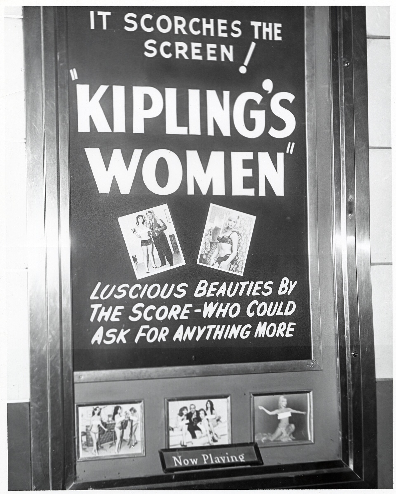
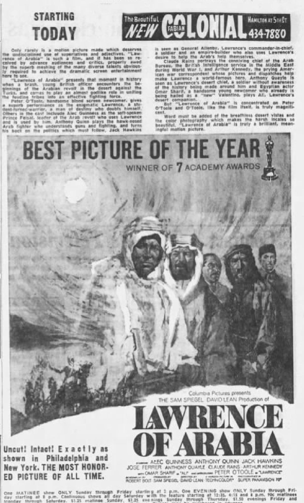
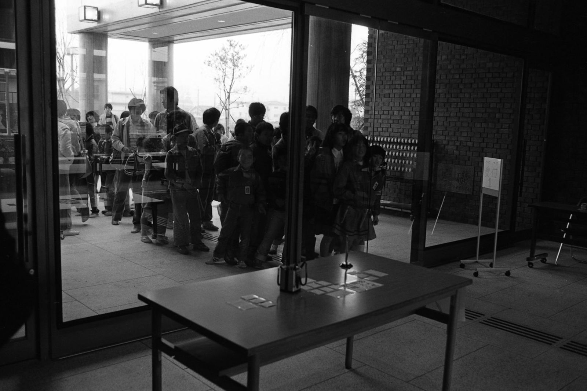

43年前の今日、1983年11月11日。東京・西新宿の空き地に設営された仮設劇場「キャッツ・シアター」で、劇団四季のミュージカル『キャッツ』の初日が開幕しました。既存の劇場を借りるのではなく、都有地の空き地に自前でテント張りの劇場を建てて長期上演に挑むという、日本演劇界で前例のない挑戦でした。

## 西新宿の都有地に現れた巨大な仮設テント

当時の日本の演劇界において、専用の仮設劇場を一から建設してミュージカルを上演することは極めて異例の試みでした。劇団四季が選んだ場所は、超高層ビル街として開発が進んでいた東京・西新宿の都有地の空き地でした。そこにサーカステントを思わせる巨大な仮設劇場「キャッツ・シアター」を設置したのです。

劇場内部は、都会のごみ捨て場という舞台設定に合わせて客席と舞台が一体化するように造り込まれ、開演に合わせて舞台が180度回転する回り舞台などの機構も導入されました。従来の劇場空間の常識を覆すこのテント劇場は、開場前から大きな注目を集めました。

## 月単位契約の壁と劇団四季の決断

劇団四季を率いていた浅利慶太がこのような異例の挑戦に踏み切った背景には、日本の劇場システムに対する強い危機感がありました。当時の日本の劇場は月単位での契約が通例であり、どれほど客足が好調で大ヒットを記録しても、契約期間が満了すれば幕を下ろさざるを得ませんでした。

劇団四季は1953年に浅利慶太や日下武史ら学生10人で結成され、当初はフランス文学を中心とするストレートプレイを上演していました。しかし、劇団員がアルバイトをせず演劇だけで生活できる経営基盤を確立するため、1970年代から本格的に商業ミュージカルへ進出します。1971年の『アプローズ』、そして1979年の『コーラスライン』の成功により、年間上演回数はそれまでの平均10回程度から一気に581回へと急増しました。しかし、どれほどヒットしても劇場の制約で収益が限られる状況を打破するため、自前の専用劇場による長期公演の実現が急務だったのです。

*Film poster at unidentified theater (11223377734) — 写真: City of Boston Archives from West Roxbury, United States / CC BY 2.0*

## 世界的大ヒット作『キャッツ』の衝撃

日本初演の演目として選ばれた『キャッツ』は、イギリスの詩人T・S・エリオットの詩集をもとに、アンドルー・ロイド・ウェバーが作曲を手がけたミュージカルです。1981年にロンドンのウエストエンドで初演され、1983年のトニー賞ではミュージカル作品賞など7部門を受賞して世界的な社会現象となっていました。

舞台には人間が一人も登場せず、猫に扮した俳優たちが都会の片隅で歌い踊るという斬新な演出が特徴でした。劇団四季は母音をはっきりと発音する独自の「母音法」を徹底させ、日本語の歌詞が明瞭に客席へ届く舞台を作り上げました。山田卓の振付とともに、個性豊かな猫たちが繰り広げるダイナミックな世界は、観客に鮮烈な印象を与えました。

*1962 - Colonial Theater - 9 Oct MC - Allentown PA — 写真: Self Scanned / Public domain*

## 1年間のロングランと上演回数700回突破

1983年11月11日に開幕した西新宿の公演は、劇場の熱気とともに瞬く間に大きな話題となりました。この年、劇団四季の年間上演回数は707回に達し、劇団の記録を大きく更新しました。

客席を埋め尽くした観客の熱い支持に支えられ、西新宿のキャッツ・シアターでの公演は翌1984年11月10日まで、ちょうど1年間にわたって続けられました。大ヒット作を年単位で上演し続ける「ロングラン公演」という演劇ビジネスのモデルが、日本でも成立することを証明した決定的な瞬間でした。

*図書館オープン — 写真: ndl / CC BY (Japan Search)*

## 大阪から全国へ広がる専用劇場の道

新宿での大成功を収めた劇団四季は、1985年には大阪市西梅田の旧国鉄コンテナヤードに再び仮設テント劇場を建設し、13か月に及ぶロングラン公演を達成しました。この仮設劇場での実績が、その後の恒久的な専用劇場建設への足がかりとなっていきます。

1996年には福岡に日本初となる専用劇場「福岡シティ劇場」を開場し、1998年にはJR東日本との連携によって東京・浜松町に「JR東日本アートセンター 四季劇場」が誕生しました。さらに電通四季劇場［海］や大阪四季劇場など、都市部に常設の専用劇場を次々と展開する原点となったのが西新宿の挑戦でした。その後も品川区五反田（2004年11月11日開場）や横浜みなとみらい（2009年11月11日開場）などにキャッツ・シアターが建てられ、11月11日は作品にとって特別な節目として刻まれていきました。

## 今も受け継がれるロングランの原点

現在、劇団四季は800名以上の俳優と800名近いスタッフを擁し、専用劇場を中心に年間3,000回以上のステージを上演して年間延べ約300万人を動員する規模へと成長しました。

西新宿の空き地に建てられたテント劇場から始まった『キャッツ』のロングランは、日本の演劇文化のあり方を大きく塗り替え、ミュージカルを世代を超えて親しまれる大衆演劇へと定着させました。40年以上の歳月が流れた今も、『キャッツ』の舞台は日本各地で上演が重ねられ、観客に感動を届け続けています。

### 参考資料

- <https://ja.wikipedia.org/wiki/%E5%8A%87%E5%9B%A3%E5%9B%9B%E5%AD%A3>
- <https://commons.wikimedia.org/wiki/File:1967_Mantra-Rock_Dance_Avalon_poster.jpg>
- <https://commons.wikimedia.org/wiki/File:Film_poster_at_unidentified_theater_(11223377734).jpg>
- <https://commons.wikimedia.org/wiki/File:1962_-_Colonial_Theater_-_9_Oct_MC_-_Allentown_PA.jpg>
- <https://adeac.jp/koshigaya-city-digital-archives/catalog/mp053510-200020>
