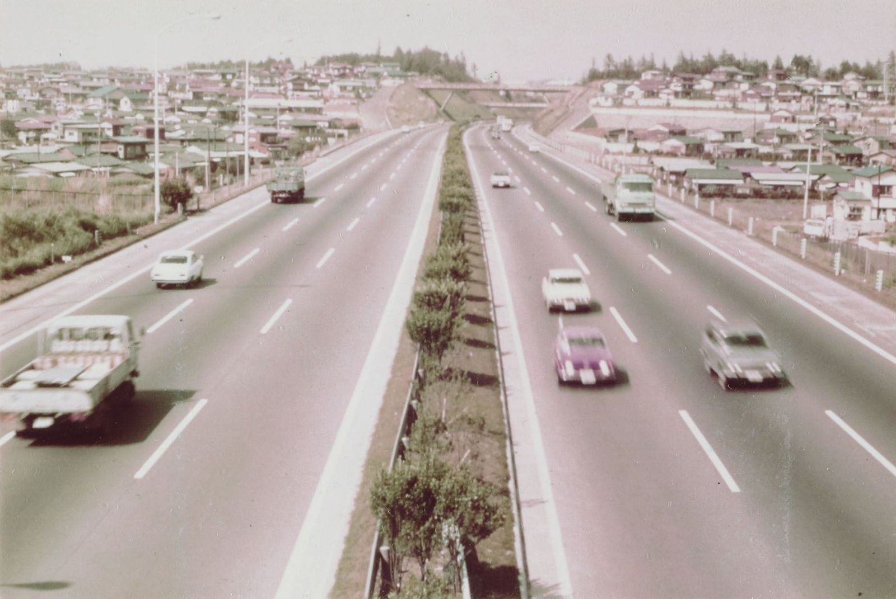
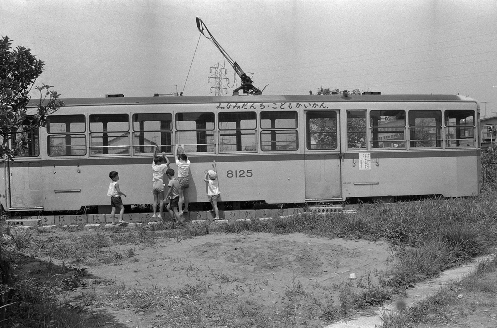
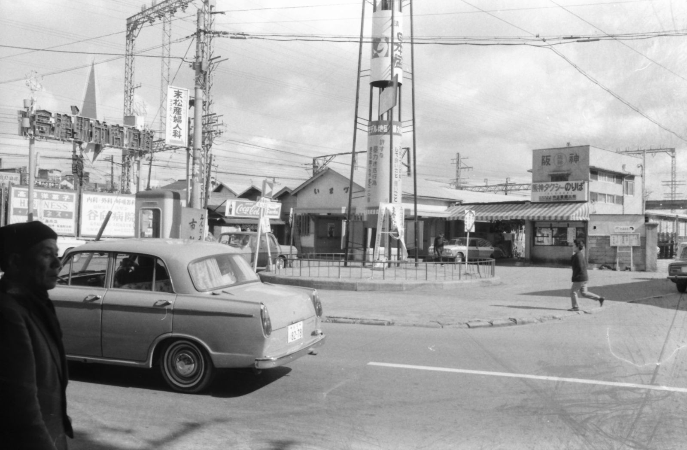

54年前の今日、1972年11月11日。東京都内を縦横に結んでいた都電が、この日の運行をもって、一部区間を除いたほぼ全線で姿を消しました。かつて東京の街の主役として親しまれた路面電車は、高度経済成長と車社会の到来に伴い、その役割を大きく変えることになったのです。

## 馬車鉄道から市電、そして都電へ

東京における路面交通の歴史は、1882年に開業した東京馬車鉄道に始まります。新橋と日本橋の間から始まった馬車鉄道は電化計画が進められ、1903年に東京電車鉄道として品川と新橋の間で電車運転を開始しました。続いて東京市街鉄道や東京電気鉄道が開業し、1906年に3社が合併して東京鉄道が誕生します。

その後、公益性の観点から電車の市有化を求める世論が高まり、1911年に当時の東京市が買収して「東京市電」が発足しました。1943年の東京都制施行によって「都電」と名称を改め、東京の街と人々の暮らしに欠かせない移動手段として定着していきました。

## 1日175万人が利用した黄金時代

都電が最も輝いていたのは、昭和30年（1955年）頃でした。営業キロは約213キロに達し、40の運転系統を擁し、1日に約175万人もの乗客が利用する日本最大の路面電車網を築き上げていました。

当時は都内各地の道路上にレールが敷かれ、通勤や通学、買い物に向かう市民を乗せてひっきりなしに電車が行き交っていました。朝夕の混雑時には満員の乗客を乗せ、まさに戦後復興と日本の成長を足元から支える大動脈だったのです。

*東名高速道路 — 写真: ndl / CC BY (Japan Search)*

## モータリゼーションと相次ぐ路線廃止

しかし、昭和30年代後半から急速に進んだモータリゼーションが都電の運命を一変させます。道路を走る自家用車やトラックが激増し、路面電車は激しい交通渋滞に巻き込まれるようになりました。定時運行が難しくなり、営団地下鉄や都営地下鉄の路線網が発達するにつれて、都電の利用者は徐々に減少していきました。

乗客の減少と道路混雑の原因という批判を受け、東京都交通局の採算は急速に悪化しました。1967年に交通局が財政再建団体に指定されると、再建計画の一環として都電路線の順次廃止が決定され、数年をかけて都内各地のレールが次々と撤去されていったのです。

*南団地子ども会館設立 — 写真: ndl / CC BY (Japan Search)*

## なぜ荒川線区間だけが生き残ったのか

1972年11月11日、残されていた路線の多くが運行を終了し、翌12日までにほぼ全線が廃止されました。その中で唯一残されたのが、27系統の一部（三ノ輪橋 - 王子駅前）と32系統（荒川車庫前 - 早稲田）でした。もともとこれらの路線も廃止が計画されていましたが、存続を決める決定的な理由がありました。

第一に、この区間は全線の約9割が道路と分離された専用軌道であり、一般車の通行を妨げることがほとんどありませんでした。第二に、並行する明治通りは当時すでに深刻な渋滞が発生しており、代替として都営バスを走らせても定時運行が不可能と判断されたことです。さらに、代替道路の建設による排気ガスや騒音といった自動車公害への懸念に加え、地域の足として利用していた沿線住民から強い存続要望が寄せられたことが、廃止を思いとどまらせる大きな力となりました。

*阪神電鉄今津駅前 — 写真: 西宮市 : ニシノミヤシ / CC BY (Japan Search)*

## 荒川線としての統合と今に残る記憶

存続が決まった区間は、1974年に恒久的な存続が決定し、同年10月1日に27系統と32系統が統合されて「荒川線」として一本化されました。三ノ輪橋から早稲田までの12.2キロ、30の停留場を結ぶ路線として新たなスタートを切ったのです。

荒川線はその後、1977年からワンマン運転の導入など近代化を進めつつ、東京に残る唯一の都電として愛され続けてきました。現在では「東京さくらトラム」の愛称もつけられ、沿線の飛鳥山公園やあらかわ遊園、三ノ輪橋停留場近くの「三ノ輪橋おもいで館」、荒川電車営業所にある「都電おもいで広場」など、かつての都電の歴史や下町の温もりを感じられる場所として、いまも親しまれています。

### 参考資料

- <https://ja.wikipedia.org/wiki/%E6%9D%B1%E4%BA%AC%E9%83%BD%E9%9B%BB%E8%BB%8A>
- <https://www.flickr.com/photos/30157224@N00/50191879567>
- <https://adeac.jp/ebina-city/catalog/photo06-165>
- <https://adeac.jp/koshigaya-city-digital-archives/catalog/mp155945-200020>
- <https://adeac.jp/nishinomiya-city/catalog/0100000758>
