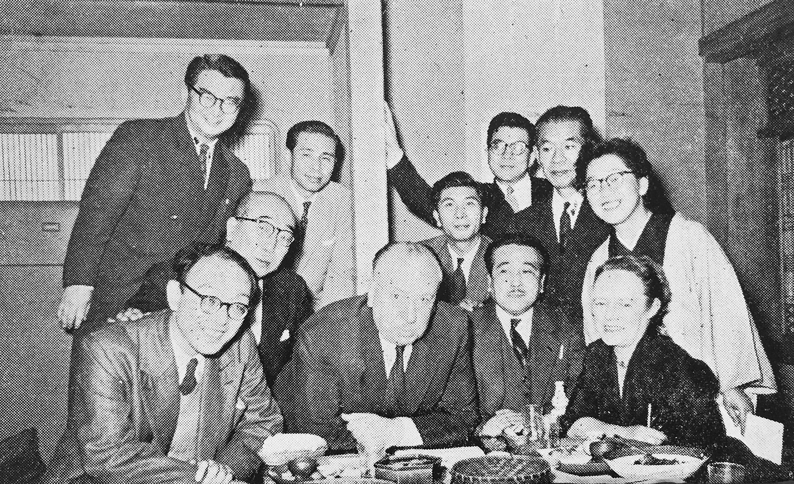

28年前の今日、1998年11月11日。映画評論家として日本中の茶の間に愛された淀川長治さんが、89歳で亡くなりました。テレビ朝日系の『日曜洋画劇場』で約32年にわたり映画の魅力を語り続け、亡くなる前日まで車椅子で収録に臨んだ生涯現役の映画人でした。

## お茶の間に映画を届けた32年と1629本

1966年10月、前身の『土曜洋画劇場』として始まった番組は、翌1967年に日曜枠へ移動して『日曜洋画劇場』となりました。まだ海外旅行も珍しく、映画館まで足を運ぶのが簡単ではなかった時代、テレビで世界の映画を日本語吹き替えで届けるこの番組は、瞬く間に全国の人気番組となりました。

その顔として番組開始から解説を務め続けたのが淀川長治さんでした。独特の抑揚をつけた「ハイ皆さん、こんばんは」「怖いですねえ、恐ろしいですねえ」という語り口は、子どもからお年寄りまで幅広く親しまれました。彼が解説した作品は実に1629本に達し、日本のテレビ映画番組の歴史そのものとなりました。

## 3回と決まった「サヨナラ」の秘密

淀川さんの代名詞といえば、番組のエンディングで斜めを向きながら放つ「サヨナラ、サヨナラ、サヨナラ」の言葉でした。実は番組が始まった当初は、放送終了の時間まで連続して言い続けていたため、週によって言う回数がバラバラでした。

ある日、小学生から直接電話があり、「学校の友達の間で、淀川さんが今週サヨナラを何回言うか賭けをしている」と教えられました。それを聞いた淀川さんは「子どもの間で賭けをするのは良くない」と諭し、それ以降は回数をきっちり3回だけに決めたという逸話が残っています。視聴者への細やかな思いやりが、あのおなじみの名調子を生み出しました。

*当日の写真ではありません · 事件当時の写真ではありません · イメージ写真 — 写真: StockSnap / Pixabay Content License*

## 死の前日、かすれた声で挑んだ最後の収録

晩年、体調を崩して東京大学医学部附属病院に入院していた淀川さんですが、映画への情熱が衰えることはありませんでした。亡くなる前日の1998年11月10日にも、病院から車椅子に乗ってテレビ朝日のスタジオに入り、11月15日放送予定の映画『ラストマン・スタンディング』の解説収録に挑みました。

病気の影響で声はかすれており、淀川さんは解説の冒頭で「今日はこんなガラガラ声で本当に申し訳ございません」と詫びを入れました。スタッフは体調を気遣って1回の収録ですぐにOKを出しましたが、淀川さんは首を横に振り、「もういっぺんやりなおし。いまの汚い」と自ら撮り直しを求めました。2回目のテイクを終え、「しかたがないね、この声。わかるよね、みんな病気であること知ってるはずだから」とうなずいてスタジオを後にしたのが、カメラの前に立った最後の姿となりました。

*当日の写真ではありません · 事件当時の写真ではありません · イメージ写真 — 写真: funnytools / Pixabay Content License*

## 盟友・黒澤明監督の死と父と同じ命日

翌11月11日午後8時9分、淀川さんは腹部大動脈瘤破裂に伴う心不全のため静かに息を引き取りました。この日は奇しくも実父の命日と同じ日でした。

亡くなる約2か月前の9月6日には、生涯の友であった黒澤明監督が亡くなっていました。車椅子で通夜に駆けつけた淀川さんは、棺の中の黒澤監督に向かって「泣かないよ。僕もあとから追いかけるから、もうすぐだよ」と語りかけていたといいます。昭和から平成へと駆け抜けた二人の巨星が、同じ年の秋に旅立つこととなりました。

*Japanese-edition-of-Alfred-Hitchcocks-Mystery-Magazine-1959-August-3 — 写真: 宝石社 / Public domain*

## 異例の追悼番組と今に残る名調子

淀川さんが亡くなった4日後の1998年11月15日、『日曜洋画劇場』では番組冒頭の約30分間を使って「サヨナラ 淀川長治さん 89年の輝ける映画人生」と題した追悼特別企画を放送しました。死の前日に収録された最後の解説が流されたあと、画面には「淀川長治さん 永い間本当に ありがとうございました。」というテロップが掲げられました。

没後も後任の固定解説者は置かれず、番組はナレーション形式へと移行しました。2006年には映画本編を一切収録せず淀川さんの解説トークだけを集めた異例のDVDが発売されるなど、その存在感は唯一無二のものでした。どんな映画にも必ず美点を見つけ出し、愛情を込めて語りかけた淀川長治さんの声は、今も日曜日の団らんの記憶とともに生き続けています。

### 参考資料

- <https://ja.wikipedia.org/wiki/%E6%B7%80%E5%B7%9D%E9%95%B7%E6%B2%BB>
- <https://pixabay.com/photos/tv-television-retro-classic-old-1844964/>
- <https://pixabay.com/photos/tv-television-vintage-oldschool-2619649/>
- <https://pixabay.com/photos/television-developing-countries-899265/>
- <https://commons.wikimedia.org/wiki/File:Japanese-edition-of-Alfred-Hitchcocks-Mystery-Magazine-1959-August-3.jpg>
