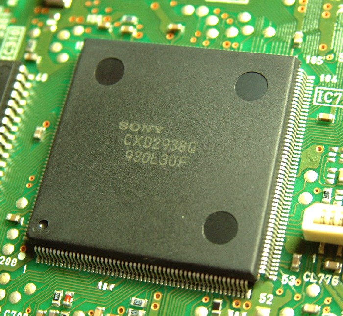
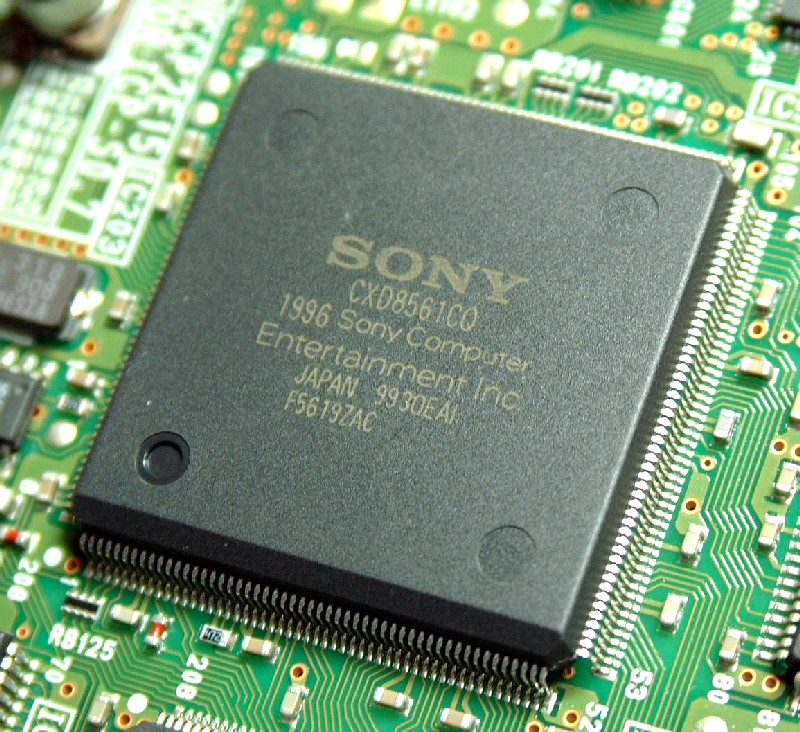
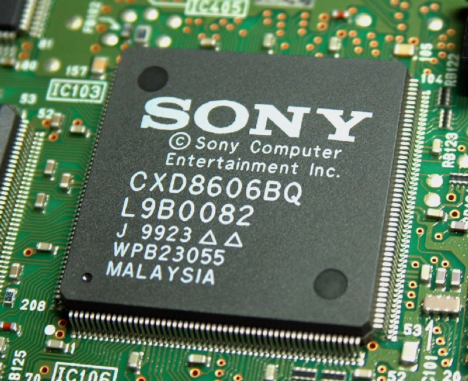

20年前の今日、2006年11月11日。ソニー・コンピュータエンタテインメントの家庭用ゲーム機「PlayStation 3（PS3）」が、世界に先駆けて日本国内で発売されました。前代機であるPS2の大成功を受けて世界中から熱い視線が注がれる中、各地の家電量販店には未明から熱心なファンが長蛇の列を作りました。

## スーパーコンピュータを目指した次世代機の構想

PS3の構想は、PS2発売から間もない2001年3月にソニー・コンピュータエンタテインメント、東芝、アイビーエムの3社が超並列プロセッサの共同研究開発に合意したことから本格化しました。のちに「Cell Broadband Engine（Cell）」と呼ばれるこのプロセッサは、スーパーコンピュータ並みの処理能力を視野に入れて設計されたものでした。

2005年5月にアメリカで開催された展示会「E3」で機体の存在が公表され、開発を率いた久夛良木健氏は、従来のゲーム機の枠にとどまらないエンタテインメントに特化した家庭用スーパーコンピュータであると強調しました。

## ブルーレイと高精細映像への挑戦

PS3は当時の最先端技術を惜しみなく投入して設計されました。映像メディアには次世代光ディスク規格であるブルーレイディスクを採用し、フルハイビジョンの高精細解像度（1080p）や高品質な映像データ転送を可能にするHDMI端子を搭載しました。音響面でも7.1チャンネルサラウンドに対応するなど、家庭のテレビ環境が地上デジタル放送や高精細画面へと移行する時代の波を先取りした仕様となっていました。

さらに、初代プレイステーションおよびPS2用ディスクソフトとの互換性を持たせるため、初期モデルには過去機種の主要チップも組み込まれ、極めてぜいたくな設計が施されていました。

*2006年の資料 — 写真: No machine-readable author provided. Yaca2671 assumed (based / CC BY-SA 3.0*

## 初回出荷8万台と発売当日の熱気

しかし、ブルーレイディスクドライブなどの先端部品の調達や生産体制の整備に時間を要したことから、日本国内における初回出荷台数は約8万台程度と、事前の高い需要に対して極めて限られた数にとどまりました。

迎えた2006年11月11日の早朝、東京の秋葉原や有楽町をはじめとする全国の大手家電量販店の前には、前夜から冷え込みの中で順番を待つ大勢の人々が列を作りました。午前中の開店と同時に用意された在庫はあっという間に完売となり、手に入れた利用者が満面の笑みで箱を抱えて店を出ていく姿がニュースで大きく報じられました。

*2006年の資料 — 写真: No machine-readable author provided. Yaca2671 assumed (based / CC BY-SA 3.0*

## 苦難の船出から販売台数の伸長へ

華々しい発売を迎えたPS3でしたが、その後の道のりは平坦ではありませんでした。最先端技術を詰め込んだCellプロセッサの製造費用や下位互換チップの搭載により初期の本体価格が高騰したこと、さらに高性能ゆえにソフト開発の難度が高かったことから、初期の販売は伸び悩みました。

しかし、その後は生産体制が安定し、ハイビジョンテレビが一般家庭に広く普及するにつれて風向きが変わっていきました。本体設計の見直しによる価格改定や、国内外のソフトウェアメーカーによる魅力的なタイトルが揃ったことで、販売台数は着実に積み上がっていきました。

*2006年の資料 — 写真: No machine-readable author provided. Yaca2671 assumed (based / CC BY-SA 3.0*

## 7700万台を超えて歴史に刻まれた一台

2012年12月末時点において、PS3の世界累計出荷台数は7700万台を突破し、競合する家庭用ゲーム機としのぎを削りながら確固たる地位を築きました。オンラインネットワークサービス「PlayStation Network」やダウンロード店舗「PlayStation Store」の基盤を確立したことも、その後のゲーム産業に大きな影響を与えました。

発売から10年以上が経過した2017年3月、全モデルの出荷が完了し、事実上の生産終了を迎えました。高精細な映像体験とネットワーク時代の扉を開いたPS3の登場は、家庭用ゲーム機の歴史における重要な節目として今も語り継がれています。

### 参考資料

- <https://ja.wikipedia.org/wiki/11%E6%9C%8811%E6%97%A5>
- <https://commons.wikimedia.org/wiki/File:CD-ROM_for_PlayStation.jpg>
- <https://commons.wikimedia.org/wiki/File:CXD2938Q_02.JPG>
- <https://commons.wikimedia.org/wiki/File:CXD8561CQ_02.JPG>
- <https://commons.wikimedia.org/wiki/File:CXD8606BQ_02.JPG>
