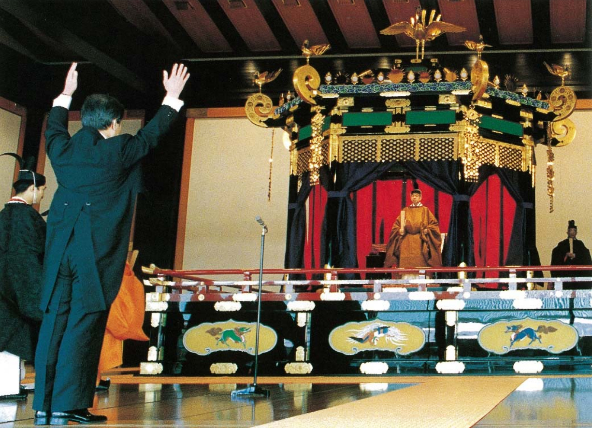
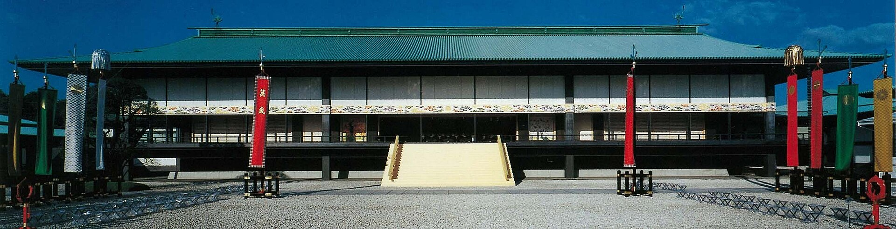
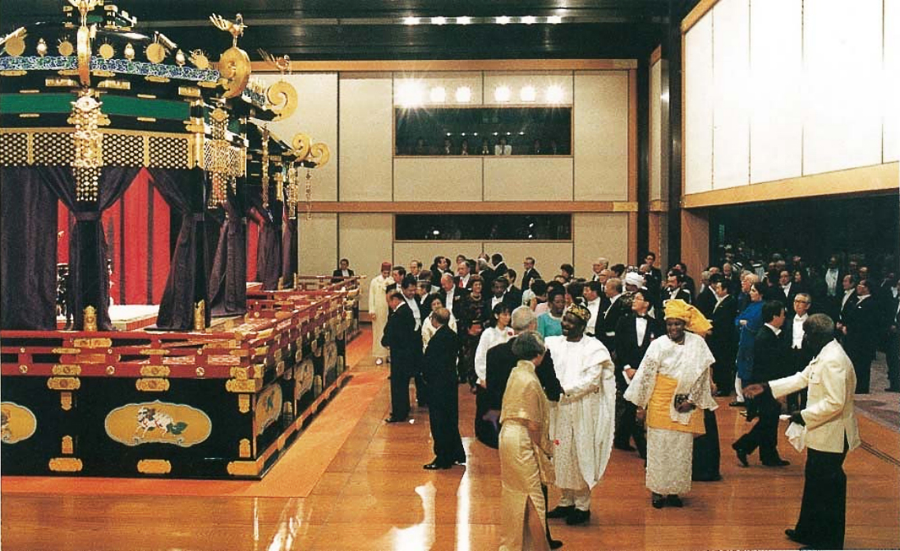

36年前の今日、1990年11月12日。第125代天皇の即位を国の内外に宣言する「即位礼正殿の儀」が、東京の皇居宮殿・正殿松の間で執り行われました。
この日は法律によって特別な国民の休日とされ、日本中が新しい時代の節目を実感する一日となりました。諸外国の戴冠式にあたるこの儀礼が東京で行われたのは、日本の長い歴史の中でも初めての出来事でした。

## 「京都で行う」規定から東京での挙行へ

古来、即位の礼は大内裏の大極殿や、のちには京都御所の紫宸殿で行われてきました。明治時代に東京奠都が行われた後も、1889年に公布された旧皇室典範には「即位の礼と大嘗祭は京都で行う」と明記されていました。そのため、大正天皇や昭和天皇の即位の礼も京都へ行幸したうえで「即位礼紫宸殿の儀」として執り行われていたのです。

しかし、1947年に改正された皇室典範では、第24条に「皇位の継承があつたときは、即位の礼を行う」と定められるにとどまり、斎行場所についての規定はなくなりました。こうして平成の代替わりを迎えるにあたり、首都である東京の皇居宮殿で儀式を行うことが決まり、名称も「即位礼正殿の儀」に改められました。

京都御所紫宸殿に常設されている天皇の高御座と皇后の御帳台は、この儀式のために一度解体され、東京の皇居まで慎重に運ばれて正殿松の間に組み立てられました。

## 正殿松の間の儀礼と、史上初のテレビ生中継

11月12日の儀式当日は、皇居宮殿の中庭に文官や武官の装束をまとった職員が並び、色鮮やかな幡旗が立てられました。天皇は伝統的な束帯である黄櫨染御袍に立纓御冠を身につけ、皇后は白を基調とした唐衣裳装束をまとって儀式に臨まれました。皇族方もそれぞれの格式に応じた装束姿で参列しました。

鉦の合図とともに参列者が起立し、松の間に据えられた高御座と御帳台の帳が開かれます。この厳粛な瞬間は、NHKをはじめとする放送機関によって史上初めてテレビで生中継されました。かつては限られた参列者しか目にすることのできなかった古式ゆかしい儀礼の姿が、全国のお茶の間に直接届けられたのです。

天皇から即位にあたってのおことばが述べられた後、海部俊樹内閣総理大臣が高御座の前に進み出て、お祝いを述べる寿詞を奏上しました。続いて海部首相の発声により参列者全員で万歳三唱が行われ、北の丸公園からは自衛隊による21発の礼砲が東京の空に轟きました。

*1989年の資料 — 写真: Kantei (Prime Minister's Office), 首相官邸 / CC BY 4.0*

## 憲法と国民主権への配慮がもたらした変更点

平成の即位礼正殿の儀では、伝統を守る一方で、日本国憲法が定める国民主権の趣旨に合わせた大きな見直しも行われました。かつて京都で行われた儀式では、首相ら三権の長は中庭に並び、束帯姿で正面の階段を上って紫宸殿に登殿していました。

しかし平成の儀式では、三権の長は天皇と同じ正殿松の間の室内に侍立する形式へと改められました。また、装束についても和装束ではなく、燕尾服などの洋装礼服を着用することとされました。

中庭に面した正殿の正面には京都御所を模した18段の階段が設置されましたが、これらは実際には使用されず、伝統を象徴する装飾にとどめられました。さらに、国内外から集まる参列者が天皇皇后の姿を直接見ることができるよう動線が見直されるなど、新しい時代にふさわしい配慮が随所に施されました。

*事件当時の写真ではありません · 1990年 — 写真: 宮内庁（Imperial Household Agency） / CC BY 4.0*

## 激動の世界情勢のなか東京に集まった各国首脳

この儀式には、国内外から多数の要人が招かれました。国外からは国家元首級が70カ国、皇室や王室が20カ国、副大統領級が15カ国、首相級が20カ国、閣僚級が35カ国と、前例のない規模の海外賓客が東京に集結しました。

当時は東西ドイツが統一を果たし、ソ連も冷戦の終結に向けて大きく動いていた歴史の転換点でした。その一方で中東情勢の緊迫化が進むなど、世界が激しく揺れ動いていた時期でもありました。即位の礼に合わせて多くの首脳が来日したことで、東京は活発な国際外交の重要な舞台ともなったのです。

参列者の席は宮殿の中庭を取り囲む豊明殿や長和殿に設けられましたが、あまりの参列者の多さに席が収まりきらず、一部の客席は中庭にせり出すように増設されるほどでした。

*事件当時の写真ではありません · 1990年 — 写真: 首相官邸, Prime Minister's Office / CC BY 4.0*

## 平成から令和へ引き継がれた儀式の伝統

東京の皇居で初めて行われた1990年の即位礼正殿の儀は、皇室の古い伝統と現代の憲法精神との調和を模索しながら作り上げられた重要な先例となりました。

このとき確立された式次第や装束、高御座を京都から東京へ運んで設営する手順などは、およそ30年後の2019年、令和の代替わりにおける即位礼正殿の儀でも基本的にそのまま踏襲されることになります。

36年前のこの日、テレビの画面を通じて全国に伝えられた高御座の開帳と万歳三唱の響きは、昭和という時代が終わり、平成という新たな時代が本格的に始まったことを日本中、そして世界中に鮮烈に印象づけました。

### 参考資料

- <https://ja.wikipedia.org/wiki/%E7%9A%87%E5%B1%85>
- <https://commons.wikimedia.org/wiki/File:Prins_Willem-Alexander_bij_de_inhuldiging_van_de_keizer_van_Japan_(cropped).jpg>
- <https://commons.wikimedia.org/wiki/File:Ceremony_of_Enthronement3.jpg>
- <https://commons.wikimedia.org/wiki/File:K%C5%8Dkyo_Seiden.jpg>
- <https://commons.wikimedia.org/wiki/File:Ceremony_of_Enthronement2.jpg>
