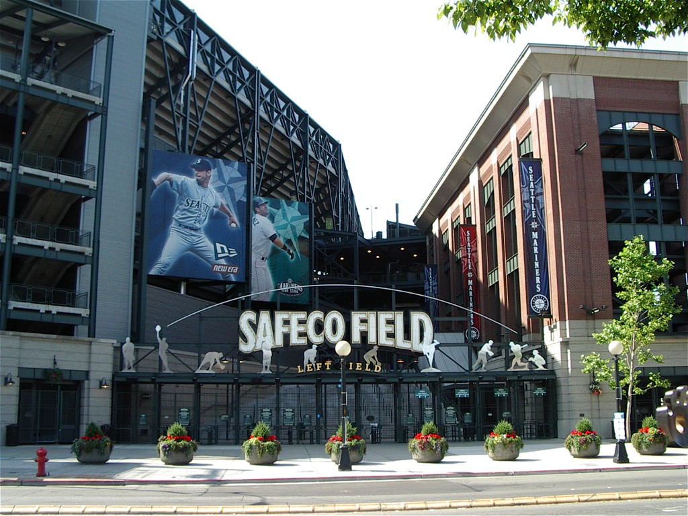
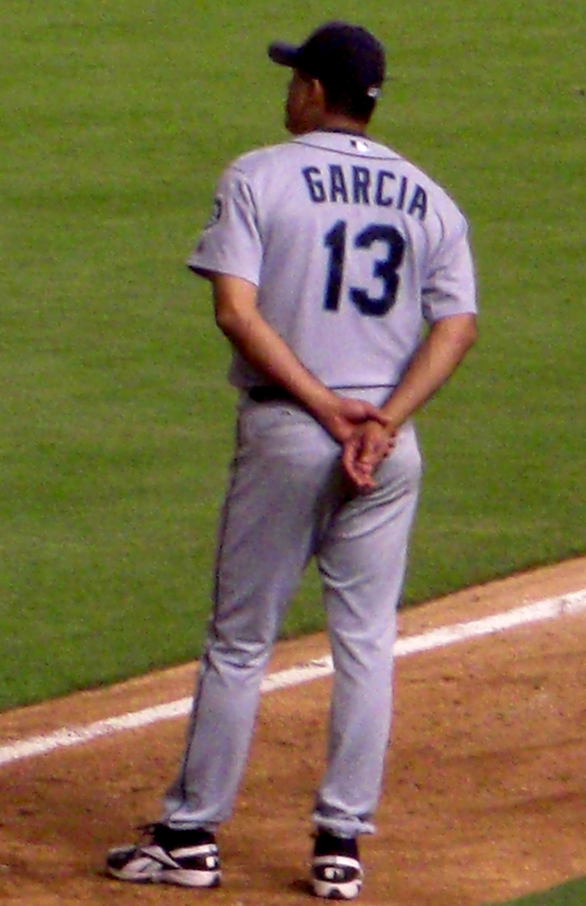
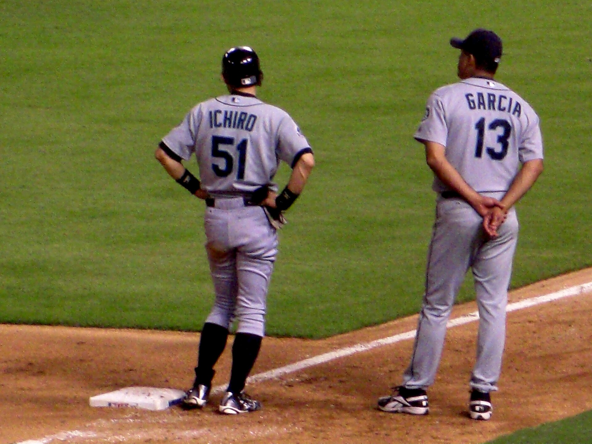

25年前の今日、2001年11月12日。アメリカの大リーグ・アメリカンリーグで、シアトル・マリナーズのイチロー（本名・鈴木一朗）選手が新人王に選出されました。

日本人初の野手としてメジャーリーグへ挑戦した1年目、ヒットを量産して首位打者と盗塁王を獲得した大活躍が公式に讃えられた瞬間でした。さらにそのわずか8日後にはリーグ最優秀選手（MVP）にも輝き、日米両国の野球ファンを熱狂させました。

## ドラフト4位から日本球界の頂点へ

愛知県西春日井郡豊山町で育ったイチロー選手は、愛工大名電高校を経て1991年のドラフト会議でオリックス・ブルーウェーブから4位指名を受けて入団しました。細身の体格から当初はプロでの大成を疑問視する声もありましたが、二軍での猛練習を経て独自の「振り子打法」を作り上げます。

1994年、仰木彬監督のもとで登録名を「イチロー」に改めると才能が一気に開花しました。日本プロ野球史上初となるシーズン200安打（210安打）を達成し、当時のパ・リーグ新記録となる打率.385を残して首位打者を獲得します。そこから日本球界で前人未到の7年連続首位打者という大記録を打ち立てました。

## 海を渡った日本人野手パイオニア

2000年のシーズン終了後、イチロー選手はポスティングシステムを利用してシアトル・マリナーズへの移籍を決断しました。それまで野茂英雄投手ら日本人投手がメジャーで活躍していましたが、日本人野手の挑戦は史上初のことでした。

アメリカのメディアやファンの中には、パワー全盛期の大リーグで細身のアジア人打者が通用するのかと懐疑的な見方もありました。しかし背番号51のマリナーズでのデビューは、そうした懸念を一瞬で払拭することになります。

*Seattle Safeco Field 01 — 写真: Mikano / CC BY-SA 3.0*

## 新人記録を塗り替えた2001年の大活躍

大リーグ1年目の2001年、イチロー選手は開幕から快音を響かせ続けました。類い稀なバットコントロールと俊足、そして強肩を生かした守備でチームを牽引し、マリナーズの地区優勝とシーズン116勝タイ記録に大きく貢献します。

残した成績は驚異的なものでした。放った安打は242本に達し、大リーグの新人最多安打記録を樹立しました。打率.350もアメリカンリーグの新人最高打率記録となり、見事に首位打者と盗塁王のタイトルを獲得したのです。さらに守備面でもゴールドグラブ賞、打撃面でシルバースラッガー賞を受賞しました。

*Carlos Garcia (cropped) — 写真: Rich Anderson / CC BY-SA 2.0*

## 11月12日の新人王、そして史上2人目のMVPへ

シーズン終了後の2001年11月12日、イチロー選手はアジア人の打者として初めてアメリカンリーグの新人王に選ばれました。日本人としては野茂英雄投手、佐々木主浩投手に続く3人目の栄誉でした。

歓喜はこれだけで終わりませんでした。8日後の11月20日、全米が注目する中で発表されたアメリカンリーグのシーズンMVPにもイチロー選手の名前が呼ばれました。アジア人選手として史上初となるMVPの受賞でした。MLBの長い歴史においても、同じシーズンに新人王とMVPを同時に獲得したのは1975年のフレッド・リン選手以来、イチロー選手が史上2人目という歴史的快挙でした。

*Ichiro and Garcia — 写真: Rich Anderson / CC BY-SA 2.0*

## 今も燦然と輝く世界の安打記録

イチロー選手の伝説は、このルーキーイヤーにとどまりませんでした。2004年にはシーズン262安打を放ち、メジャーの歴代記録を84年ぶりに塗り替えました。大リーグ史上唯一となる10年連続200安打以上を達成し、メジャー通算3000安打と500盗塁も達成しています。

日本とアメリカの一軍公式戦を合わせた通算安打数は4367本に達し、ギネス世界記録に認定されました。マリナーズでは背番号51が永久欠番となり、2025年にはアジア人選手として初めてアメリカ野球殿堂入りを果たしました。あの日、2001年11月12日に刻まれた新人王の栄光は、今も世界中の野球ファンの心に鮮やかに残っています。

### 参考資料

- <https://ja.wikipedia.org/wiki/%E3%82%A4%E3%83%81%E3%83%AD%E3%83%BC>
- <https://commons.wikimedia.org/wiki/File:Ichiro_Suzuki_Apr_20_2001.jpg>
- <https://commons.wikimedia.org/wiki/File:Seattle_Safeco_Field_01.jpg>
- <https://commons.wikimedia.org/wiki/File:Carlos_Garcia_(cropped).jpg>
- <https://commons.wikimedia.org/wiki/File:Ichiro_and_Garcia.jpg>
