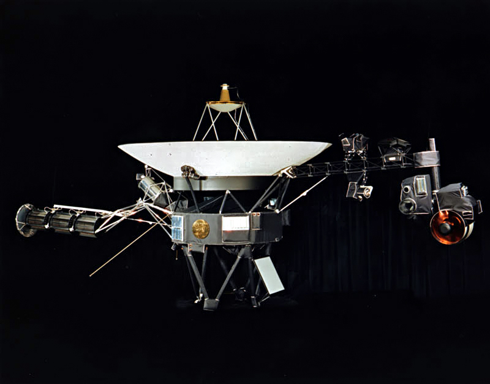
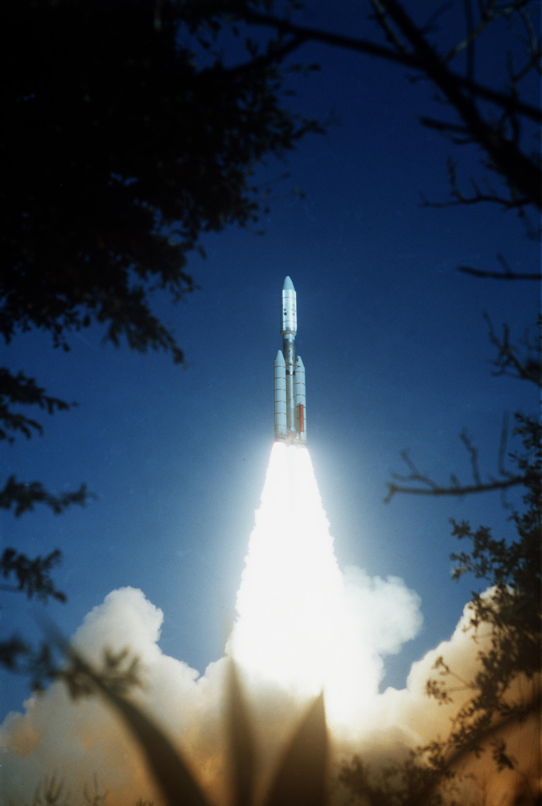
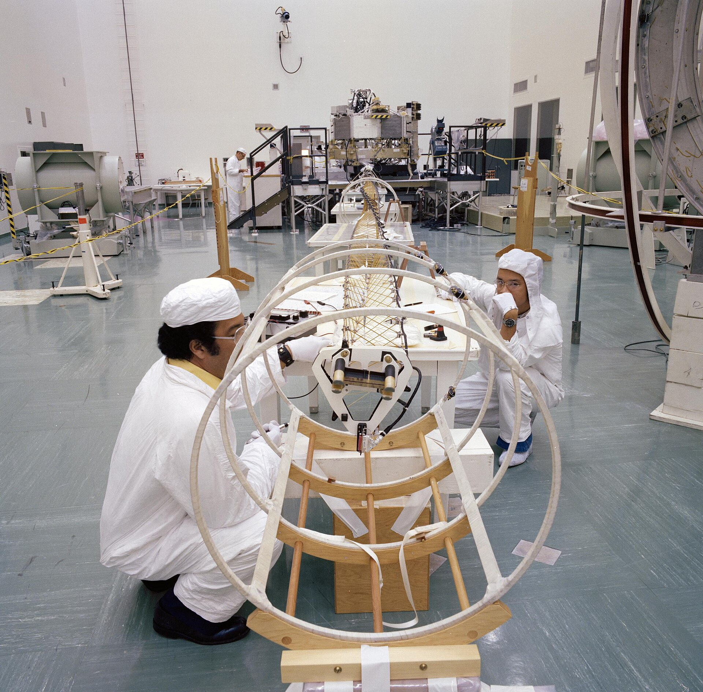

46年前の今日、1980年11月12日。アメリカ航空宇宙局（NASA）の無人惑星探査機「ボイジャー1号」が、土星に最接近しました。地球から遥か遠く離れた巨大ガス惑星の環や衛星を、かつてない至近距離から克明に捉えた歴史的な瞬間でした。

## 惑星グランドツアー構想と緊迫の打ち上げ

ボイジャー計画の原点は、惑星の配置がほぼ同じ方向に集中する好機を捉え、巨大惑星を連続して巡る「惑星グランドツアー」構想にありました。ボイジャー1号は1977年9月5日、フロリダ州のケープカナベラル空軍基地からタイタンIIIEセントールロケットで打ち上げられました。姉妹機であるボイジャー2号の打ち上げから16日後の出発でした。打ち上げ時にはロケット第2段が予定より約1秒早く燃焼終了するトラブルがありましたが、上段のセントールステージが補い、無事に木星や土星へと向かう高速軌道に乗りました。機体には、未知の生命体へ向けたメッセージを刻んだ「ゴールデンレコード」も積み込まれていました。

## 木星での大発見を経て土星へ向回

高速軌道を進んだボイジャー1号は、先に打ち上げられた2号を追い抜き、1979年3月5日に木星中心から34万9000キロまで最接近しました。最接近前後の48時間で集中的な観測を行い、衛星イオにおける活発な火山活動を発見するなど、天文学の常識を覆す成果を挙げました。木星の重力を利用して加速する重力アシスト（スイングバイ）に成功した機体は、次なる目的地である土星へと針路を向けました。

*1977年の資料 — 写真: NASA/JPL-Caltech / Public domain*

## 1980年11月12日、土星表面から12万4000キロの接近

そして1980年11月12日、ボイジャー1号は土星表面から12万4000キロ以内にまで接近しました。地球からは望遠鏡でしか見えなかった神秘的な環の姿が、鮮明な画像として次々と送られてきました。環は無数の氷の小片や岩石デブリ、宇宙塵で構成されており、複雑な無数の筋状構造を持つことが判明しました。さらに、土星大気には時速1800キロに達する猛烈な東風が吹いていることや、北極を取り囲む一辺約1万3800キロの巨大な六角形の雲の構造など、驚くべき気象現象が次々に明らかになったのです。

*1977年の資料 — 写真: NASA/JPL / Public domain*

## 冥王星ではなく衛星タイタンを選んだ決断

土星接近にあたり、地上の管制チームには大きな選択肢がありました。それは、土星探査のあとに冥王星へ向かう航路をとるか、それとも土星最大の衛星タイタンを精密に観測するかという岐路でした。1978年に冥王星の衛星カロンが見つかったことで冥王星の質量が判明し、一方でタイタンには濃い大気が存在することが確実視されていました。研究者たちは長期運用のリスクを考慮し、タイタンへの最接近を優先することに決めました。タイタンの重力アシストを受けたボイジャー1号は、冥王星には向かわず、太陽系の黄道面を離脱して宇宙の彼方へと飛び出すことになりました。

*1977年の資料 — 写真: NASA/JPL / Public domain*

## 古代からの呼び名と人類の知的好奇心

日本をはじめ東アジアでは、古代中国の五行説において五惑星に「土徳」が配当されたことから、この第6惑星を古くから「土星」と呼んできました。肉眼では淡い光を放つ星として見上げられていた天体に、人類の手で作られた探査機が到達し、その精緻な環の姿を暴いたのです。1990年2月14日には、太陽系を振り返りながら地球を捉えた「ペイル・ブルー・ドット」を含む連続写真を撮影し、人類の故郷の小ささを静かに教えてくれました。

## 太陽系を脱出し、星間空間を飛び続ける現在

惑星科学の任務を終えたボイジャー1号は、太陽圏の境界を目指しました。2004年12月に太陽風が急減速する末端衝撃波面を通過し、2012年8月25日には太陽圏を脱出して星間空間（恒星間空間）へと到達しました。電力を節約するために多くの観測装置を停止させながらも、磁力計などの一部機器で観測を続けています。2017年には軌道制御用エンジンを37年ぶりに作動させることにも成功しました。打ち上げから長い年月を経た今も、地球から最も遠い人工物として、秒速16.9キロで未知の深宇宙を航行し続けています。

### 参考資料

- <https://ja.wikipedia.org/wiki/%E3%83%9C%E3%82%A4%E3%82%B8%E3%83%A3%E3%83%BC1%E5%8F%B7>
- <https://commons.wikimedia.org/wiki/File:The_Sounds_of_Earth_Record_Cover_-_GPN-2000-001978.jpg>
- <https://commons.wikimedia.org/wiki/File:Voyager.jpg>
- <https://commons.wikimedia.org/wiki/File:PIA01480_Voyager2Launch-NASA.jpg>
- <https://commons.wikimedia.org/wiki/File:Deployed_magnetometer_boom_of_one_of_NASA%27s_Voyager_PIA21738.jpg>
