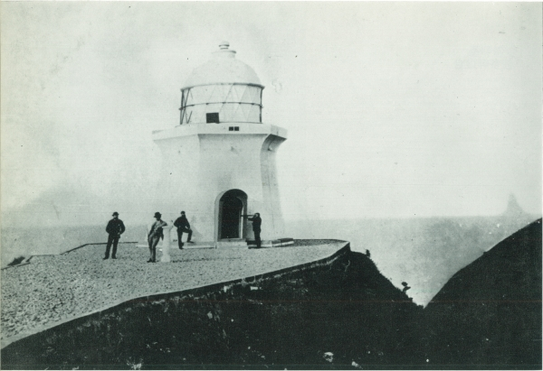
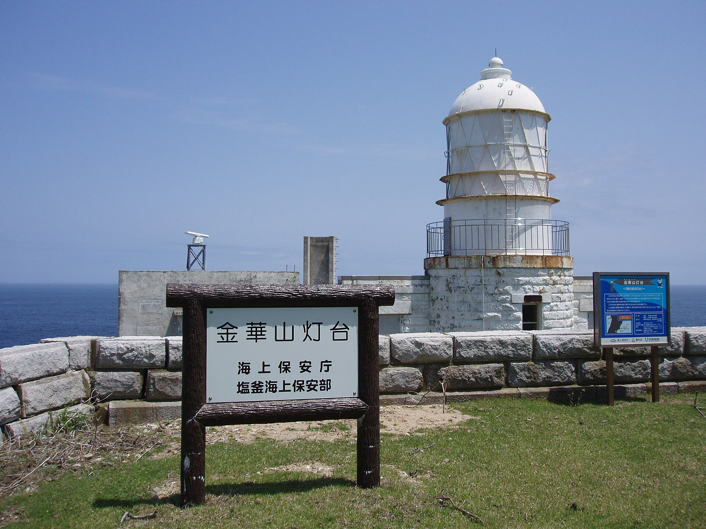
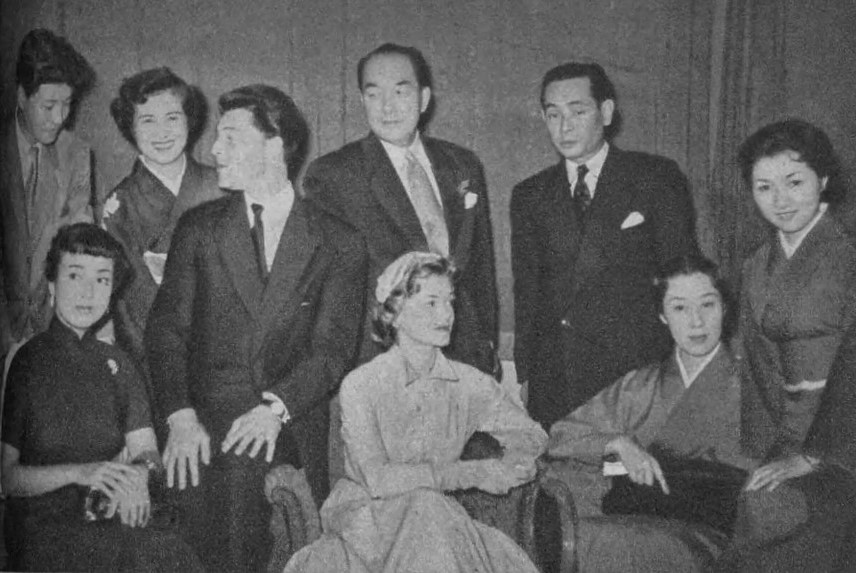

20年前の今日、2006年11月12日。日本で最後の有人灯台だった長崎県男女群島の女島灯台が自動化され、国内から「灯台守」の姿が消えることになりました。翌月12月5日にはすべての残務処理が終了して無人化され、明治の近代化とともに始まった灯台守という存在は、名実ともに歴史の1ページとなりました。

## 近代日本の海を拓いた灯台守の歴史

日本の近代的な灯台守の歴史は、幕末から明治初期に遡ります。イギリス公使ハリー・パークスらの働きかけを受け、江戸幕府から明治政府へと引き継がれた条約に基づき、スコットランドから技師のリチャード・ヘンリー・ブラントンが招かれました。ブラントンは全国各地に26基の洋式灯台を建設し、スコットランドの制度に倣った灯台守の仕組みを日本に整えました。

戦前は逓信省灯台局などが管理し、第二次世界大戦中には米英など連合国軍の攻撃を受けながら任務を全うし、殉職した灯台守もいました。戦後は海上保安庁がその業務を引き継ぎ、全国各地の岬や孤島に職員が常駐して、船の航行を見守り続けました。

## 絶海の要衝、男女群島と女島灯台の誕生

女島灯台が位置する男女群島は、長崎県五島列島の福江島から南西へ約80キロメートル離れた東シナ海に浮かぶ孤島群です。古代には遣唐使船が南路を取る際の目印とされた航海の要所であり、荒波に洗われる断崖絶壁に囲まれています。

この難所に灯台を築く工事は1925年6月2日に着工しました。港も道もない険しい島で、船着場や道路の切り拓きから資材の運搬に至るまで、すべてが人力で行われました。当時の金額で約15万円の巨費を投じ、1927年7月8日に完工、同年12月1日に初点灯を迎えました。屏風ヶ浦と呼ばれる高さ100メートルあまりの断崖絶壁の上に立つ白亜の灯塔は、「日本の灯台50選」にも選ばれる名灯台となりました。

*1st Iojima Lighthouse — 写真: Unknown authorUnknown author / Public domain*

## 風雨と孤立に耐えた過酷な勤務

女島灯台には点灯当初から職員が常駐し、1927年12月には日本の灯台で初となる公衆電報取扱の電信局が開設されました。1941年10月には無線方位信号所、1956年6月には船舶気象通報業務が加わり、孤島における重要任務は年を追うごとに増していきました。

しかし、海が荒れれば船の接岸は困難を極め、孤立無援の生活を強いられる過酷な環境でした。1982年11月29日には、灯台守の交代要員を運んでいた海上保安庁のヘリコプターが男島山頂付近に墜落し、3名が命を落とし、6名が負傷する痛ましい事故が発生しました。さらに1997年には、中国からの違法操業漁船によって島に上陸した密入国者と海上保安官が直接対峙し、検挙にあたる緊迫した事件も起きています。

*Kinkasan Lighthouse Miyagi Japan — 写真: SEKIUCHI (my own work) / CC BY-SA 2.1 jp*

## 『喜びも悲しみも幾歳月』が伝えた生き方

かつての灯台守は、家族を伴って全国各地の辺ぴな岬や孤島を数年ごとに転勤して歩く生活を送っていました。その過酷でありながら誇り高い日常を描いたのが、1957年に公開された木下惠介監督の名作映画『喜びも悲しみも幾歳月』です。女島灯台もまた、その物語の舞台の一つとして描かれました。

電気や通信の発達、自動電球交換機や遠隔監視システムの導入によって、1960年代以降、全国の灯台は次々と無人化されていきました。かつて数百人規模で存在していた灯台職員の定住拠点は次々に役目を終え、21世紀に入ったときには、女島灯台だけが日本でただ一箇所、生身の人間が交代で守り続ける最後の灯台となっていたのです。

*Eiga-Hyoron-1953-December-2 — 写真: Unknown photographer / Public domain*

## 2006年11月12日、最後の一歩と今に残るもの

2006年11月12日、女島灯台の自動化工事が完了し、機器による遠隔制御へと切り替えられました。職員たちは機器の作動を確認し、残務処理を終えた12月5日、ついに島を離れました。この瞬間、日本国内の有人灯台はゼロとなり、「灯台守」という職業は日本の海から完全に消滅しました。

無人化された現在も、女島灯台の明かりは東シナ海を航行する船舶の進路を照らし続けています。かつて灯台守たちが風を読み、海を見つめて記録していた気象観測データは、自動観測装置によって今も気象庁へと送られ、日々の天気予報や海上警報に活かされています。人の温もりによって守られていた時代の記憶は、今も孤島の断崖の上に生き続けています。

### 参考資料

- <https://ja.wikipedia.org/wiki/11%E6%9C%8812%E6%97%A5>
- <https://commons.wikimedia.org/wiki/File:Brunton_lighthouse_at_Tsunoshima.jpg>
- <https://commons.wikimedia.org/wiki/File:1st_Iojima_Lighthouse.jpg>
- <https://commons.wikimedia.org/wiki/File:Kinkasan_Lighthouse_Miyagi_Japan.jpg>
- <https://commons.wikimedia.org/wiki/File:Eiga-Hyoron-1953-December-2.jpg>
