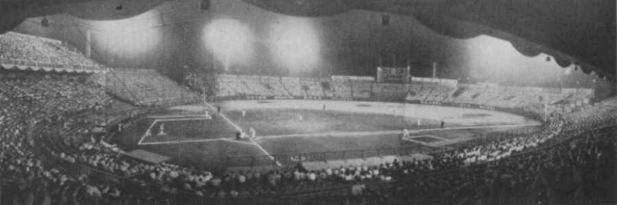
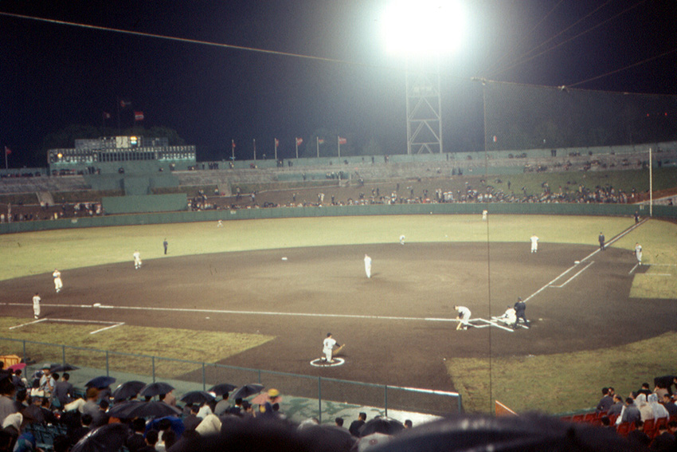
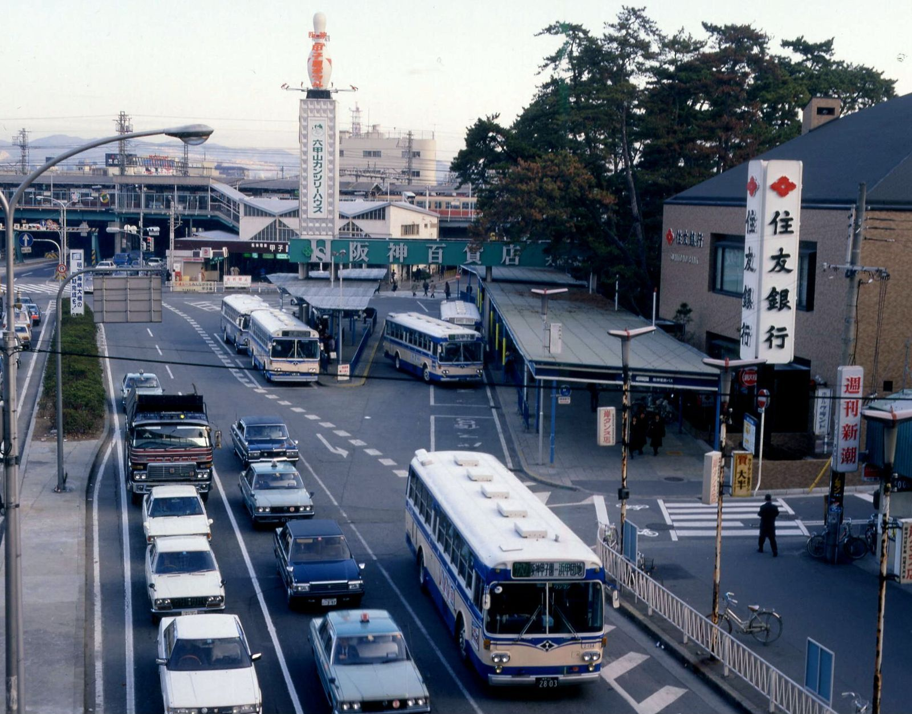

39年前の今日、1987年11月12日。読売ジャイアンツのエースとして活躍した江川卓投手が、32歳の若さで現役引退を発表しました。通算135勝を挙げ、数々の伝説を残した「昭和の怪物」の突然の幕引きは、球界とファンに大きな衝撃を与えました。

## 天竜川で鍛えられた肩と高校時代の怪物伝説

福島県いわき市に生まれた江川投手は、幼少期を静岡県で過ごしました。小学生のころ、天竜川へ石を投げたところ大人の飛距離と遜色なく対岸まで届き、日課として石を遠投したことで強い地肩が鍛えられました。栃木県の作新学院高校に進学すると、その剛腕は日本中を震撼させます。

高校在学中の公式戦でノーヒットノーランを9回、完全試合を2回達成。36イニング連続無安打無失点という驚異的な記録を残しました。自身が「ボールが浮く感覚を持った」と語る快速球と、縦に大きく割れるカーブを武器に、相手打者を全く寄せ付けない投球を披露しました。

## 甲子園を席巻した1973年センバツの衝撃

1973年春の第45回選抜高等学校野球大会は、まさに「江川のための大会」となりました。初戦の相手は強打を誇る大阪の北陽高校でしたが、江川投手は1回から打者にバットを一度もかすらせず3者連続三振を奪うなど、19奪三振完封勝ちという鮮烈な甲子園デビューを飾ります。

続く小倉南高校を退け、準々決勝の今治西高校戦では8者連続奪三振を含む毎回20奪三振で1安打完封。この大会で奪った通算60個の奪三振記録は、今なおセンバツ史上最多記録として残っています。甲子園球場周辺には江川投手を一目見ようと数千人の群衆が集まり、警察が出動するほどの大フィーバーとなりました。

*事件当時の写真ではありません · 1950年 — 写真: 若松不二夫 / Public domain*

## 騒動の末のプロ入りと1981年の投手五冠王

法政大学を経て、ドラフトをめぐる大きな騒動の末に1979年に読売ジャイアンツへ入団。逆風の中でのスタートとなりましたが、マウンド上で実力を証明していきます。入団2年目の1980年から引退する1987年まで、毎年欠かさず2桁勝利を記録しました。

特に1981年には20勝6敗、防御率2.28、221奪三振の好成績を収め、最多勝、最優秀防御率、最多奪三振、最高勝率、最多完封の投手五冠王を達成。読売ジャイアンツを日本一へと導き、セ・リーグの最優秀選手（MVP）に選出されるなど、名実ともに日本球界のエースとなりました。

*Tokyo - Baseball (3410369438) — 写真: Roger W / CC BY-SA 2.0*

## ファンを魅了した真っ向勝負と8者連続奪三振

江川投手の真骨頂は、強打者との真っ向勝負にありました。1984年のオールスターゲーム第3戦では、江夏豊さんの持つ9者連続奪三振に迫る8者連続奪三振を記録し、全国の野球ファンを沸かせました。

また、1985年に阪神タイガースのランディ・バース選手が王貞治さんの持つシーズン55本塁打の記録に迫っていた際、チーム方針としての敬遠策が囁かれる中でも正々堂々と勝負を挑みました。翌1986年にもバース選手に7試合連続本塁打となる一発を浴びるなど、いかなる場面でも逃げずに立ち向かうフェアプレーの姿勢は、多くの人々から称賛を受けました。

*阪神電鉄甲子園駅前 : バス停留所と枝川名残の松 — 写真: 西宮市 : ニシノミヤシ / CC BY (Japan Search)*

## 32歳での引き際と今なお語り継がれる記憶

しかし、長年投げ続けてきた右腕には限界が近づいていました。肩の故障に悩まされ、1987年11月12日、32歳という若さで現役引退を発表。プロ生活9年間で通算266試合に登板、135勝72敗3セーブ、1366奪三振、防御率3.02という堂々たる数字を残してマウンドを降りました。

引退後は野球解説者として、明快で深みのある解説でファンを楽しませ続けています。高校時代から日本中を熱狂させ、太く短いプロ野球人生を駆け抜けた江川卓投手。あの電撃引退のニュースが流れた日の衝撃は、今も多くの人々の記憶に刻まれています。

### 参考資料

- <https://ja.wikipedia.org/wiki/%E6%B1%9F%E5%B7%9D%E5%8D%93_(%E9%87%8E%E7%90%83)>
- <https://commons.wikimedia.org/wiki/File:Korakuen_stadium_aerial_photograph_1984.jpg>
- <https://commons.wikimedia.org/wiki/File:Korakuen_Stadium_Nighter_1951.jpg>
- <https://commons.wikimedia.org/wiki/File:Tokyo_-_Baseball_(3410369438).jpg>
- <https://adeac.jp/nishinomiya-city/catalog/0100000559>
