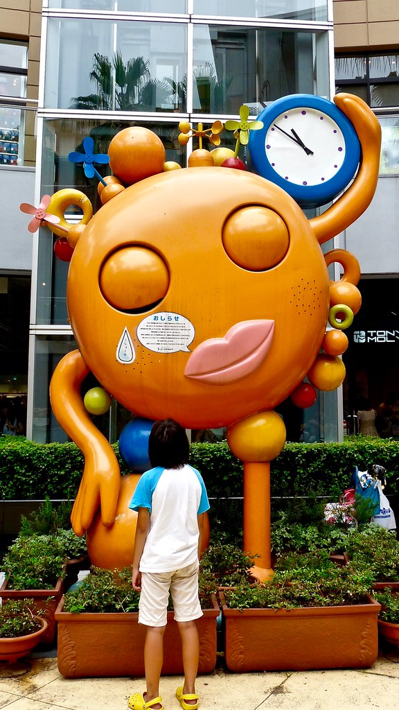
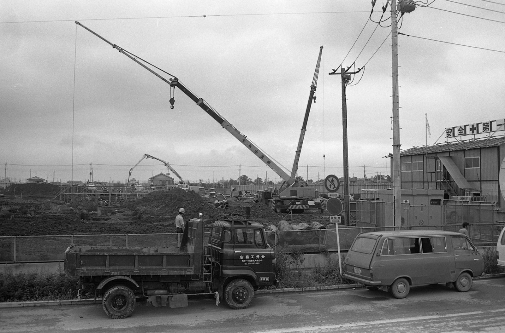
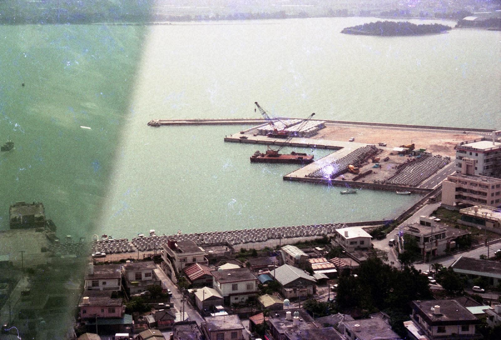

44年前の今日、1982年11月12日。日本の3代目南極観測船「しらせ」が就役しました。初代「宗谷」、2代目「ふじ」の歴史を受け継ぎ、昭和に建造された自衛艦として最大級の船体を誇ったこの巨艦は、四半世紀にわたって南極の厳しい自然と対峙し続けました。

## 宗谷とふじに続く大型砕氷艦の誕生

日本の南極地域観測は1956年に始まりました。当初は第二次世界大戦を生き抜いた灯台補給船「宗谷」が使われ、1965年からは本格的な砕氷艦として2代目「ふじ」が就役しました。しかし観測の進展とともに運ぶべき物資や観測機器の量は増え続け、ふじの老朽化も進んだことから、さらに強力な砕氷能力と輸送力を備えた後継艦の建造が文部省と防衛庁により進められました。

## 公募15位から「白瀬氷河」へ——船名決定の舞台裏

新砕氷艦の建造計画が進む中、1980年に船名の一般公募が行われました。集まった応募数は62275通に達し、1位は「さくら」、2位は「やまと」、3位は「しょうわ」と続き、「しらせ」は15位にとどまっていました。2位のやまとは戦艦大和の印象が強く砕氷艦にふさわしくないとされ候補から外れました。選考委員会では明治の探検隊長・白瀬矗中尉にちなむ「白瀬」が浮上しましたが、当時の海上幕僚監部の通達では砕氷艦の名称は「主として山の名」と規定されており、人名を直接つけることはできませんでした。そこで昭和基地近くにある「白瀬氷河」に着目し、通達を「主として山又は氷河の名」へと改正することで、「白瀬氷河」を由来とする「しらせ」の命名が実現したのです。

*Automaton Clock 時計 Karakuri-chan からくりちゃん in the LaLaport TOKYO-BAY Shopping Centre in Funabashi (Chiba) Japan — 写真: Arjan Richter / CC BY 2.0*

## 氷厚1.5メートルを砕く圧倒的な性能

就役したしらせは、自衛艦として初めて基準排水量1万トンを超え、昭和時代に建造された自衛艦の中で最大の規模を誇りました。ディーゼルエンジン6基による電気推進方式を採用し、軸出力は30,000馬力に達しました。3ノットの速度で厚さ1.5メートルの定着氷を連続して砕いて前進できる性能を持ち、それ以上の厚い氷に対しては200メートルから300メートル船体を後退させ、最大出力で突進して船体を氷に乗り上げて割る「ラミング（チャージング）」を行いました。船体後部には大型ヘリコプター用の飛行甲板と格納庫を備え、物資や人員の安全な空輸も可能にしました。

*(仮称)千間台小学校建築風景 — 写真: ndl / CC BY (Japan Search)*

## 36,650回の体当たりと傾斜53度の激動航海

1983年の第25次観測隊から2008年の第49次隊まで、しらせは計25回にわたり南極観測の輸送支援に従事しました。この間の行動日数は3,803日、総航程は1,006,562キロメートルに達し、輸送人員は1,498人、物資は約23,900トンにのぼりました。過酷な南極海でのラミング回数は通算36,650回を数えました。砕氷艦特有の丸みを帯びた船底を持ち、横揺れを抑えるフィン（ビルジキール）がないため、外洋では猛烈な揺れに見舞われることでも知られていました。2001年の航海では暴風圏を航行中に左へ53度、右へ41度傾く記録を残し、これは今なお海上自衛隊の動揺記録として語り継がれています。

*佐敷町空撮写真 — 写真: 南城市教育委員会 / CC BY (Japan Search)*

## 解体の危機から船橋での第二の人生へ

後継艦となる2代目「しらせ」にバトンを渡すため、2008年7月に初代しらせは退役しました。巨艦ゆえに維持費がかさむことから一時は解体処分が決定されましたが、保存を求める声が高まり、2009年に民間の気象情報会社ウェザーニューズへの売却が決定しました。船名はローマ字表記の「SHIRASE」に改められ、現在は千葉県船橋市の港に係留され、気象や環境問題の情報発信拠点として一般公開されています。毎年秋になるとオレンジ色の巨体が東京を出港し、春に帰還するニュースは、長きにわたり多くの人々に季節の訪れを伝えていました。

### 参考資料

- <https://ja.wikipedia.org/wiki/11%E6%9C%8812%E6%97%A5>
- <https://www.flickr.com/photos/36516818@N00/8714084144>
- <https://www.flickr.com/photos/42102924@N02/5014766405>
- <https://adeac.jp/koshigaya-city-digital-archives/catalog/mp185370-200020>
- <https://nanjo-archive.jp/document/?detail=28663&genre=6>
