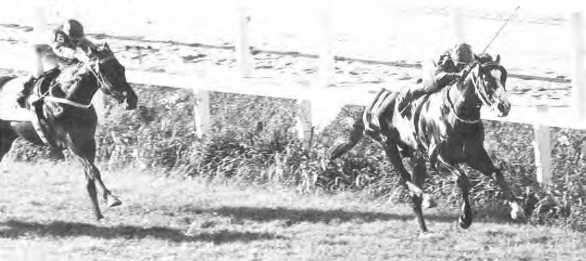
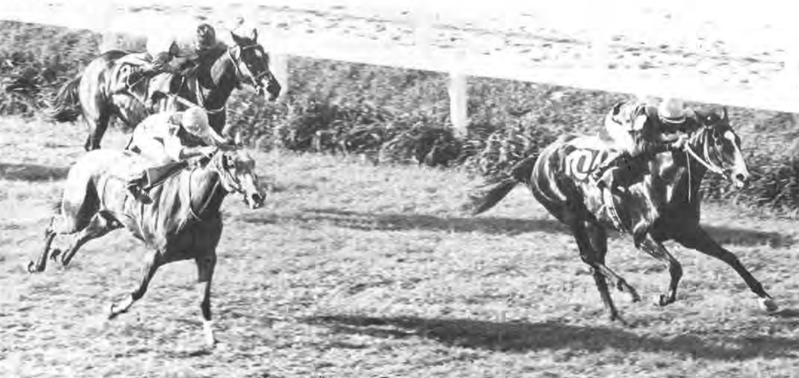
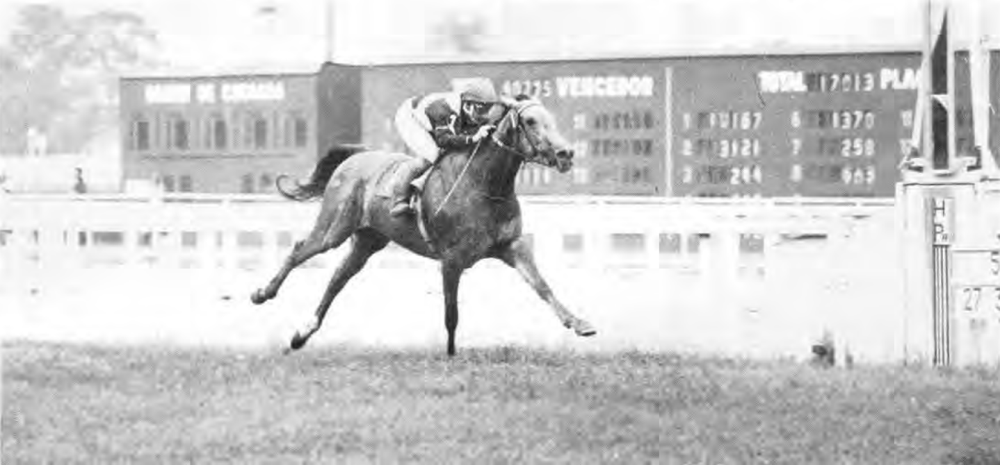

43年前の今日、1983年11月13日。秋深まる京都競馬場に集まった大観衆の視線は、ただ1頭の黒鹿毛の馬に注がれていました。クラシック三冠の最終関門、菊花賞。単勝1番人気に支持されたミスターシービーが、シンザン以来19年ぶりとなる史上3頭目の三冠馬に輝いた瞬間でした。

## 父内国産馬の誇りを背負って誕生

ミスターシービーは1980年4月、北海道浦河町の岡本牧場で誕生しました。父は「天馬」と称された快速馬トウショウボーイ、母も重賞3勝の実力馬シービークインという血統でした。母の所有者である千明牧場によって育成され、美浦トレーニングセンターの松山康久厩舎に入厩します。馬名は千明牧場（Chigira Bokujou）の頭文字を取り、牧場を代表する馬になってほしいという願いが込められていました。

当時、日本の競馬界では外国産種牡馬の産駒が主流を占めており、日本生まれの種牡馬の仔が頂点を極めることは極めて困難とされていました。しかしシービーは父の優れた筋肉と柔軟な骨格を受け継ぎ、デビュー前から大きな期待を集めていたのです。

## 最後方から全馬を抜き去る破天荒な春二冠

1982年11月のデビュー戦から手綱を握り続けたのは吉永正人騎手でした。2戦目以降、ゲートの出遅れ癖が見られたシービーでしたが、陣営はその豪快な末脚を信じ、無理に前へ行かせず後方で待機する追い込み戦法を選択します。

翌1983年4月、クラシック初戦の皐月賞は雨の不良馬場となりました。先行有利とされるぬかるんだコースで、シービーは後方16番手から徐々に進出し、大外を豪快に回して一気に突き抜けて一冠目を獲得しました。続く日本ダービーでも出遅れて17番手からの競馬となりましたが、向正面から鋭く進出。最終コーナーで他馬と接触する不利を乗り越えて先頭に立ち、二冠を達成しました。その劇的な勝ちっぷりは、多くの人々を熱狂させました。

*Despacito GP Presidente de la República — 写真: https://abcpcc.com.br/gerenciador/arquivos/1/revista-turf-e- / Public domain*

## 菊花賞のタブーを破った「淀の坂」での奇襲

二冠を制したシービーの前に立ちはだかったのが、菊花賞の舞台である京都競馬場・芝3000メートルの長丁場でした。短距離から中距離で強さを発揮した父トウショウボーイの血統から、長距離に対するスタミナ不安を唱える声も少なくありませんでした。

レース当日、シービーは道中最後方を進みました。京都外回りコースの第3コーナーには名物の高低差のある坂があり、「ゆっくり上り、ゆっくり下る」のが長距離戦の鉄則とされていました。下り坂でスピードを上げると直線で息が持たなくなるため、途中で仕掛けるのは御法度だったのです。

しかし2周目の上り坂に差しかかったとき、シービー自身が前へ行きたがる素振りを見せました。吉永騎手は無理に抑えず手綱を緩めると、シービーは坂を下りながらグングンと加速。最終コーナーを曲がり終える前に先頭に立つという、前代未聞のレース運びを演じたのです。

*Dourness GP OSAF — 写真: https://abcpcc.com.br/gerenciador/arquivos/1/revista-turf-e- / Public domain*

## どよめくスタンド、そして19年ぶりの戴冠

常識外れの早仕掛けに、京都競馬場のスタンドからは悲鳴とも歓声ともつかない大きなどよめきが沸き起こりました。テレビの中継アナウンサーも「坂の下りで先頭に立った」と驚きの声を上げました。

そのまま直線に入ったシービーは、スタミナが切れるどころか堂々と後続を突き放し、先頭のままゴール板を駆け抜けました。1964年にシンザンが打ち立てて以来、実に19年間誰も到達できなかったクラシック三冠の栄誉を、日本生まれの父母を持つ内国産馬として史上初めて手に入れた瞬間でした。レース後、吉永騎手は「ぼつぼつ行くつもりだったんだけど、シービーが全速力で行っちゃった。僕はただ捕まってるだけでしたよ」と語り、シービー自身の天衣無縫な走りを称えました。

*Anilité GP Henrique Possolo — 写真: https://abcpcc.com.br/gerenciador/arquivos/1/revista-turf-e- / Public domain*

## 今も心に生きる「ターフの演出家」

翌1984年には距離が2000メートルに短縮された天皇賞（秋）も最後方からの大外一気で制し、「四冠馬」となりました。その後、一世代下から現れたもう1頭の三冠馬シンボリルドルフとの激闘を経て1985年に引退。1986年には父トウショウボーイとともに史上初の父子顕彰馬に選定されています。

いつもファンをハラハラさせながら、最後には信じられない豪脚でねじ伏せる姿は「ターフの演出家」と呼ばれ、昭和競馬の黄金期を象徴するアイドルホースとして深く愛されました。京都の坂をものともせず風のように駆け抜けたあの日の衝撃は、今も色あせることなく語り継がれています。

### 参考資料

- <https://ja.wikipedia.org/wiki/%E3%83%9F%E3%82%B9%E3%82%BF%E3%83%BC%E3%82%B7%E3%83%BC%E3%83%93%E3%83%BC>
- <https://commons.wikimedia.org/wiki/File:Derek_GP_Latino.png>
- <https://commons.wikimedia.org/wiki/File:Despacito_GP_Presidente_de_la_Rep%C3%BAblica.png>
- <https://commons.wikimedia.org/wiki/File:Dourness_GP_OSAF.png>
- <https://commons.wikimedia.org/wiki/File:Anilit%C3%A9_GP_Henrique_Possolo.png>
