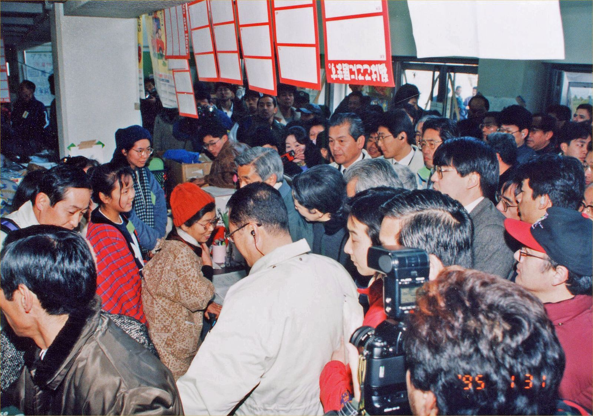
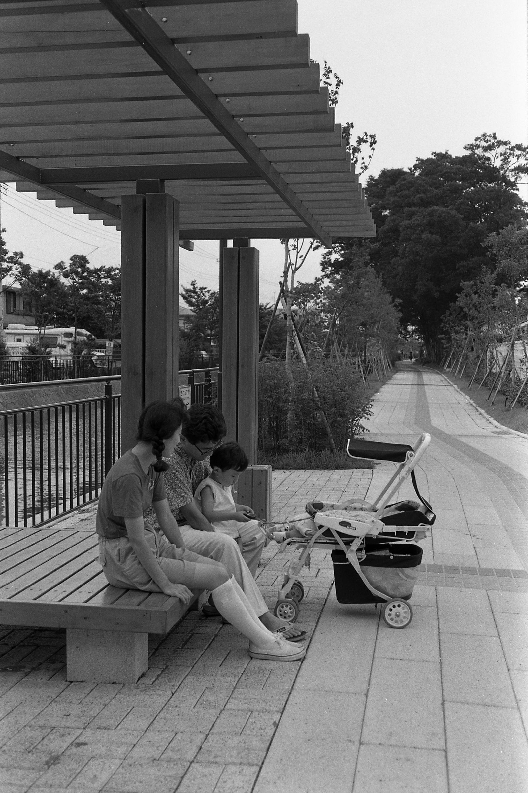
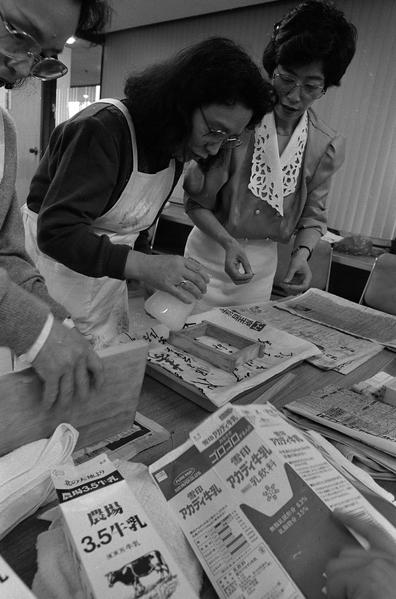

1998年11月13日、前年に経営破綻した北海道拓殖銀行が、すべての店舗で営業を終了しました。「拓銀さん」の愛称で親しまれ、北海道経済の大黒柱として君臨した名門都市銀行の窓口が閉ざされました。都市銀行の経営破綻は戦後初であり、現在に至るまで唯一の歴史的な金融危機でした。

## 「拓銀さん」と親しまれた道民銀行の歩み

北海道拓殖銀行は、1900年2月16日に北海道拓殖銀行法（拓銀法）に基づく特殊銀行として誕生しました。初代頭取には曽根静夫が就任し、資本金300万円、職員26名で、現在の北海道電力本社がある札幌市中央区大通東1丁目に本店を構えて発足しました。北海道の拓殖事業に長期・低利の資金を供給する国策銀行として、道内産業の基盤づくりを支えてきました。

戦後の1950年に拓銀法が廃止されると民間銀行として再出発し、1955年には都市銀行の仲間入りを果たしました。全国展開する都市銀行でありながら拓銀は北海道に根ざし、道内市町村の多くが指定金融機関とし、大多数の企業が口座を持ちました。「拓銀と取引がある」ことは大きな信用とステータスでした。ヒグマの「たくちゃん」や、サンリオの「みんなのたあ坊」の通帳は道民の日常に深く溶け込んでいました。

## バブルの波と「SSKトリオ」の拡大路線

北海道財界で絶大な影響力を誇った拓銀でしたが、都市銀行の中では最も小規模でした。1970年代後半から生え抜きの頭取が続いたことで業容拡大への機運が高まりましたが、バブル景気の波は北海道へ遅れて届きました。他の都市銀行が不動産融資で収益を上げる中、出遅れた拓銀には焦りが募っていました。

1989年に頭取となった山内宏のもとで策定された「たくぎん21世紀ビジョン」では、企業成長や不動産開発を支援するインキュベーター戦略が追加されました。拡大路線を主導した鈴木茂会長、佐藤安彦副頭取、海道弘司常務は「SSKトリオ」と呼ばれ、行内の実権を掌握しました。拓銀は新設の総合開発部を中心に、土地評価額を大幅に超える融資を実行しました。しかし担保は他行の劣後順位が多く、審査機能も軽視され、融資は歯止めを失っていきました。

*1995年1月31日 天皇皇后両陛下訪問 中央体育館 — 写真: ndl / CC BY (Japan Search)*

## 膨らみ続ける不良債権と崩壊への序曲

バブル崩壊とともに、融資は巨額の不良債権へと一転しました。特にカブトデコムやソフィアグループへの融資は泥沼化しました。採算性のないホテル建設などに資金が注ぎ込まれ、赤字が膨らむ中でも延命資金が投じられ続けました。カブト関連への融資総額は最終的に2800億円を超え、債務保証も1000億円以上に達しました。

拓銀は責任追及を恐れ、多数のペーパーカンパニーを通じて不良債権を飛ばすなどの隠蔽工作を行いました。しかし1994年には雑誌報道で経営危機が取り沙汰され、同年末には大蔵省から決算承認銀行に指定。1995年5月発表の決算では、設立以来95年で初の赤字に転落しました。格付け機関ムーディーズから最低水準の評価を受ける中、1997年3月にはテレビ番組の報道を契機に、翌日だけで10億円以上が引き出される取り付け騒ぎが発生しました。

*7/15号 タウンビート 逆川緑道 — 写真: ndl / CC BY (Japan Search)*

## 1998年11月13日、看板を下ろした日

北海道銀行との合併交渉も破談に終わり、資金調達に行き詰まった拓銀は、1997年11月17日に経営破綻を発表しました。都市銀行の破綻という前代未聞の事態は日本中に衝撃を与えました。破綻後、事業の受け皿として選ばれたのは、同じく札幌に本店を置く第二地方銀行の北洋銀行でした。

破綻から約1年にわたり営業を続けながら引き継ぎ作業が進められ、1998年11月13日、北海道拓殖銀行はすべての通常営業を終了しました。長年利用してきた顧客が訪れる中、拓銀としての歴史に区切りがつきました。週明けの11月16日からは、道内店舗が北洋銀行、道外店舗が中央信託銀行（現：三井住友信託銀行）として看板を掛け替え、新たな業務を開始しました。

*牛乳パックで作る手すきはがき教室 — 写真: ndl / CC BY (Japan Search)*

## 北洋銀行への継承と今に残る痕跡

1998年11月16日の営業譲渡により、北洋銀行は拓銀から109の店舗を引き継ぎました。総店舗数は231店となり、資金量も拓銀の道内預金が加わって約4兆7000億円に達し、道内最大かつ第二地銀でトップの規模へと飛躍しました。拓銀の貸出債権も慎重な査定を経て引き継がれ、地域経済の混乱を食い止めました。

拓銀は1999年に法人解散し、2006年に清算を結了しました。札幌のランドマークであった拓銀本店ビルは解体され、2010年4月には新ビル「北洋大通センター」が竣工。翌2011年には北洋銀行本店営業部が移転し、旧拓銀本店の口座もここへ引き継がれました。「拓銀さん」と親しまれ、北海道の近代化と経済を牽引した都市銀行の歩みは、今も街の記憶として残されています。

### 参考資料

- <https://ja.wikipedia.org/wiki/11%E6%9C%8813%E6%97%A5>
- <https://commons.wikimedia.org/wiki/File:Hakodate1008_GoryokakuKoenMae_19920812.jpg>
- <https://adeac.jp/nishinomiya-city/catalog/0101000490>
- <https://adeac.jp/koshigaya-city-digital-archives/catalog/mp089300-200020>
- <https://adeac.jp/koshigaya-city-digital-archives/catalog/mp235391-200020>
