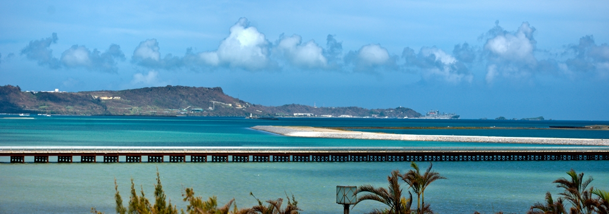
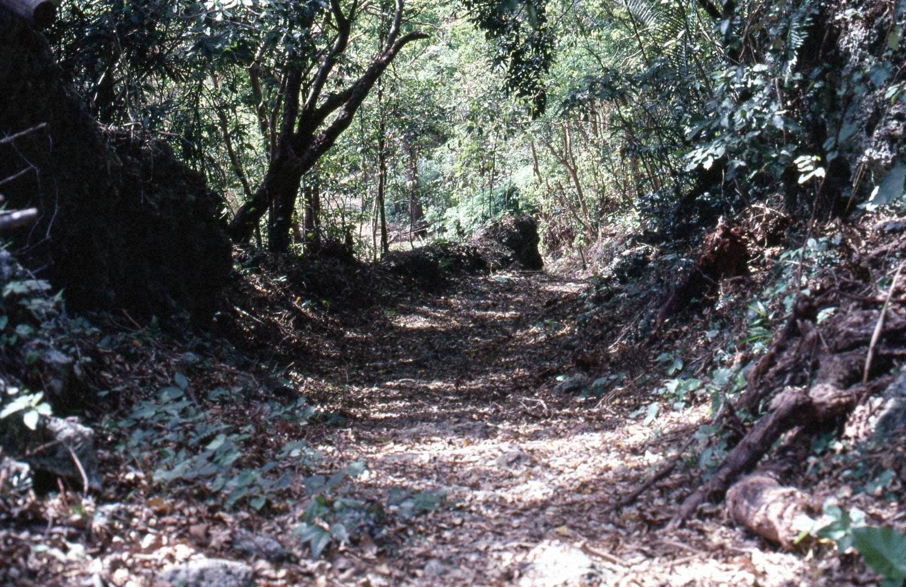
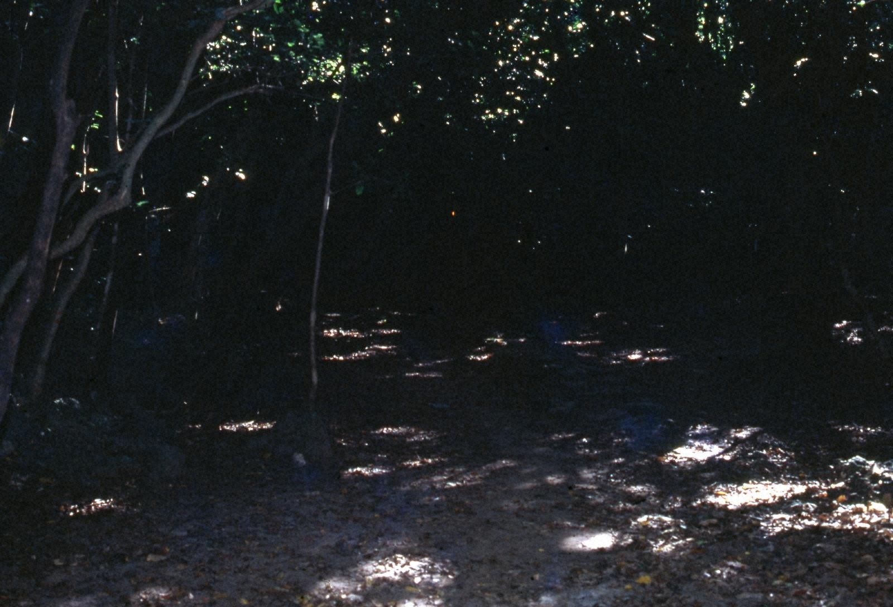

45年前の今日、1981年11月13日。沖縄本島北部の山原の森で、日本でおよそ100年ぶりとなる新種の鳥が確認され、「ヤンバルクイナ」と命名されたことが発表されました。豊かな原生林に守られて生き延びていた飛べない鳥の登場は、日本中の動物学会と自然愛好家を驚かせました。

## 近代日本で起きた「奇跡の発見」

日本国内の鳥類相は明治期以降の近代的な調査によって調べ尽くされたと考えられており、新種の鳥が見つかることなどあり得ないと思われていました。最後に新種の鳥が記録されてからおよそ100年が経過していた1980年代初頭、その常識を覆す大発見が沖縄の地でもたらされました。

発表された新種の和名は「ヤンバルクイナ」。沖縄本島北部の国頭村、大宜味村、東村に広がる森林地帯「山原（やんばる）」の名を冠したこの鳥は、世界中でこの狭い地域にしか生息していない貴重な固有種でした。

## 地元では噂されていた「飛べない鳥」

学会にとっては驚天動地の発見でしたが、地元の人々にとっては完全に無名というわけではありませんでした。山原の住民の間では、古くから「アガチー（せかせか歩くもの）」や「ヤマドゥイ（山鳥）」などの名前で呼ばれ、林道や森の中で見かけることが知られていたのです。

「山原の森にキジのような鳥がいる」という噂や目撃談は以前から語られており、録音家による鳴き声の採取や愛好家による生態写真の撮影も行われていました。しかし、学術的にそれが未知の種であると証明する決め手がないまま、歳月が流れていました。

*Okinawa Japan — 写真: R9 Studios FL (Thanks to all the fans!!!) / CC BY 2.0*

## 山階鳥類研究所による追跡と捕獲

転機が訪れたのは1978年でした。山階鳥類研究所の研究者が沖縄本島最高峰の与那覇岳（標高503メートル）で未知のクイナ類を目撃したことを機に、本格的な調査の気運が高まりました。1981年には特別調査チームが編成され、山原の森で集中的な探索が始まります。

同年6月28日、与那覇岳のふもとに仕掛けられた罠で幼鳥1羽が捕獲され、続く7月4日には成鳥1羽の捕獲に成功しました。さらに、地元の鳥獣保護員である玉城長正氏が道路際で回収し、高校教諭の友利哲夫氏によって剥製標本にされていた個体が研究所へ持ち込まれました。

*知念城跡 — 写真: 南城市教育委員会 / CC BY (Japan Search)*

## 赤いくちばし、飛べない翼――際立つ特徴

捕獲された生体と標本を詳細に測定した結果、これまでに知られているどの鳥とも異なる特徴を持つ新種であることが確定しました。全長は約35センチ、体重は340から430グラムほど。上面は暗いオリーブ褐色で、喉から腹部にかけて黒白の横縞模様が入る美しい姿をしていました。

何より目を引いたのは、鮮やかな赤色をした太いくちばしと頑丈な脚、そして真っ赤な瞳でした。天敵の少ない孤立した島で進化したため、翼の筋肉は小さく退化しており、ほとんど空を飛ぶことができません。夜になると樹上に登ってヘビなどの外敵をやり過ごす特異な生態も明らかになりました。

*場所不明 — 写真: 南城市教育委員会 / CC BY (Japan Search)*

## 森林伐採と外来種の脅威を乗り越えて

新種発見のニュースは大きな歓喜をもたらした一方で、生息環境の危機も浮き彫りにしました。戦後の復興や経済開発に伴い、山原地域では1980年代まで広範囲な森林伐採が続けられていたからです。

さらに、林道の整備に伴う交通事故（ロードキル）や、人為的に持ち込まれたフイリマングース、ノネコによる捕食によって、個体数は深刻な打撃を受けていきました。発見から間もない1982年には早くも国の天然記念物に指定され、地域一体となった生息環境の保全活動が急ピッチで進められることになりました。

## 山原の象徴として未来へつなぐ森

ヤンバルクイナの発見は、沖縄本島北部の自然環境がいかに貴重であるかを日本社会に強く認識させる決定打となりました。木々の伐採を減らし、道路での減速を呼びかけるフェンスや標識の設置、外来種マングースの防除事業など、多くの保護対策が積み重ねられてきました。

2021年には、山原の森を含む地域が「奄美大島、徳之島、沖縄島北部及び西表島」としてユネスコの世界自然遺産に登録されました。赤いくちばしを輝かせながら森を駆けるヤンバルクイナは、今も豊かな生物多様性を誇る奇跡の森のシンボルとして生き続けています。

### 参考資料

- <https://ja.wikipedia.org/wiki/11%E6%9C%8813%E6%97%A5>
- <https://www.flickr.com/photos/60904035@N00/2946230621>
- <https://www.flickr.com/photos/53477219@N02/5991224861>
- <https://nanjo-archive.jp/document/?detail=34254&genre=6>
- <https://nanjo-archive.jp/document/?detail=34262&genre=6>
