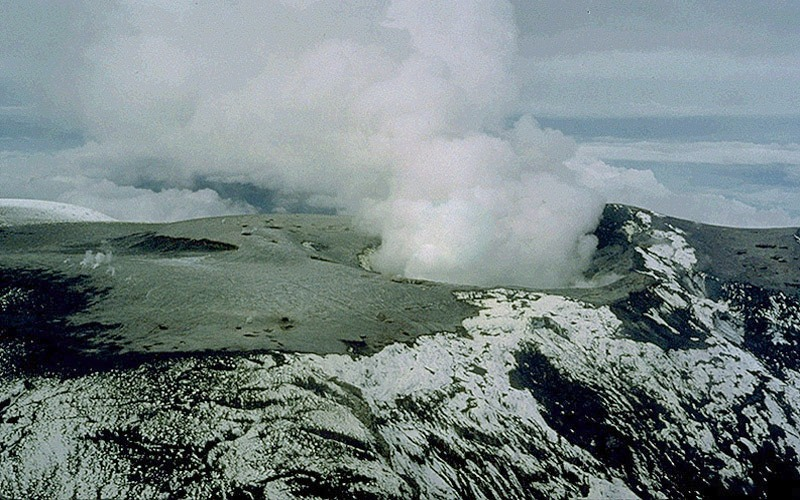
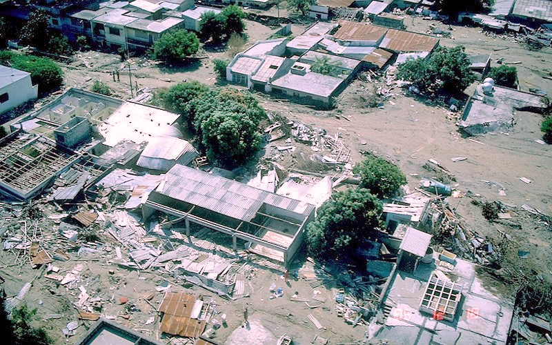
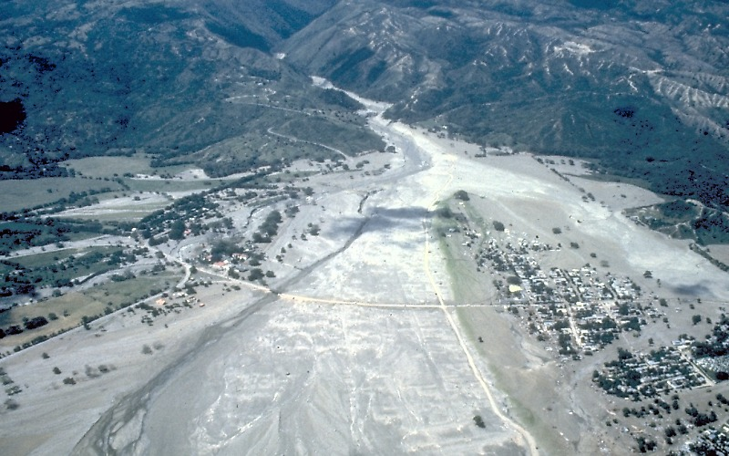

41年前の今日、1985年11月13日。南米コロンビアのアンデス山脈に位置するネバドデルルイス火山が本格的な噴火を起こしました。赤道直下でありながら雪と氷に覆われた山頂から、火砕流の熱によって溶け出した大量の泥流が麓へ押し寄せ、一夜にして多くの命を奪いました。

## 140年の眠りから覚めた「眠れる獅子」

ネバドデルルイス火山は、地元ではクマンダイやラ・メサ・デ・エルベオとも呼ばれる活火山です。過去には1595年に636人、1845年に約1,000人の死者を出す泥流災害を引き起こした記録がありました。被災することになるトリマ県の街アルメロは、皮肉にもその1845年の泥流堆積物の上に築かれていた街でした。

火山は1984年11月に約140年ぶりとなる活動を再開していました。翌1985年9月11日には水蒸気爆発を起こし、泥流が西側斜面を27キロ流下しました。この時は水系が異なったため、西側にあった人口約35万人の都市マニサレスに被害は出ませんでしたが、山が確実に活動期に入っている兆候を示していました。

## 生かされなかった警告と届かなかった避難情報

噴火の危険の高まりを受け、1985年10月7日、コロンビア国立地質鉱山研究所はアメリカの火山学者の指導のもとでハザードマップを作成しました。この地図は地方自治体や関係機関に配布され、アルメロに泥流が達する危険性を明確に示していました。しかし、直近で火山活動が一時沈静化していたことなどから、この警告はほとんど重視されませんでした。

アメリカ地質調査所（USGS）による専門家の追加派遣も検討されましたが、直前に起きたコロンビア最高裁占拠事件の影響で中止となってしまいます。住民たちの間でも過去の偽情報への慣れがあり、警戒感が薄れていました。さらに当日は街で祭りが開かれて近隣からも人々が集まっており、市民の動揺を恐れた市長自身がラジオで「噴火はない」と放送し続けたことが、避難の遅れを決定づけました。

*Nevado del Ruiz summit 1985 - Marso — 写真: Jeffrey Marso, USGS geologist / Public domain*

## わずか2時間半で100キロを駆け抜けた濁流

11月13日15時過ぎに本格的な噴火が始まり、21時頃に最高潮に達しました。噴火の規模自体は火山爆発指数3という「やや大規模」なものでしたが、高温の火砕流が山頂の雪や氷を融解させたことで、東側斜面に凄まじい規模の火山泥流が発生しました。

最大幅50メートルにも達した泥流は、発生からわずか2時間半で100キロ以上の距離を流れ下り、深夜のアルメロの街を直撃しました。人口28,700人の約4分の3にあたる21,000人が泥流に巻き込まれて命を落としました。噴火災害全体での犠牲者は死者23,000人、負傷者5,000人、家屋損壊5,000棟に達し、1902年のフランス領マルティニーク島のプレー山噴火（約30,000人死亡）に次ぐ、20世紀で2番目に多くの死者を出した火山災害となりました。

*Armero Mudflow and ruins — 写真: N. Banks (w:United States Geological Survey) / Public domain*

## 世界を揺るがした13歳の少女の記憶

被災直後の現場は深い火山灰の泥濘に覆われ、重機の搬入もままならず、救助活動は困難を極めました。その中で世界的な注目を集めたのが、13歳の少女オマイラ・サンチェスさんでした。彼女は崩壊した建物の瓦礫と水の中に下半身を挟まれ、首と手だけが水面に出た状態で身動きが取れなくなっていました。

救助隊が必死に手を尽くすものの人力では引き揚げることができず、周囲の水位を下げる大型ポンプも届きませんでした。サンチェスさんは生きる希望を語り、家族への愛情を口にしながら耐え続けましたが、被災から3日後の11月16日に衰弱のため息を引き取りました。彼女の最後まで諦めない姿と救助の限界を伝える映像や写真は世界中に配信され、自然災害の過酷さと救難体制の課題を人々の胸に深く刻み込みました。

*Armero aftermath USGS — 写真: Jeffrey Marso, USGS geologist / Public domain*

## 日本をはじめとする24カ国の国際支援

この未曾有の惨状に対し、世界24の国が支援の手を差し伸べました。アメリカは合衆国国際開発庁（AID）を通じて専門家やヘリコプター12機、テント500張、毛布2,250枚などを送付し、エクアドルは移動病院を派遣、フランスは1,300のテントや医薬品を届けました。ベルギーのフィリップ皇太子も現地を慰問に訪れています。

日本からも、政府による125万ドルの支援に加え、国連を通じた50,000ドルの拠出、そして医師や看護師、技術者からなる8名の専門家チームが現地に派遣されて被災者の治療や支援活動に貢献しました。この災害復旧には、当時のコロンビアのGNPの約20パーセントに相当する77億ドルもの費用が費やされることとなりました。

## 墓地となった旧市街地と現代への教訓

かつてのアルメロの街は再建されることなく、旧市街地全体が墓地として保全されました。1990年代半ばになっても現場は6メートル以上の火山灰や瓦礫に覆われたままで、多くの遺骨が今もその大地に眠っています。現在のアルメロの街は、被災地から北へ約8キロ離れた安全な場所に移転して再建されました。

事前にハザードマップがありながら避難に結びつかなかったこの悲劇は、2008年にユネスコから「正確な知識の不足と情報伝達の不備による世界最悪の人災による悲劇」の一つとして認定されました。自然災害の予測がいかに正しく行われても、それを的確に人々に伝え、避難行動へ繋げなければ命は救えないという重い教訓を、ネバドデルルイス火山の噴火は今も私たちに問いかけ続けています。

### 参考資料

- <https://ja.wikipedia.org/wiki/%E3%82%B3%E3%83%AD%E3%83%B3%E3%83%93%E3%82%A2>
- <https://commons.wikimedia.org/wiki/File:Armerodisaster.png>
- <https://commons.wikimedia.org/wiki/File:Nevado_del_Ruiz_summit_1985_-_Marso.jpg>
- <https://commons.wikimedia.org/wiki/File:Armero_Mudflow_and_ruins.jpg>
- <https://commons.wikimedia.org/wiki/File:Armero_aftermath_USGS.jpg>
