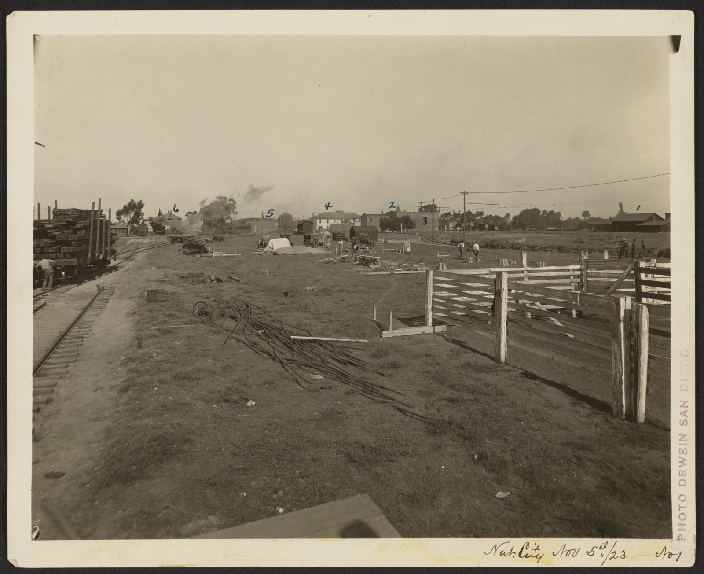

35年前の今日、1991年11月13日。当時18歳で国民的人気を誇っていた宮沢りえさんのヌード写真集『Santa Fe』が発売されました。写真家の篠山紀信さんが撮影したこの作品は、発売と同時に日本中で熱狂的な社会現象を巻き起こし、150万部以上という驚異的な大ベストセラーを記録しました。

## トップアイドルへの階段を駆け上がった少女時代

宮沢りえさんは1973年、東京都練馬区で日本人の母親とオランダ人の父親のもとに生まれました。11歳の時にモデルとしてデビューを果たし、1985年には明星食品「チャルメラ」のCMに出演して芸能活動を本格化させます。一躍その名を知らしめたのは、1987年に起用された初代「リハウスガール」でした。その透明感あふれる美貌と存在感は、多くの人々の心を瞬く間に捉えました。

女優としてもすぐに才能を開花させます。1988年に主演を務めた映画『ぼくらの七日間戦争』で日本アカデミー賞新人賞を受賞し、1989年にはドラマ『青春オーロラ・スピン スワンの涙』で連続ドラマ初主演を果たしました。同年9月には小室哲哉さんのプロデュースによるシングル『ドリームラッシュ』で歌手デビューを飾り、音楽番組『ザ・ベストテン』の最終回にもランクインします。さらに1990年にはシングル『NO TITLIST』でオリコン週間チャート1位を獲得し、第41回NHK紅白歌合戦に初出場するなど、まさに時代の頂点を極めるトップアイドルとして駆け抜けていました。

## 日本中を揺るがした写真集『Santa Fe』と世界記録

そうした絶頂期の最中に発表されたのが、1991年11月13日発売のヌード写真集『Santa Fe』でした。トップアイドルが本格的なヌード写真集を出版することは当時の常識を大きく覆し、世間に凄まじい衝撃を与えました。撮影を手がけたのは、時代を切り取る希代の写真家・篠山紀信さんでした。

発売されるやいなや全国の書店に読者が殺到し、累計発行部数は150万部以上を突破しました。この数字は、日本の芸能人写真集における売上部数として史上最高記録であり、それだけでなく写真集の世界記録をも達成することとなりました。その反響の大きさは日本国内にとどまらず、東南アジアをはじめとする海外市場でも海賊版が出回るほどの社会現象へと発展していったのです。

*当日の写真ではありません · 事件当時の写真ではありません — 写真: Unknown / Public Domain Mark 1.0*

## 激動の1990年代と「すったもんだ」の日々

写真集の大成功によって時代の寵児となった宮沢さんでしたが、その後の人生には激動の波が押し寄せました。1992年10月27日、当時相撲界で国民的人気を博していた貴乃花光司さんとの婚約を発表し、“世紀のカップル誕生”として日本中から祝福を受けました。しかし、わずか2か月後の1993年1月27日には「人生最高のパートナーになれなかった」とのコメントを残し、電撃的に婚約を解消することになります。この破局には母の相談を受けた歌手の美川憲一さんによる説得などもあり、大きな注目を集めました。

その後も1994年に宝酒造『タカラcanチューハイ』のCMで発した「すったもんだがありました」というセリフが新語・流行語大賞の年間大賞を受賞し、1995年には出演予定だった映画『藏』の直前降板騒動が起こるなど、世間の激しい注目とプレッシャーの中で波乱の時期を経験することになりました。

*Santa Fe, New Mexico #1 — 写真: gholmes / CC BY 2.0*

## 本格派女優への覚醒と映画賞の総なめ

激動の時代を経て、宮沢さんは女優としての実力を着実に磨き上げていきました。2001年の香港映画『華の愛～遊園驚夢』で第23回モスクワ国際映画祭の主演女優賞を受賞すると、2002年の松竹映画『たそがれ清兵衛』でヒロインを演じ、日本アカデミー賞をはじめキネマ旬報など数々の名だたる映画賞で最優秀主演女優賞を獲得します。これにより本格派女優としての高い評価を揺るぎないものとしました。

2004年の映画『父と暮らせば』でもキネマ旬報主演女優賞やブルーリボン賞を受賞し、舞台の分野でも精力的に活動を続けました。2013年には、舞台『おのれナポレオン』で天海祐希さんの急病による代役を急遽引き受け、わずか2日間の稽古で2時間20分におよぶ長大な台詞の役を見事に演じきるなど、その圧倒的なプロ意識を証明しました。その後も2014年の『紙の月』で東京国際映画祭最優秀女優賞および日本アカデミー賞最優秀主演女優賞、2016年の『湯を沸かすほどの熱い愛』でも日本アカデミー賞最優秀主演女優賞を受賞するなど、日本を代表する名女優としての地位を確立しました。

*Santa Fe, New Mexico — 写真: szeke / CC BY-SA 2.0*

## 35年を経ても色褪せない伝説の金字塔

私生活では2018年に森田剛さんと結婚し、2021年には夫とともに新事務所「MOSS」を設立しました。同年には、かつてブレイクのきっかけとなった三井のリハウスのCMに34年ぶりに出演を果たし、多くの人々に当時の記憶を鮮やかに甦らせました。

1991年11月13日に発売された『Santa Fe』が記録した150万部という数字は、出版界の歴史に刻まれた不滅の金字塔です。芸能界の写真集売上記録として35年が過ぎた現在も破られておらず、日本文化史における特別な出来事として語り継がれています。18歳の少女が見せた覚悟と、時代を切り拓いたその一冊は、今も多くの人々の記憶に鮮烈に残っています。

### 参考資料

- <https://ja.wikipedia.org/wiki/11%E6%9C%8813%E6%97%A5>
- <https://archive.org/details/1_20220419_20220419_0143>
- <https://archive.org/details/cna_000210>
- <https://www.flickr.com/photos/13494744@N00/5768168949>
- <https://www.flickr.com/photos/43355249@N00/30724978308>
