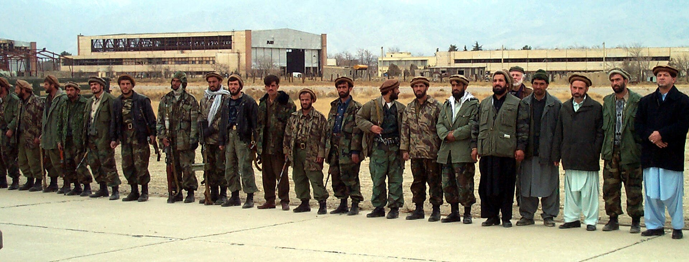
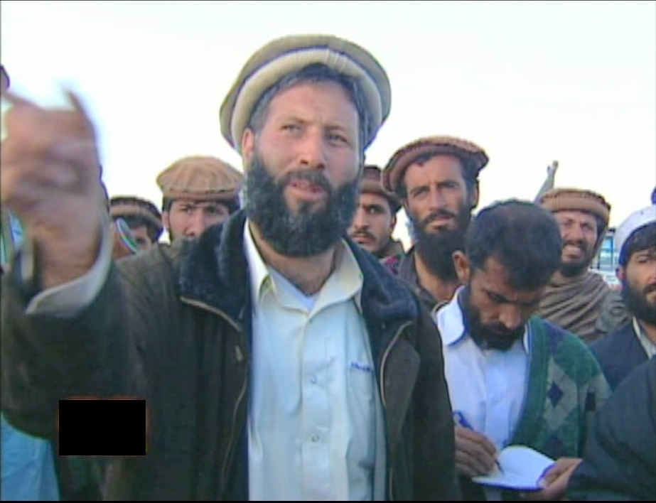
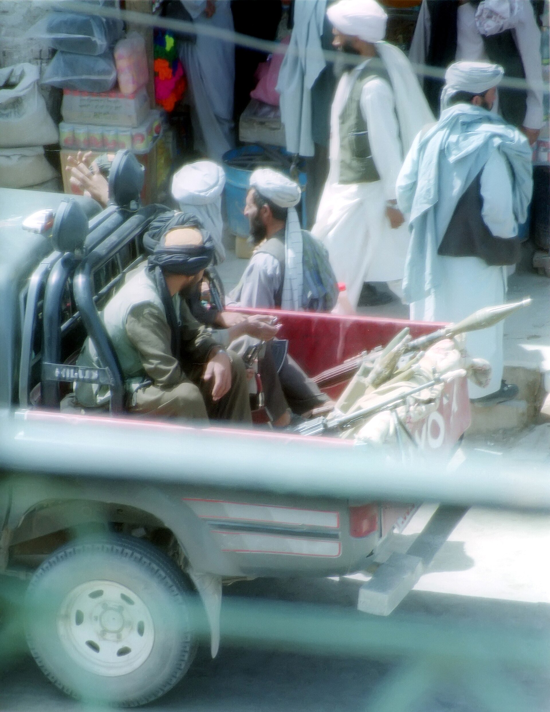

25年前の今日、2001年11月13日。アフガニスタンの首都カーブルが、反ターリバーン勢力「北部同盟」の進軍によって制圧されました。1996年から首都を支配していたターリバーン政権は事実上の崩壊へと追い込まれました。世界を震撼させたアメリカ同時多発テロ事件からおよそ2カ月。遠く離れた中央アジアの古都で起きたこの出来事は、国際社会の安全保障の枠組みを大きく揺るがす歴史的瞬間となりました。

## 追いつめられていた北部同盟と司令官の暗殺

1996年9月、イスラム原理主義勢力ターリバーンが首都カーブルを制圧しました。それまで政権を担っていたブルハーヌッディーン・ラッバーニー大統領らは首都を追われ、北部の山岳地帯へと逃れることになります。彼らはタジク人、ウズベク人、ハザーラ人といった非パシュトゥーン系民族の勢力を結集し、「アフガニスタン救国・民族イスラム統一戦線」（通称・北部同盟）を結成して頑強な抵抗を続けました。

国際社会において、ターリバーンによる政権を公式に承認した国はパキスタン、サウジアラビア、アラブ首長国連邦のわずか3カ国にとどまっていました。国際連合における代表権は、首都を追われたラッバーニーらのイスラム国政府が保持し続けていたのです。

しかし、戦況は年を追うごとに北部同盟にとって厳しいものとなっていきました。ターリバーンが国土の大半を掌握するなか、北部同盟の支配地域は北東部の一角にまで押し込められていました。さらに2001年9月9日、北部同盟の軍事指導者であり「パンジシールの獅子」と呼ばれたアフマド・シャー・マスード国防相が、報道陣を装った自爆テロによって暗殺されるという致命的な打撃を受けました。

## 同時多発テロと世界を巻き込む反転攻勢

マスード司令官の暗殺からわずか2日後の2001年9月11日、アメリカで同時多発テロ事件が発生します。首謀者とされた国際テロ組織アルカーイダの指導者ウサーマ・ビン・ラーディンを匿っていたターリバーンに対し、アメリカ政府は身柄の引き渡しを強く要求しました。しかしターリバーン側がこれを拒絶したため、アメリカ軍を中心とする有志連合は10月、アフガニスタン領内への軍事作戦に踏み切りました。

有志連合による強力な航空支援と物資の供与を受けた北部同盟は、これまでの防戦一方の態勢から一気に攻勢へと転じました。北部の要所マザーリシャリーフなどを次々と奪還した北部同盟の部隊は、南の首都カーブルを目指して怒涛の進撃を開始したのです。

*Northern Alliance troops line a runway at Bagram Airbase — 写真: Jim Garamone / Public domain*

## 11月13日、カーブル入城と政権の崩壊

2001年11月13日未明、激しい空爆と北部同盟の接近に直面したターリバーンの部隊は、首都カーブルからの撤退を余儀なくされました。夜明けとともに、北部同盟の装甲車や歩兵部隊が市内へと進軍。大きな市街戦に発展することなく、首都は制圧されました。

5年間にわたったターリバーンによる厳格な支配はここに幕を下ろしました。街中では音楽が流れ始め、映画館が再開され、男性たちが義務付けられていた長いあごひげを剃り落とすなど、それまで禁じられていた市民の自由が一部で戻る光景が世界中のメディアを通じて報じられました。

制圧の翌日である11月14日には、国際連合安全保障理事会において決議1373が採択され、国連がターリバーン政権を交代させようとするアフガニスタン国民の努力を公式に支援することが承認されました。

*General Ali and his Afghan fighters, November 2001 — 写真: "Dalton Fury" -- the pen-name of a Major in the Delta Force / Public domain*

## ボン合意とカルザイ暫定政権の船出

カーブル奪還の直後、国際社会はアフガニスタンの新たな国造りに向けた協議を急ぎました。11月27日からドイツのボンで主要四派による会議が開かれ、12月5日にいわゆる「ボン合意」が成立しました。

この合意に基づき、パシュトゥーン人部族の出身で元国王派の指導者であったハーミド・カルザイ氏を議長とする暫定行政機構が発足しました。首都を制圧した北部同盟は外相、内相、国防相といった主要閣僚ポストを占め、ラッバーニー氏は大統領の座から退きつつも新体制の樹立を後押ししました。こうしてアフガニスタンは、国際社会の支援を受けながら新たな民主化の道を歩み始めることになったのです。

*2001年の資料 — 写真: bluuurgh / Public domain*

## 20年後に巡ってきた歴史の皮肉

しかし、カーブル制圧によってターリバーンが完全に壊滅したわけではありませんでした。彼らはパキスタン国境付近や南部山岳地帯に逃れて勢力を温存し、ゲリラ戦を継続していきました。長期間にわたる内戦と腐敗、治安悪化はアフガニスタン社会を疲弊させ続けました。

そして歴史は数奇な巡り合わせを見せます。2021年8月、アメリカ軍の完全撤退に伴い、息を吹き返したターリバーンが再び攻勢を強め、わずか数週間で首都カーブルを再び制圧したのです。アシュラフ・ガニー大統領は国外へ亡命し、20年間にわたって国際社会が支えてきた共和国政府は崩壊しました。

2001年11月13日に北部同盟がカーブルを制圧したあの日、多くの人々が長い戦乱の終わりと新しい時代の幕開けを信じました。しかし、平和への道のりがいかに険しく脆いものであったかを、その後の四半世紀の歴史が物語っています。

### 参考資料

- <https://ja.wikipedia.org/wiki/%E3%82%AB%E3%83%BC%E3%83%96%E3%83%AB>
- <https://commons.wikimedia.org/wiki/File:US_forces_Operation_Enduring_Freedom.jpg>
- <https://commons.wikimedia.org/wiki/File:Northern_Alliance_troops_line_a_runway_at_Bagram_Airbase.jpg>
- <https://commons.wikimedia.org/wiki/File:General_Ali_and_his_Afghan_fighters,_November_2001.jpg>
- <https://commons.wikimedia.org/wiki/File:Taliban-herat-2001_retouched.jpg>
