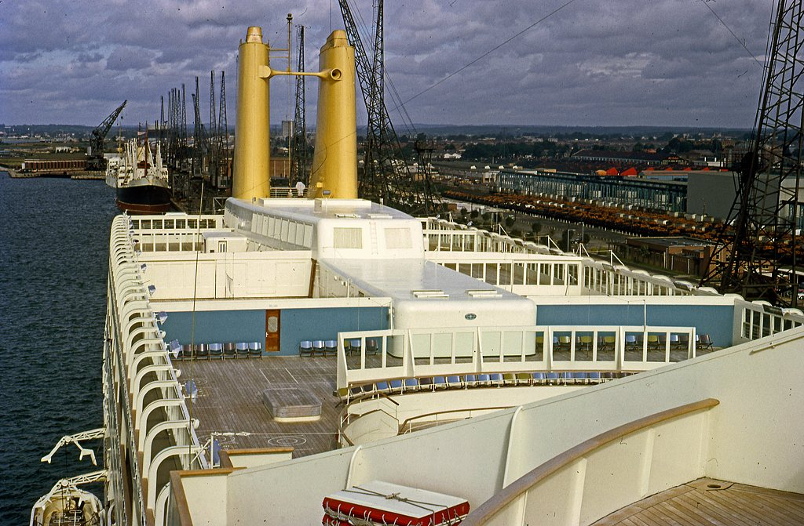
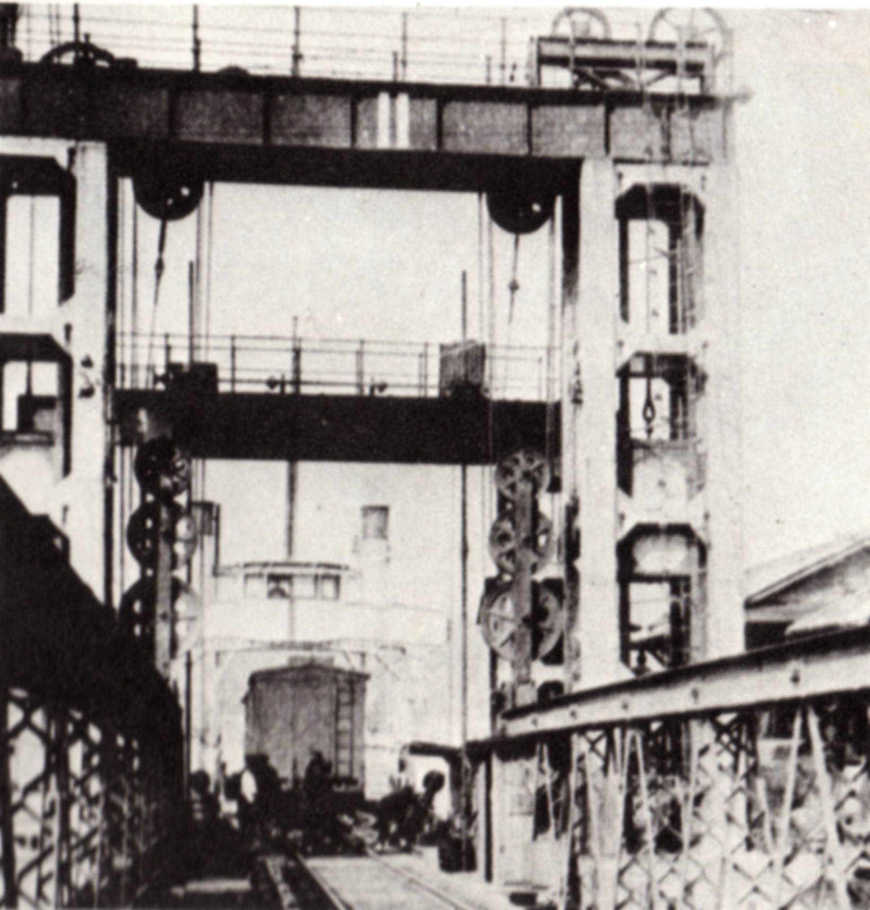
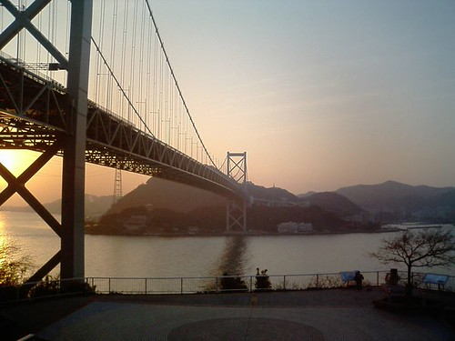

53年前の今日、1973年11月14日。本州と九州を隔てる関門海峡の上に、東洋最長を誇る巨大な吊り橋「関門橋」が開通しました。白波が立つ激しい海峡の空高く銀灰色の主塔がそびえ立ち、本土と九州が高速道路の橋で結ばれたこの瞬間は、高度経済成長期を迎えていた日本中に大きな希望と驚きを与えました。

## 海峡をまたぐ悲願――トンネルから空の架橋へ

本州と九州を隔てる関門海峡は、もっとも狭い早鞆瀬戸で幅約650メートルと非常に短い距離にあります。しかし、大潮の潮流は最大10ノット（時速約18キロ）を超え、鳴門海峡や来島海峡と並ぶ日本三大急潮の一つとして知られる海の難所でした。古くから連絡船が行き交っていましたが、天候に左右されやすい海上交通を克服するため、近代以降は海底トンネルの整備が先行しました。

1942年には世界初の海底鉄道トンネルである関門鉄道トンネルが開通し、1958年には歩行者道も備えた国道2号の関門国道トンネルが完成しました。しかし、戦後の高度経済成長に伴い、本州と九州を往来する自動車の交通量は爆発的に増加します。片側1車線の関門国道トンネルだけでは深刻な交通混雑をさばききれなくなり、高速道路網と直結する新たなルートの建設が急務となっていったのです。

## 1968年着工、東洋一の吊橋への挑戦

1968年3月に「関門自動車道」として高速自動車国道の指定を受け、同年6月に起工式が行われました。架橋地点に選ばれたのは、壇ノ浦（下関市）と和布刈（門司区）を結ぶ海峡の最狭部です。橋長は1,068メートル、主塔と主塔のあいだの最大支間長は712メートルに及びました。それまで日本最長だった北九州市の若戸大橋（橋長627メートル、最大支間長367メートル）を大きく上回り、完成時点では日本のみならず東洋で最長の吊橋となりました。

激しい潮流と強風、そして1日に約1千隻もの船舶が航行する超過密航路の真上で橋を架ける工事は、当時の日本の土木技術の限界に挑むものでした。主ケーブルの直径は67センチメートル、ハンガーケーブルは直径53センチメートルに達し、補剛桁には風の影響を抑える強固なトラス構造が採用されました。この卓越した技術と設計は高く評価され、1973年度の土木学会田中賞を受賞しています。

*P^O liner SS Canberra at Southampton 1962 (3) - geograph.org.uk - 3826116 — 写真: Ronald Searle / CC BY-SA 2.0*

## 巨大客船キャンベラ号と「グレーグリーン」の色彩

関門橋の設計には、航路としての関門海峡の重要性が色濃く反映されました。世界中の大型船舶が行き交う国際航路であるため、橋桁の高さには特別な配慮が求められました。当時、世界最大級のクルーズ客船であったイギリスの「キャンベラ号」のマストの高さが57メートルであったことから、海面から桁下までの高さを61メートル確保することに決まりました。潮位の干満を考慮すれば最大62メートルの高さの船まで通れる構造となっています。

また、橋の塗装にも画期的な工夫が施されました。当時の航空法では、高さ60メートル以上の建造物は昼間の視認性を確保するため、赤色、あるいは赤と白のツートンカラーに塗装することが義務付けられていました。しかし、歴史ある海峡の景観を損ね、航行する船舶の視界にも悪影響を与えるとして関係各所との粘り強い交渉が行われました。その結果、強力なサーチライト型の航空灯を設置することを条件に規制の例外が認められ、関門海峡の海と山に調和する「グレーグリーン」が採用されたのです。この前例は、その後の日本の長大構造物の色彩規制が見直される大きなきっかけとなりました。

*Komorie wharf movable bridge for train ferry — 写真: Ministry of Railways, Japan / 鉄道省 / Public domain*

## 1973年11月14日、大動脈の誕生と記念切手

1973年11月14日、待ち望まれた関門橋が正式に供用を開始しました。開通に合わせて中国自動車道および北九州道路と接続され、本州と九州が初めて高速道路で直結されました。開通の日には、雄大な吊橋の姿を描いた額面20円の記念切手も発行され、全国の郵便局で多くの人々が買い求めました。

開通当初、関門橋を含む区間の通行料金は普通車で1キロあたり64円と、一般の高速道路の約2.6倍に設定されていました。これは割高な建設費の償還に加え、既存の関門国道トンネルとの交通量を適切に配分するための措置でした。下関側の壇之浦パーキングエリアと門司側のめかりパーキングエリアからは、眼下に広がる早鞆瀬戸の激しい潮の流れと、橋の上を行き交う車列を一望することができ、新たな観光名所としても賑わいを見せました。

*the Kanmon Straits — 写真: shimontec / CC BY-SA 2.0*

## 日本の長大橋のパイオニアとして今も生きる

関門橋の成功は、その後の日本の長大橋建設技術に決定的な影響を与えました。関門橋で培われた調査、設計、施工、そして強風対策や防食技術（溶射技術）のノウハウは、本四連絡橋や1998年に開通した世界最大級の明石海峡大橋へと確かに受け継がれていきました。

開通から40年が経過した2011年度からは、5年計画で大規模な補修工事が実施され、主塔の再塗装やコンクリート床版の打ち替えなどが行われました。供用開始から50年を迎えた2023年3月末までに、関門橋を渡った車両の累計は約4億7千万台に達しています。台風などの強風時には国道トンネルが、トンネルの集中工事時には関門橋が迂回路として機能し、本州と九州を結ぶかけがえのない大動脈として、今も海峡の風を受け止めながら日本の物流と人々の暮らしを支え続けています。

### 参考資料

- <https://ja.wikipedia.org/wiki/11%E6%9C%8814%E6%97%A5>
- <https://commons.wikimedia.org/wiki/File:Found_Photo_-_Japan_-_Unknown_Construction_2.tif_(34176170121).jpg>
- <https://commons.wikimedia.org/wiki/File:P%5EO_liner_SS_Canberra_at_Southampton_1962_(3)_-_geograph.org.uk_-_3826116.jpg>
- <https://commons.wikimedia.org/wiki/File:Komorie_wharf_movable_bridge_for_train_ferry.jpg>
- <https://www.flickr.com/photos/26568116@N00/21592285>
