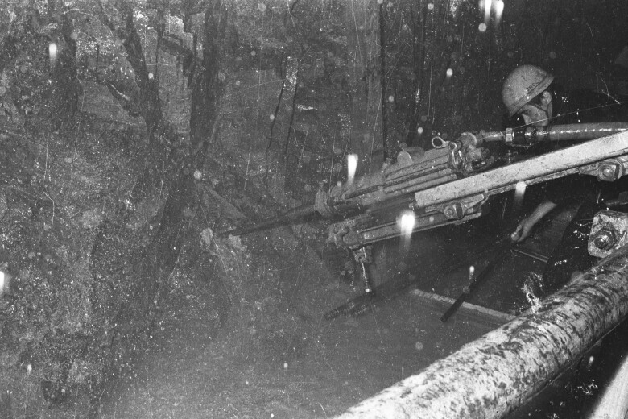
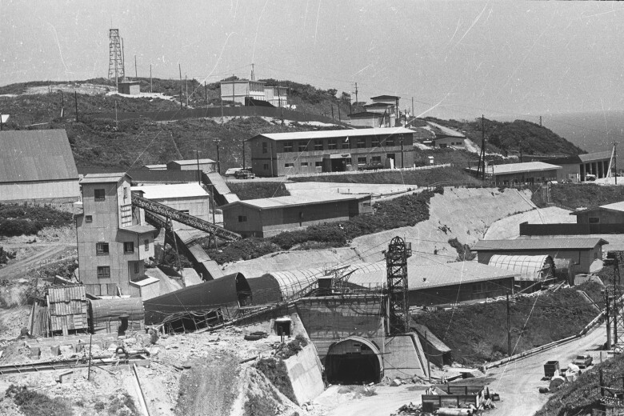
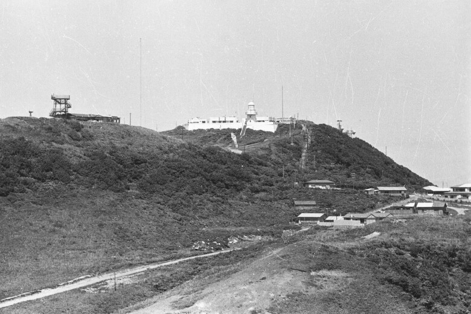

55年前の今日、1971年11月14日。本州と北海道を海の底で結ぶ青函トンネルの本工事起工式が、北海道と本州の両側で挙行されました。荒れ狂う津軽海峡の底に鉄路を通すという前代未聞の大事業が、いよいよ本格的な掘削工事へと踏み出した日でした。

## 洞爺丸事故の悲劇と海底トンネル構想の本格化

古くから本州と北海道を結ぶ大動脈は、国鉄が運航する青函連絡船でした。しかし1950年代には朝鮮戦争に起因するとみられる浮流機雷が津軽海峡に流入するなど、航路の安全が常に脅かされていました。

決定打となったのは、1954年9月26日に発生した洞爺丸事故です。台風の接近下で誤った気象判断により出航した連絡船のうち、洞爺丸を含む5隻が函館港外で遭難し、1,400人以上の命が失われる大惨事となりました。

どんな悪天候でも絶対に途切れない安全な交通路を確保しなければならないという国民的要請を受け、戦前から温められていた海底トンネル構想が一気に現実の計画として動き始めました。

## 西口ルートの選定と足掛け十数年の調査工事

計画段階では、青森県大間町と北海道戸井町を結ぶ距離の短い東口ルートと、青森県三厩村と北海道福島町を結ぶ西口ルートの2つが検討されました。しかし東口ルートは水深が深い上、海底の地質が掘削に適さないと判定され、最終的に西口ルートの採用が決まりました。

1961年に建設工事が開始され、深海探査艇「くろしおII号」による海底調査や、秋田県での実験隧道の建設が進められました。1964年には日本鉄道建設公団が発足し、北海道と本州の双方で斜坑の掘削や先進ボーリングが開始されます。

海底下約100メートルの未知の地質を慎重に見極めるため、調査坑の掘削だけでも足掛け十数年もの歳月が費やされました。

*青函トンネル工事 — 写真: 柿崎 / CC BY-SA (Japan Search)*

## 1971年11月14日、本工事の起工式を迎える

1971年9月28日に本工事に着手したことを受け、同年11月14日、北海道側と本州側の双方で待望の本工事起工式が執り行われました。全長53.85キロメートルという世界最長の鉄道トンネルの本体工事が、ついに本格始動したのです。

当初は在来線規格で設計されていましたが、整備新幹線計画に合わせて新幹線規格へと設計が変更されました。のちに新幹線計画が一時凍結された際も、将来の新幹線乗り入れを見据えた規格がそのまま維持されました。

この起工式は、本州と北海道が陸続きになる未来へ向けた歴史的な出発点となりました。

*青函トンネル工事現場 — 写真: 柿崎 / CC BY-SA (Japan Search)*

## 毎分85トンの激しい出水と34人の尊い犠牲

海底下の掘削は、猛烈な水圧との絶え間ない戦いでした。1976年5月6日、北海道側の吉岡作業坑で切羽付近からの湧水が急増し、固定ポンプ座の貯水槽が水没する異常出水が発生しました。

出水のピークは毎分85トンに達し、設置されていた防水扉すら水圧で破られ、本坑1,300メートルを含む坑道が水没の危機に陥りました。排水ポンプを増設して水を抜き、出水切羽の手前を閉塞して右側へ迂回坑を掘ることで、162日目にしてようやく掘進を再開させました。

困難を極めた難工事の全工程において、34人もの尊い作業員が殉職しました。青森県の竜飛崎には、命を捧げた彼らの功績を後世に伝える殉職者の碑が静かに佇んでいます。

*青函トンネル工事現場と龍飛崎の灯台 — 写真: 柿崎 / CC BY-SA (Japan Search)*

## 「無用の長物」批判を越えて結ばれた鉄路

トンネル本体の建設費は計画段階の5,384億円から実際には7,455億円に膨らみ、取り付け線を含めると約9,000億円に達しました。さらに着工当時には全盛を誇った青函航路も、完成を迎える頃には航空機や長距離フェリーに旅客を奪われていました。

湧水を汲み上げる維持費の大きさからも「昭和三大馬鹿」「無用の長物」「泥沼トンネル」と揶揄され、事業放棄すら論じられた時期もありました。しかし1985年3月10日に本坑が全貫通し、1988年3月13日、青函連絡船の歴史に幕を下ろすとともに青函トンネルが開通しました。

開通後は天候に左右されない強みが発揮され、特に北海道の基幹産業である農産物の輸送量が飛躍的に伸びるなど、批判を覆す成果を示しました。

## 新幹線が海底を疾走する現在の大動脈

現在、青函トンネルは三線軌条となっており、在来線の貨物列車と新幹線が同じ線路を共有して走行しています。1日に定期列車だけで21往復、臨時列車を含めると約50本もの貨物列車が運行され、首都圏と北海道を結ぶ物流の要です。

2016年3月26日には北海道新幹線が開業し、新青森と新函館北斗の間が海底経由で直結しました。かつて荒波を恐れながら船で渡った津軽海峡を、今は新幹線がわずかな時間で駆け抜けていきます。

55年前の今日に始まった本工事の決断は、今なお日本の国土交通と食糧流通を揺るぎなく支え続けています。

### 参考資料

- <https://ja.wikipedia.org/wiki/11%E6%9C%8814%E6%97%A5>
- <https://kenshi-archives.pref.aomori.lg.jp/il/meta_pub/G0000004pic_A32-02-00-015-25>
- <https://kenshi-archives.pref.aomori.lg.jp/il/meta_pub/G0000004pic_A11-00-00-92-23>
- <https://kenshi-archives.pref.aomori.lg.jp/il/meta_pub/G0000004pic_A11-00-00-92-05>
- <https://kenshi-archives.pref.aomori.lg.jp/il/meta_pub/G0000004pic_A11-00-00-92-07>
