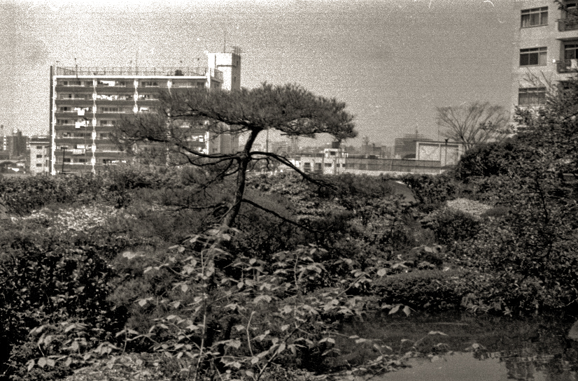
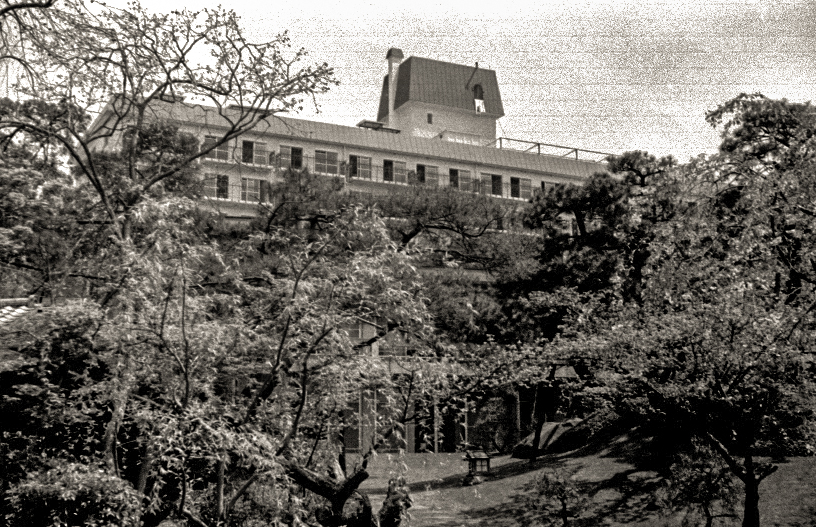
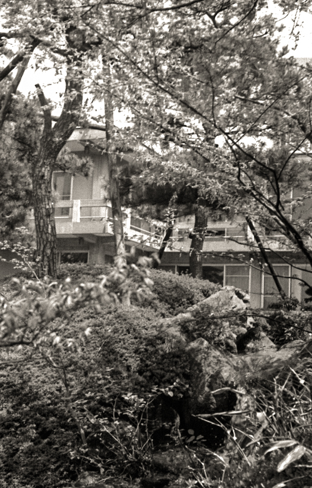

56年前の今日、1970年11月14日。東京・渋谷区神宮前の千駄谷区民会館において、日本で最初となるウーマン・リブ大会「解放のための討論会―性差別を告発する」が開催されました。

当時、反戦や平等を掲げていたはずの社会運動の現場でさえ、女性たちは男性の補助的な役割に押し込められていました。そうした現実に抗い、自らの声で性差別を告発したこの集会は、日本社会における新たな女性解放運動の幕開けを告げる象徴的な出来事となりました。

## 「ウーマン・リブ」という言葉の登場

1960年代後半から1970年代前半にかけて、ヨーロッパやアメリカでは女性解放運動、いわゆるウーマン・リブ運動が急速に広まっていました。19世紀から20世紀初頭にかけての参政権獲得を目指した「第一波フェミニズム」に対し、このリブ運動は「第二波フェミニズム」と呼ばれ、社会構造や意識の根底にある性差別の撤廃を求めたものでした。

アメリカでは、ベトナム反戦運動や公民権運動に参加していた女性運動家たちが、男性中心の組織運営や性差別的扱いに衝突し、独立した組織を結成して運動を始めました。この潮流は日本にも伝わり、1970年10月4日付の朝日新聞都内版が、英語の運動名を「ウーマン・リブ」と表記して報じたことで、この言葉が広く知られるようになりました。

## 男性運動家への幻滅と自立への歩み

当時の日本は、ベトナム反戦運動や全共闘運動など、若者たちによる社会変革の運動が激しく展開されていた時代でした。しかし、そうした先進的とされる運動の内部にあっても、強烈な男女差別が依然として存在していました。

運動の委員会や街頭での演説、発言を担当するのは男性ばかりで、女性参加者に割り振られるのは電話番やお茶くみ、炊事、逮捕者の救援活動といった下働きばかりでした。後にウーマン・リブのカリスマ的存在となる田中美津さんらは、「平等や革命を掲げながら、女への日常的な差別は世の中の構図と変わらない」と、男性運動家たちの矛盾に深い幻滅を抱くようになりました。

*Tokyo 1970-04-12 — 写真: Szilas / CC0*

## 「便所からの解放」と10月の街頭デモ

男性主導の運動に見切りをつけた女性たちは、自分たちの言葉で自らの解放を訴える行動を起こし始めました。1970年10月21日の国際反戦デー、田中美津さんらは女性だけで街頭デモを敢行しました。

このデモで彼女たちが配った手書きのビラには、「便所からの解放」という強烈な言葉が掲げられていました。女性を単なる身の回りの世話係や性的対象として扱う社会のあり方に真っ向から異議を申し立てたこの行動は、メディアにも取り上げられ、日本でウーマン・リブが社会的な注目を浴びる決定的な契機となりました。

*Tokyo 1970-04-13 — 写真: Szilas / CC0*

## 11月14日、千駄谷区民会館での告発

街頭デモの熱気が冷めやらぬ中、1970年11月14日、渋谷区神宮前の千駄谷区民会館で亜紀書房の主催による大会が開かれました。集会の名は「解放のための討論会―性差別を告発する」でした。

会場には多くの女性が集まり、職場や家庭、学校、そして活動組織の中でそれぞれが経験してきた不当な差別や抑圧について発言しました。女性だからという理由で決めつけられてきた役割分担を拒絶し、個人の尊厳を回復しようとする熱のこもった討論が繰り広げられ、日本における最初の大規模なリブ大会として歴史に刻まれました。

*Tokyo 1970-04-16 — 写真: Szilas / CC0*

## 広がるうねりと世界基準の男女平等へ

11月14日の集会に続き、同年12月8日には「12・8侵略と差別と闘う女集会」が開かれるなど、女性たち自身の連帯と行動は急速に拡大していきました。個々の生活体験に基づいた告発は、既存の政治運動の枠組みを超えて多くの共感を呼びました。

こうした国内外での運動の高まりは、社会意識の変革を後押しし、1979年の国連総会における「女子差別撤廃条約」の採択へと結びついていきました。日本国内でも法整備や職場環境の見直しが進むなど、この時期に芽生えた問題提起は、以後の男女平等施策の推進に大きな影響を与えることになりました。

## 半世紀を経て今に生きる問いかけ

渋谷の一角、千駄谷区民会館で女性たちが上げた声から、半世紀以上の月日が流れました。当時告発された固定的な性別役割分担や、女性を二等市民のように扱う風潮に対しては、長年の法改正や意識改革の積み重ねによって多くの見直しがなされてきました。

しかし、社会のあらゆる場面で真の平等が実現されたかといえば、今なお向き合うべき課題は少なくありません。あの日、自らの尊厳をかけて立ち上がった女性たちの問いかけは、現在を生きる私たちにとっても決して色あせることのない重要な道標となっています。

### 参考資料

- <https://ja.wikipedia.org/wiki/%E6%9D%B1%E4%BA%AC%E9%83%BD>
- <https://commons.wikimedia.org/wiki/File:Tokyo_1970-04-11.jpg>
- <https://commons.wikimedia.org/wiki/File:Tokyo_1970-04-12.jpg>
- <https://commons.wikimedia.org/wiki/File:Tokyo_1970-04-13.jpg>
- <https://commons.wikimedia.org/wiki/File:Tokyo_1970-04-16.jpg>
