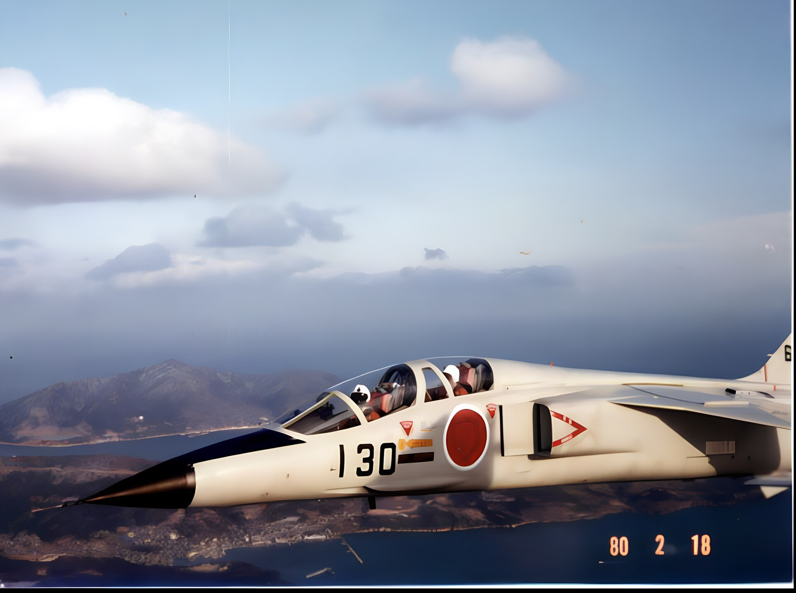
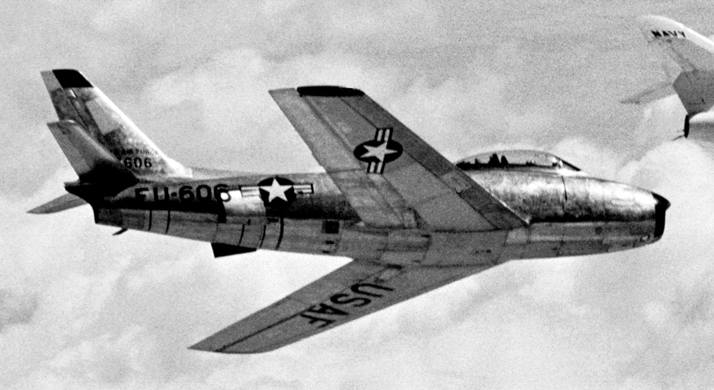
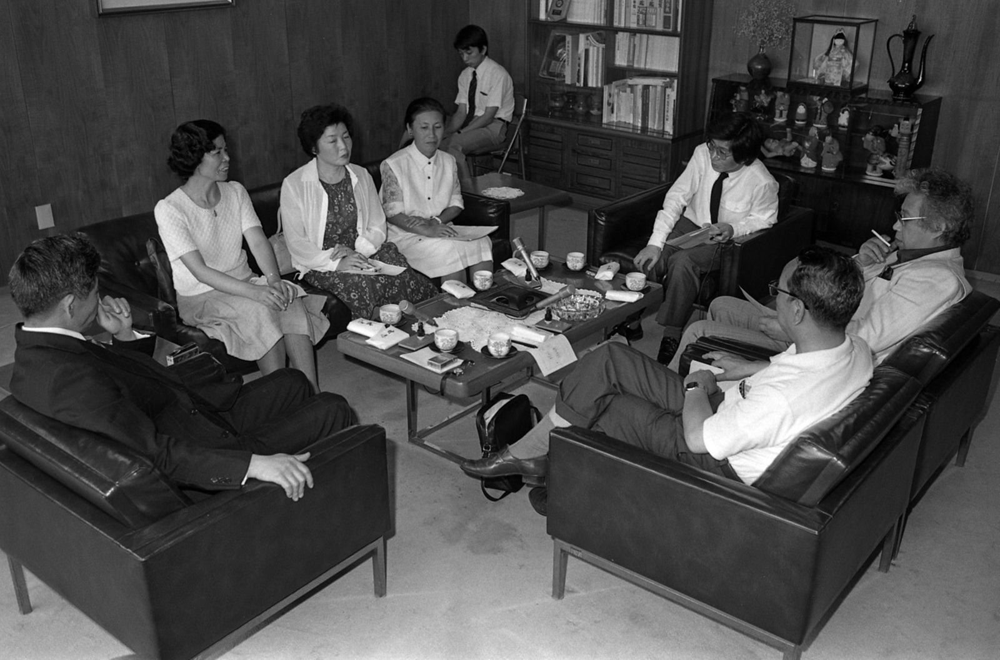

44年前の今日、1982年11月14日。静岡県の航空自衛隊浜松基地で行われていた航空祭で、展示飛行を行っていた曲技飛行チーム「ブルーインパルス」の機体が墜落しました。大勢の観客が見上げる青空の下で発生したこの惨事は、パイロット1名が殉職し、基地の周辺住民12名が負傷する深刻な事態へと発展しました。

## 浜松基地で産声を上げたブルーインパルス

ブルーインパルスの歴史は、まさに事故が起きた浜松基地から始まりました。1955年にアメリカからジェット戦闘機F-86Fの供与を受けた自衛隊では、アメリカ留学で本場サンダーバーズの曲技飛行に感銘を受けたパイロットたちが、浜松基地で訓練を開始しました。1958年10月19日の浜松基地開庁記念式典で初めて一般公開され、映画の中でしか見られなかったジェット機による見事な曲技飛行は、当時の人々に強烈な印象を与えました。

その後、1960年に源田實航空幕僚長のもとで「空中機動研究班」として正式に発足し、部隊の愛称は浜松を流れる天竜川にちなむ案なども経て、最終的に「ブルーインパルス」と名付けられました。パイロットたちは教官任務の傍らで技を磨き、航空自衛隊の広報の象徴として全国へ展開していったのです。

## 東京五輪の空に描いた巨大な五輪マーク

チームの名を不動のものにしたのが、1964年10月10日の東京オリンピック開会式でした。青、黄、黒、緑、赤の5色のカラースモークを引いた5機のF-86Fが、国立競技場の上空に見事な五輪の輪を描き出した瞬間は、戦後日本の復興を象徴する名場面として国民の記憶に深く刻まれました。

この開会式での成功の裏には、秒単位で進む式典に合わせてNHKラジオの音声を受信しながらタイミングを測るなど、極限の集中力と高度な操縦技術がありました。ブルーインパルスは日本の空を彩る華やかな存在として、各地の航空祭で絶大な人気を集めるようになっていきました。

*22SQ T-2overkinkasan — 写真: Yoichi Kurono (CT-17StarGazer) / CC0*

## 国産初の超音速機「T-2」への世代交代

20年以上にわたって親しまれたF-86Fセイバーでしたが、時代の進歩とともに後継機への移行が求められるようになりました。そこで選ばれたのが、日本が初めて独自に開発した超音速高等練習機「T-2」でした。三菱重工業を中心に日本の航空技術を結集して開発されたT-2は、マッハ1.6の飛行能力を持ち、1971年に初飛行、1974年に部隊使用が承認された機体です。

1981年12月27日、長年活動したF-86Fによる戦技研究班は解散し、翌1982年1月12日、宮城県の松島基地第4航空団第21飛行隊内に「T-2ブルーインパルス」が新たに編成されました。新鋭の超音速機による力強く鋭いアクロバット飛行は、新たな時代の幕開けとして大きな期待を集めていました。

*F-86 Sabre in flight — 写真: NACA / Public domain*

## 1982年11月14日、航空祭の暗転

新型機T-2による展示飛行が本格化して迎えた1982年11月14日、生まれ故郷である浜松基地の航空祭には、華麗な飛行を一目見ようと大勢の観衆が詰めかけていました。秋晴れの空の下、展示飛行のクライマックスとして披露されたのが、複数の機体が垂直に急降下しながら地上すれすれで四方へ放射状に散開する大技「下向き空中開花」でした。

しかし、白煙を引いて急降下してきた編隊のうち、4番機が十分な高度で機体を引き起こすことができませんでした。機体は猛スピードのまま基地敷地内の境界付近に激突し、爆発炎上しました。操縦していたパイロット1名が死亡し、基地の外の周辺住民12名が飛び散った破片や火災などで負傷する事態となりました。

*市民ディスカッション — 写真: ndl / CC BY (Japan Search)*

## 残された重い教訓と現在への歩み

自衛隊の航空機が基地の敷地を越えて周辺住民に負傷者を出すという事故は、地域社会と自衛隊の信頼関係に大きな問いを投げかけました。曲技飛行の危険性と安全管理の徹底、そして演技を行う高度や課目の見直しが厳しく迫られることになりました。

ブルーインパルスはその後、徹底した原因究明と安全対策を重ね、現在は機体をT-4練習機へと更新して活動を続けています。多くの人々を魅了する美しい飛行の裏側には、常に命がけの厳しさと、二度と惨劇を繰り返さないための重い教訓が宿っています。

### 参考資料

- <https://ja.wikipedia.org/wiki/11%E6%9C%8814%E6%97%A5>
- <https://commons.wikimedia.org/wiki/File:Test_of_the_XT-2.jpg>
- <https://commons.wikimedia.org/wiki/File:22SQ_T-2overkinkasan.jpg>
- <https://commons.wikimedia.org/wiki/File:F-86_Sabre_in_flight.jpg>
- <https://adeac.jp/koshigaya-city-digital-archives/catalog/mp193091-200020>
