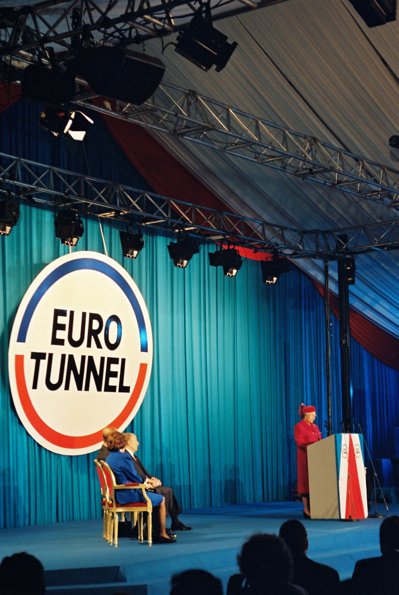
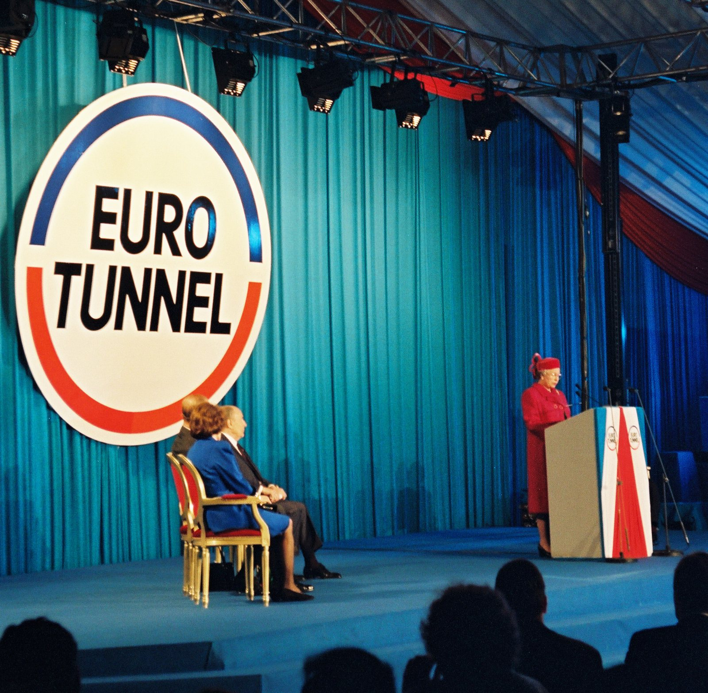
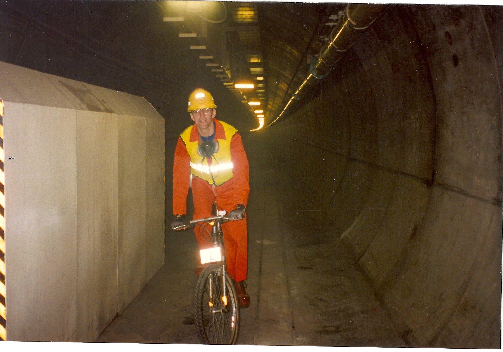

32年前の今日、1994年11月14日。イギリスとヨーロッパ大陸を結ぶ英仏海峡トンネルで、国際高速列車「ユーロスター」が待望の営業運転を開始しました。海の下をくぐり抜けてグレートブリテン島と大陸を鉄路で結ぶという人類の悲願が、ついに現実の交通手段として動き出した記念すべき日です。

## ナポレオンの時代から続いた2世紀の夢

英仏海峡（ドーバー海峡）を海底トンネルで結ぶという構想は、決して現代に始まったものではありませんでした。記録に残る最初のアイデア募集は1751年に遡り、1752年には鉱山技師アルベール・マチューが具体的なトンネル案を提示しました。1802年には、そのマチューがナポレオン1世に対して海峡トンネルの建設を直接提案しています。

その後、1833年に最初の地質調査が行われ、1872年には海峡トンネル会社が設立されて1881年にイギリス側から掘削が開始されたものの、国防上の理由などから工事は中止されました。計画の浮上と挫折が繰り返された後、1986年2月に英仏両政府が事業を公式に認可し、同年5月に本格着工を迎えました。構想からおよそ2世紀を経て、悲願の事業はようやく現実のものとなったのです。

## 1994年11月14日、海底を貫くユーロスターの発進

1990年12月1日に海底の先進トンネルが貫通し、1994年5月6日に両国の首脳らが出席して開通式が挙行されました。そして迎えた1994年11月14日、一般乗客を乗せた高速列車ユーロスターの商業運転が正式にスタートしました。

イギリスのフォークストンとフランスのカレーの間を海底深くでつなぎ、ロンドンとパリ、ブリュッセルなどの主要都市が鉄路で直結されました。ユーロスターの営業最高速度は時速300キロに達しますが、トンネル区間内では安全管理やすれ違いを考慮して時速160キロに制限されています。それでも海峡を船で渡る従来の時間と比べれば劇的な短縮となり、欧州の人の移動に歴史的な変革をもたらしました。

*Speech of Queen Elizabeth II for the opening of the Channel Tunnel (1994) — 写真: Thierry Dauwe / European Communities, 1994 / EC - Audiovisua / CC BY 4.0*

## 青函トンネルを抜いた海底部37.9キロの巨大構造

英仏海峡トンネルは、直径7.6メートルのレールトンネル（鉄道トンネル）2本と、その中間に配置された直径4.8メートルのサービストンネル（保守用トンネル）1本の、計3本で構成されています。列車走行に伴う空気圧を逃がすためのダクトや、各所をつなぐ連絡通路が緻密に設けられた近代土木工学の結晶です。

特筆すべきは海底下を貫く部分の長さで、海底部長は37.9キロメートルに達し、日本の青函トンネルを抜いて世界一の記録を樹立しました。最大水深は60メートルに及び、建設費用はおよそ1兆8,000億円に上りました。

*Speech of Queen Elizabeth II for the opening of the Channel Tunnel (1994) (cropped) — 写真: Thierry Dauwe / European Communities, 1994 / EC - Audiovisua / CC BY 4.0*

## 日本の技術力が支えたフランス側の難工事

この世紀のプロジェクトにおいて、日本のものづくり技術も決定的な役割を果たしました。トンネル掘削には主にTBM工法（トンネルボーリングマシン工法）とシールド工法が採用され、英仏合わせて計11機の大型掘削機が投入されました。イギリス製6機、アメリカ製1機に対し、日本製は4機が採用されています。

特にフランス側からの掘削に参加した川崎重工業製のマシン2機は、水圧や脆弱な地盤が立ちはだかる困難な区間の掘削を見事にこなしました。この過酷な現場を克服した奮闘は、のちに日本のテレビ番組『プロジェクトX』でも取り上げられています。イギリス側のマシンが掘削完了後に地下深くに潜り込ませて投棄されたのに対し、フランス側から進んだ川崎重工業などのマシンはイギリス側まで到達し、地上に記念展示された後に分解されるという名誉ある役目を果たしました。

*事件当時の写真ではありません · 1993年 — 写真: MicDT / CC BY-SA 4.0*

## 経営再建と20世紀最高の鉄道プロジェクト

華々しく開業した英仏海峡トンネルでしたが、莫大な建設費負担が重くのしかかりました。2006年には当時の運営会社であったユーロトンネルグループが総額91億ユーロの債務により経営破綻に追い込まれます。その後、債務減額と再建計画が進められ、2017年には運営会社名が「ゲットリンク」へと改称されました。

一方でその土木的功績は世界から極めて高く評価されています。米国土木学会（ASCE）は、20世紀の10大プロジェクトを選ぶ「モニュメンツ・オブ・ザ・ミレニアム」において、パナマ運河や関西国際空港、エンパイア・ステート・ビルディングなどと並び、鉄道部門の代表として英仏海峡トンネルを選定しました。名実ともに20世紀最高の鉄道プロジェクトとして歴史に刻まれています。

## 鉄路が切り拓いた現代の欧州ネットワーク

現在ではユーロスターだけでなく、乗用車やトラックを運ぶ専用列車ユーロトンネルシャトルや貨物列車が頻繁に海の下を行き交っています。トンネル内での通信環境も整えられ、かつて海底深くの隔絶された空間だった場所を、人々は日常の交通路として快適に行き交うようになりました。

海によって隔てられていた島国イギリスとヨーロッパ大陸を一つにつないだあの日から歳月が流れました。海の下を国際列車が駆け抜けた1994年11月14日の旅立ちは、今も世界の交通史に燦然と輝く金字塔です。

### 参考資料

- <https://ja.wikipedia.org/wiki/%E3%82%A4%E3%82%AE%E3%83%AA%E3%82%B9>
- <https://commons.wikimedia.org/wiki/File:Fran%C3%A7ois_Mitterrand_%26_Elizabeth_II_-_Eurotunnel_-_1994.jpg>
- <https://commons.wikimedia.org/wiki/File:Speech_of_Queen_Elizabeth_II_for_the_opening_of_the_Channel_Tunnel_(1994).jpg>
- <https://commons.wikimedia.org/wiki/File:Speech_of_Queen_Elizabeth_II_for_the_opening_of_the_Channel_Tunnel_(1994)_(cropped).jpg>
- <https://commons.wikimedia.org/wiki/File:Mike_on_a_bike.jpeg>
