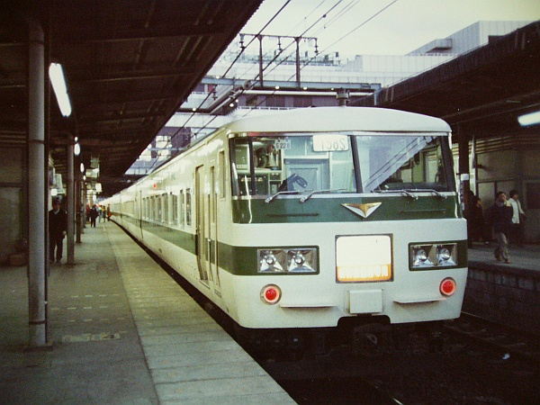

44年前の今日、1982年11月15日。上越新幹線の大宮駅から新潟駅までの区間が開業し、待望の一番列車が走り出しました。本州の太平洋側と日本海側を初めて直結させたこの新幹線は、雪国の人々の暮らしや旅の形を根本から変える大きな一歩となりました。

## 本州を初めて横断した新幹線の誕生

上越新幹線は、1971年に全国新幹線鉄道整備法に基づく基本計画路線として告示され、整備計画の決定を経て着工されました。東海道・山陽新幹線や東北新幹線が列島を縦断するルートを採っていたのに対し、上越新幹線は関東平野から山脈を越えて日本海側へと抜ける、日本初の本州横断新幹線でした。

建設を担ったのは日本鉄道建設公団です。本州日本海側最大の都市である新潟市と首都圏を結ぶこの鉄路は、豪雪によって冬場の交通が寸断されがちだった日本海側地域にとって、長年待ち望まれた悲願の高速ルートでした。

## 豪雪と険しい三国山脈に挑んだ難工事

路線の総延長は、実キロで269.5キロ、営業キロで303.6キロにおよびます。最大の難所となったのは、群馬県と新潟県の県境に立ちはだかる三国山脈でした。この中央分水嶺を貫くため、大清水トンネルをはじめとする数々のトンネルが掘削され、構造全体の約39パーセントをトンネルが占めることになりました。

さらに建設陣を悩ませたのが、世界でも有数の豪雪地帯を通過するという過酷な気象条件でした。雪による脱線や運行障害を防ぐため、線路脇から温水を噴射して雪を溶かすスプリンクラー融雪設備を新潟県内を中心に大規模整備しました。また、群馬県の上毛高原駅や新潟県内の各駅では、線路やホーム全体を頑丈な屋根で覆う構造を採用するなど、雪害を克服するための最新技術が惜しみなく投入されました。

*1982年の資料 — 写真: Peee at Japanese Wikipedia / CC BY-SA 3.0*

## 1982年11月15日、緑のラインが走り出した日

開業前日の1982年11月14日、上野駅と新潟駅を結んでいた在来線の名物特急「とき」が多くのファンに見送られながらラストランを終えました。そして翌11月15日、上越新幹線の暫定的な起点となった大宮駅と新潟駅の間で、いよいよ新幹線の営業運転が開始されました。

当時の車体には、東日本エリアの豊かな自然を象徴する鮮やかな緑色のラインが引かれていました。一番列車がホームを滑り出すと、駅には多くの鉄道ファンや沿線住民が詰めかけ、雪国へ向かう新しい時代の幕開けを祝福しました。同時に国鉄では全国規模の大規模ダイヤ改正が実施され、全国の鉄道網の時刻が一斉に塗り替えられました。

*1982年の資料 — 写真: L.Willms / CC BY-SA 3.0*

## 「あさひ」と「とき」、二つの愛称とダイヤ

開業時に登場した列車名は、速達タイプの「あさひ」と、各駅停車タイプの「とき」の2種類でした。前日まで在来線特急として親しまれていた「とき」の名が各駅停車タイプに引き継がれ、東海道・山陽新幹線における「ひかり」と「こだま」のような役割分担が敷かれました。

大宮から新潟までを短時間で結ぶ新幹線のスピードは圧倒的で、それまで半日近くを要していた首都圏と新潟の往復は、わずか数時間へと短縮されました。ビジネスの利便性が飛躍的に高まっただけでなく、越後湯沢をはじめとする沿線のスキー場や温泉地へのアクセスも劇的に向上し、冬の観光客の流れを大きく変える原動力となりました。

*1982年の資料 — 写真: L.Willms / CC BY 4.0*

## 新潟県民の愛着が実らせた「とき」の復活

開業から15年が経過した1997年10月、北陸新幹線の一部開業に伴う愛称再編により、上越新幹線の東京・新潟間を結ぶ列車はすべて「あさひ」に統一され、「とき」の名称はいったん姿を消すことになりました。

しかし、新設された北陸新幹線の「あさま」と「あさひ」の名前が一文字違いで紛らわしく、乗客の誤乗が相次ぎました。さらに、新潟県の象徴である国の特別天然記念物「佐渡島のトキ」にちなむ名前に深い愛着を寄せていた地元住民や自治体から、列車名の復活を求める熱心な声が上がりました。その熱意が実を結び、2002年12月のダイヤ改正で「あさひ」が「とき」へと改称され、5年ぶりの復活を果たしました。一度廃止された新幹線の愛称が復活した事例は、新幹線の歴史の中でも極めて異例のことでした。

## 豪雪をものともせず駆け抜ける今の上越新幹線

現在、上越新幹線の全列車は最新鋭のE7系車両に統一され、東京駅と新潟駅の間を最速1時間29分で結んでいます。冬になれば白銀の世界へと姿を変える越後平野を、スプリンクラーの水を浴びながら正確無比に疾走する姿は、今や冬の風物詩として定着しています。

1982年11月15日に産声を上げた上越新幹線は、険しい自然を最新の鉄道工学で克服し、太平洋と日本海をつなぐ命綱として、今も人々と地域を結び続けています。

### 参考資料

- <https://ja.wikipedia.org/wiki/%E4%B8%8A%E8%B6%8A%E6%96%B0%E5%B9%B9%E7%B7%9A>
- <https://commons.wikimedia.org/wiki/File:485_hibari_final.jpg>
- <https://commons.wikimedia.org/wiki/File:185-200_Shinkansen_Relay_Omiya_1982.jpg>
- <https://commons.wikimedia.org/wiki/File:Shinkansen_0-series-train_Tokyo_1982_with-foreign-visitor.jpg>
- <https://commons.wikimedia.org/wiki/File:Shinkansen-platform_Tokyo-station_Passengers-queuing-up-at-door-position.jpg>
