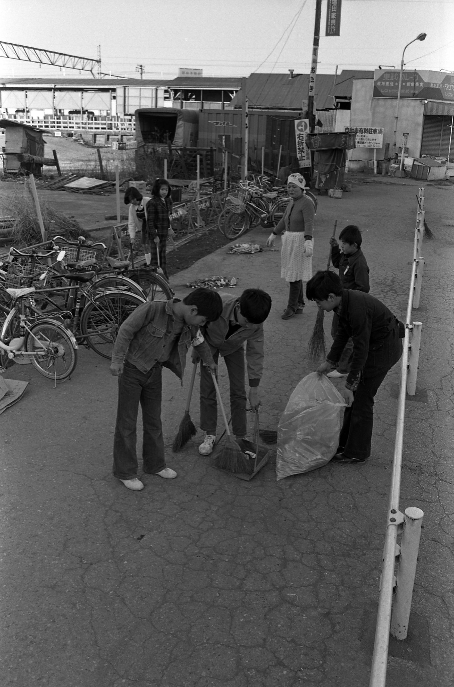
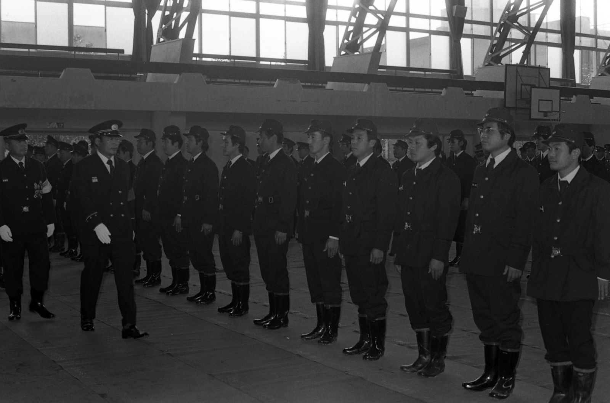
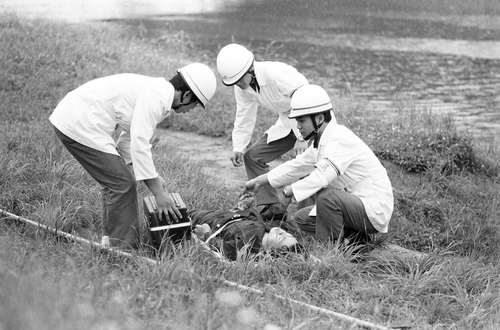

49年前の今日、1977年11月15日。新潟市で、部活動を終えて家路についていた中学1年生の横田めぐみさんが、突然行方不明になりました。自宅まであとわずかという通学路で起きた失踪事件は、20年の歳月を経て、国家による拉致という前代未聞の凶行であったことが判明します。

## 父の誕生日の翌日、普段と変わらない下校路で

1964年10月5日、日本銀行職員の父・滋さんと母・早紀江さんの長女として生まれた横田めぐみさんは、朗らかで読書や歌が大好きな少女でした。失踪前日の11月14日は父・滋さんの誕生日で、「これからはおしゃれに気をつけて」と櫛をプレゼントしていました。

1977年4月に新潟市立寄居中学校へ入学しためぐみさんは、バドミントン部に所属していました。11月15日夕方、練習を終えた彼女はチームメート2人と一緒に午後6時半すぎに校門を出て、新潟市水道町の自宅へ向かいました。途中で友人と別れ、自宅までのわずかな距離を歩いていた午後6時35分頃、その姿を最後に消息を絶ちました。

## 機動隊760人を投入、警察犬が止まった「ある地点」

帰宅時間を過ぎても戻らない娘を心配した両親は警察へ捜索願を提出しました。新潟中央警察署は全職員を非常招集し、県警本部と連携して最大220人態勢で夜を徹した捜査を開始しました。

翌11月16日には、新潟県警始まって以来と言われる規模の捜索が行われ、機動隊760人が投入されました。空き地や海岸の防風林などを徹底的に捜索したものの、遺留品すら見つかりませんでした。この捜索の際、警察犬は通学路の途中にある「ある地点」で必ずぴたりと足を止め、そこから先の追跡が不可能になりました。当時は事件か事故かすら判明せず、街には深い不安と沈黙が広がりました。

*弥生町子ども会越谷駅前清掃 — 写真: ndl / CC BY (Japan Search)*

## 暗闇の20年、取材から浮かび上がった北朝鮮の影

手がかりのないまま年月が流れる中、真相を追うジャーナリストの石高健次氏らによる調査が大きな転機をもたらしました。1990年代、元北朝鮮工作員らの証言取材を通じて「13歳の中学1年生がバドミントンの練習帰りに拉致された」という断片的な情報が浮上します。

ネット検索もない時代、過去の新聞縮刷版などを徹底的に調べ直した結果、1997年1月7日、その少女が横田めぐみさんであることが突き止められました。同年1月21日、父・滋さんのもとに「娘さんは拉致され、北朝鮮で生存している可能性がある」という知らせが届きました。失踪から実に20年が経っていました。

*消防特別点検（大沢第一体育館にて） — 写真: ndl / CC BY (Japan Search)*

## 実名告発と「家族会」の結成、動いた日本社会

娘の安全を案じながらも、両親は苦悩の末に実名での公表を決断しました。1997年2月に週刊誌や新聞で大々的に報道されると、拉致問題は国会でも取り上げられ、日本社会全体を揺るがす大問題へと発展しました。

同年3月25日、各地で同様に家族を奪われた被害者家族が集まり、「北朝鮮による拉致被害者家族連絡会」（家族会）が結成され、横田滋さんが代表に就任しました。4月からは両親による街頭での署名活動が始まり、娘との再会を信じて全国を巡る果てしない救出運動が本格化しました。

*水難救助訓練（葛西用水） — 写真: ndl / CC BY (Japan Search)*

## 日朝首脳会談での拉致認定、そして今も続く闘い

北朝鮮側は当初「月を見て吠える狂犬の声」などと猛反発し、関与を全面否定していました。しかし2002年9月に行われた日朝首脳会談において、金正日総書記が日本人拉致を公式に認め、謝罪しました。辛光洙ら工作員による犯行だったことが白日の下に晒された瞬間でした。

その後、一部の拉致被害者が日本への帰国を果たしたものの、めぐみさんをはじめとする多くの被害者の完全な帰国は果たされていません。日本政府は「全員の生存を前提に対処する」とし、解決なくして国交正常化はないとの姿勢を維持しています。通学路から忽然と少女が消えたあの11月15日から半世紀近く。家族と支援者たちの祈りと闘いは、今も続いています。

### 参考資料

- <https://ja.wikipedia.org/wiki/%E6%A8%AA%E7%94%B0%E3%82%81%E3%81%90%E3%81%BF>
- <https://jmapps.ne.jp/chigasaki_history/det.html?data_id=334>
- <https://adeac.jp/koshigaya-city-digital-archives/catalog/mp168798-200020>
- <https://adeac.jp/koshigaya-city-digital-archives/catalog/mp167736-200020>
- <https://adeac.jp/koshigaya-city-digital-archives/catalog/mp174639-200020>
