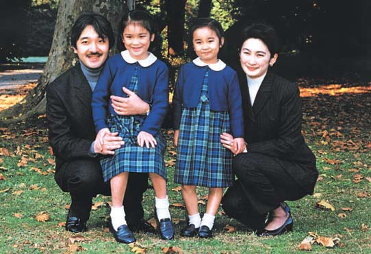
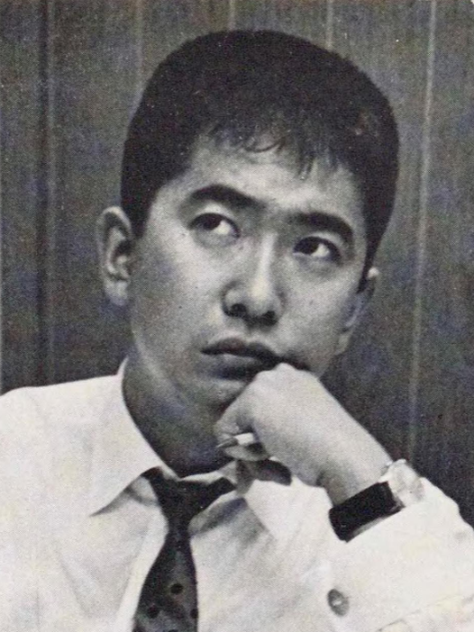
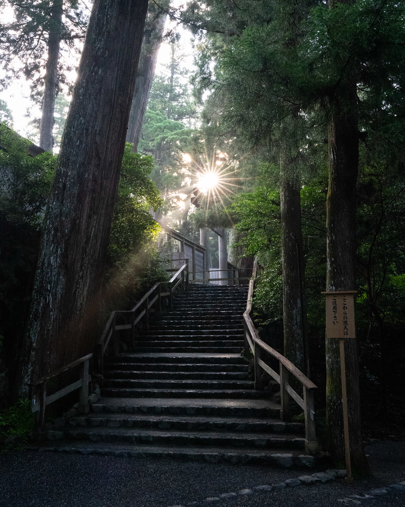

21年前の今日、2005年11月15日。天皇、皇后両陛下の長女である紀宮清子内親王と、東京都職員の黒田慶樹さんの結婚式が、東京・日比谷の帝国ホテルで執り行われました。皇室典範の規定に基づき、紀宮さまはこの日をもって皇族の身分を離れ、民間人の「黒田清子さん」となられました。日本中が温かな祝福に沸いた一日を振り返ります。

## 「さんまの会」での再会と秋篠宮さまの橋渡し

お二人の縁を結んだのは、紀宮さまの次兄である秋篠宮文仁親王でした。お相手の黒田慶樹さんは、学習院初等科時代からの秋篠宮さまのご学友であり、高等科や大学時代もクラブ活動などを通じて親交を深めていた間柄でした。大学卒業後は三井銀行（後のさくら銀行、現在の三井住友銀行）勤務を経て、1997年に東京都庁へ入庁し、都市整備局などで実務に励む地方公務員でした。

転機となったのは2003年1月でした。秋篠宮邸で開かれていた友人たちの集まり「さんまの会」に招かれた黒田さんは、幼少期から顔見知りであった紀宮さまと再会を果たします。その後、二人は約2年間にわたり交際を深めました。秋篠宮さまは後に記者会見で「最初二人が会うきっかけを作ったのは私でありますし、二人が会ったうちの何回か、場所を提供したのも事実であります」と明かされています。連絡には電子メールのほか手紙が用いられ、手紙は秋篠宮さまが自ら双方へ届けられたといいます。

## 度重なる延期を乗り越えた婚約内定発表

2004年1月に黒田さんからの求婚を紀宮さまが承諾され、翌2月には天皇、皇后両陛下へ紹介されました。婚約内定の動きは同年11月に報道され、大きな話題を呼びました。しかし、直前に発生した新潟県中越地震への配慮から、11月9日に予定されていた正式発表は延期されます。さらにその後、大叔母にあたる宣仁親王妃喜久子さまの薨去が重なり、再度の延期を余儀なくされました。

正式な婚約内定発表と記者会見が行われたのは、年の瀬も押し迫った2004年12月30日のことでした。会見で紀宮さまは黒田さんの魅力について「ご自分の考えをしっかりとお持ちになりながら、ゆったりと他人を許容することのできる寛さを持っておられるところ」と語られました。一方の黒田さんも「宮さまには、これからの生活の多くが新しいことで、ご不安をお感じになることも多くおありかと存じますけれども、私といたしましては、できる限りのことをさせていただきたい」と誠実に応え、国民に爽やかな印象を与えました。

*Prince Fumihito of Akishino and his family — 写真: 在チェコ日本国大使館 / CC BY 4.0*

## 帝国ホテルでの神道式挙式と歴史的な披露宴

年が明けた2005年3月19日の「納采の儀」、10月5日の「告期の儀」を経て、迎えた11月15日。紀宮さまは午前10時ごろに皇居を出立し、式場となった日比谷の帝国ホテルへ向かわれました。午前11時、ホテル内の「蘭の間」にて神道式の結婚式が執り行われました。天照大神を祀った式場で、伊勢神宮大宮司の北白川道久さんが斎主を務め、天皇、皇后両陛下や皇太子ご夫妻をはじめとする両家の親族が列席しました。

午後4時からは同ホテルで披露宴が催され、皇族方や親族、知人ら130人が出席しました。天皇、皇后両陛下が内親王の結婚披露宴に出席されるのは、歴史上初めてのことでした。披露宴では黒田さんの「職場の上司」にあたる当時の東京都知事・石原慎太郎さんが乾杯の発声を担当し、和やかな祝宴となりました。

*Shintaro-Ishihara-1 — 写真: Unknown photographer / Public domain*

## 皇籍を離れ、民間人「黒田清子さん」として歩む道

結婚式が行われた11月15日午前、新居のある区役所に婚姻届が提出されて受理されました。これにより紀宮さまは皇統譜から一般の戸籍へと移り、皇族の身分を離れて民間人「黒田清子」さんとなりました。翌16日には宮内庁長官が皇統譜に登録を行い、警護の担当も皇宮警察本部から警視庁へと引き継がれました。皇室経済会議の決定に基づき、民間での生活基盤を支えるための一時金として国から1億5,250万円が支給されています。

結婚を前にした同年10月には、警視庁府中運転免許試験場で普通自動車運転免許（AT限定）を取得されるなど、一般国民としての生活に向けた準備を着実に進められていました。長年にわたり両陛下のお側近くで良き相談相手として支え続け、山階鳥類研究所での研究活動など自立した歩みを進めてこられた紀宮さまの新たな門出に、多くの国民が温かい拍手を送りました。

*Sunburst at Ise Grand Shrine Naiku — 写真: Big Ben in Japan / CC BY-SA 2.0*

## 結婚後も変わらぬ絆と伊勢神宮祭主としての務め

民間人となってからの清子さんは、夫である慶樹さんとともに穏やかな家庭を築きながら、皇室と最も近い親戚として温かな交流を続けました。天皇、皇后両陛下の結婚記念日をご自宅で祝われたり、御所での夕食会や宮中行事、国賓を迎える宮中晩餐会に招かれたりするなど、変わらぬ絆で皇室を支えられました。

さらに2012年からは、昭和天皇の皇女である池田厚子さんを補佐する伊勢神宮の臨時祭主に就任し、2013年の第62回神宮式年遷宮に奉仕されました。そして2017年6月には、池田さんの後任として明治以降で11人目となる伊勢神宮祭主に正式に就任しました。2019年の天皇陛下の退位や即位に伴う祭儀にも神宮祭主として奉仕するなど、皇室の伝統を継承する重責を果たされています。2005年の秋の日に踏み出された一歩は、今も静かに日本の歴史と文化に息づいています。

### 参考資料

- <https://ja.wikipedia.org/wiki/%E9%BB%92%E7%94%B0%E6%B8%85%E5%AD%90>
- <https://commons.wikimedia.org/wiki/File:Shintar%C5%8D_Ishihara_2003.jpg>
- <https://commons.wikimedia.org/wiki/File:Prince_Fumihito_of_Akishino_and_his_family.jpg>
- <https://commons.wikimedia.org/wiki/File:Shintaro-Ishihara-1.png>
- <https://www.flickr.com/photos/74418647@N00/51345675212>
