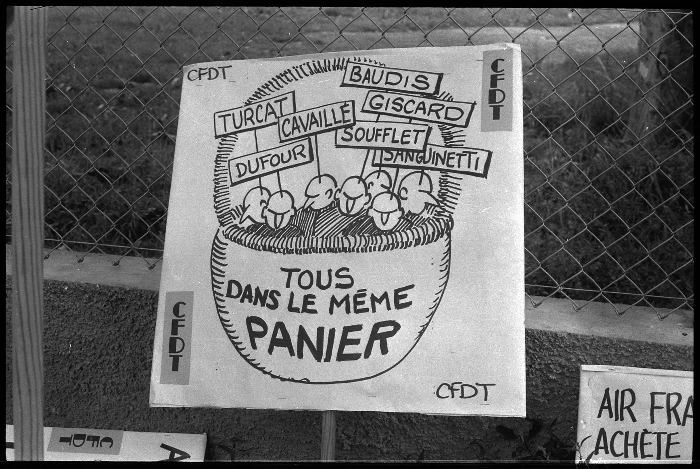
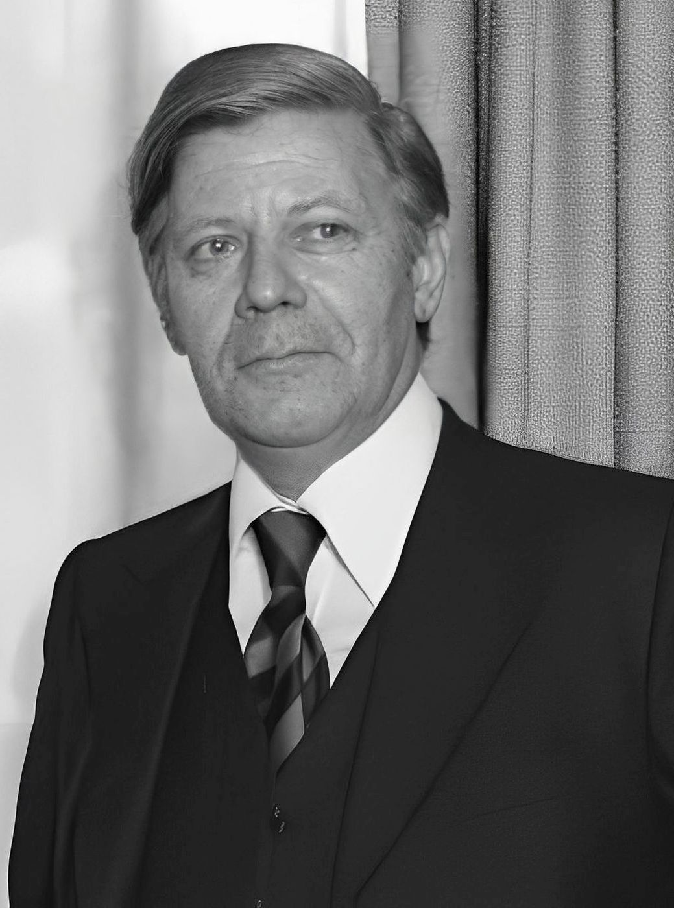
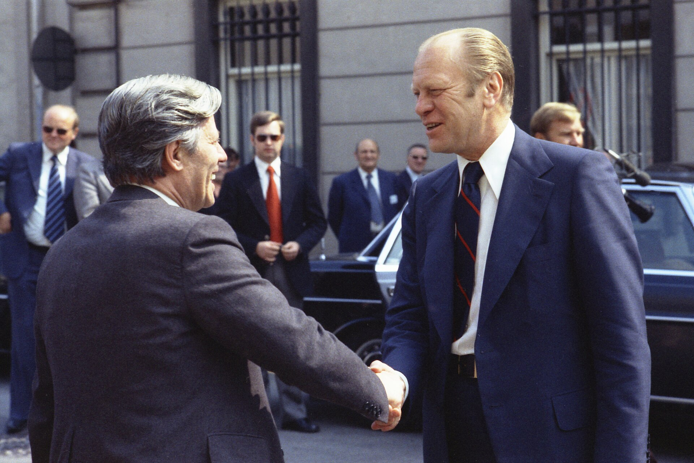

51年前の今日、1975年11月15日。フランスの首都パリの南西にあるランブイエ城に、主要先進工業国の首脳たちが集まりました。のちに世界政治・経済の定例舞台となる主要国首脳会議、その記念すべき第1回サミットの開幕です。

## 1930年代以来の不況とオイルショックの影

1970年代半ば、世界は極めて厳しい経済的試練に直面していました。いわゆる石油危機による深刻なエネルギー危機と急激なインフレ、それに伴う失業の拡大は、先進工業国に大きな打撃を与えていました。当時直面していた不況は「1930年代の世界恐慌以来の最も深刻なもの」と評されるほどであり、各国が自国優先の保護主義に走ることを防ぎ、世界貿易の成長と通貨の安定を取り戻すための国際協力が強く求められていたのです。

## ジスカールデスタンとシュミットの危機感

こうした状況の中で、新たな対話の枠組みを構想したのが、フランスのジスカールデスタン大統領と西ドイツのシュミット首相でした。既存の国際会議が持っていた堅苦しい形式的な手続きや官僚的な進行に対して、両首脳は強い不満を抱いていました。本当に必要なのは、各国の最高責任者が直接顔を合わせ、腹を割って率直に意見を交わし、困難な経済的決断に直面するリーダー同士が互いに励まし合える場であると考えたのです。

*事件当時の写真ではありません · 1974年 — 写真: André Cros / CC BY-SA 4.0*

## 不測の事態で就任した6人のリーダーたち

会議に集まったのは、フランス、西ドイツ、イタリア、日本、イギリス、アメリカの6か国首脳でした。当時はまだカナダが参加しておらず、「G6」と呼ばれる枠組みでした。特筆すべきは、参加した首脳全員が、それぞれ前年の1974年に不測の事態によって就任したばかりだったという点です。国内外の政変や混乱を経てリーダーとなった彼らにとって、このサミットは互いの信頼関係を築き、人となりを知り合う貴重な機会でもありました。

*Helmut Schmidt Helsinki 1975 — 写真: Dieter Demme / CC BY 3.0 de*

## パリ近郊の古城、ランブイエに集う

舞台となったのは、パリから急行列車で約30分、広大な森に囲まれたランブイエ城でした。1375年に建てられたこの城は、かつてルイ16世やナポレオン1世も利用した歴史ある名城であり、当時はフランス大統領の別邸として使われていました。首都の喧騒を離れ、静寂に包まれた別邸に集まることで、首脳たちはリラックスした雰囲気の中で本音の議論を戦わせることができたのです。

*President Gerald Ford and Helmut Schmidt — 写真: Courtesy Gerald R. Ford Library / Public domain*

## 3日間にわたって議論された世界経済の課題

11月15日から17日までの3日間にわたり、多岐にわたる議題が話し合われました。世界経済に関する生産的な意見交換をはじめ、インフレとエネルギー危機、失業対策と経済回復、世界貿易の成長促進、多国間貿易交渉、さらにはソビエト連邦および東側諸国との経済関係や発展途上国との協力関係に至るまで、議論は熱を帯びました。ここで掲げられた「保護主義の回避」「エネルギー依存の克服」「成長の促進」という基本姿勢は、その後の数十年にわたる国際社会の羅針盤となりました。

## G6からG7へ、半世紀を超えて続く対話の礎

ランブイエで非公式なフォーラムとして始まった首脳同士の会合は、翌年以降カナダが加わってG7となり、さらに時代を経てG8と呼ばれるなど、形を変えながら現在も毎年開催されています。大国のトップが一堂に会して世界の危機を乗り切るための合意を模索するという外交スタイルは、まさに1975年11月15日のランブイエ城から始まりました。

### 参考資料

- <https://ja.wikipedia.org/wiki/%E7%AC%AC1%E5%9B%9E%E5%85%88%E9%80%B2%E5%9B%BD%E9%A6%96%E8%84%B3%E4%BC%9A%E8%AD%B0>
- <https://commons.wikimedia.org/wiki/File:Takeo_Miki_and_Mutsuko_with_John_Hubbard.jpg>
- <https://commons.wikimedia.org/wiki/File:24.9.74._Manif_des_ouvriers_de_la_SNIAS_(a%C3%A9rospatiale)_(1974)_-_53Fi5270.jpg>
- <https://commons.wikimedia.org/wiki/File:Helmut_Schmidt_Helsinki_1975.jpg>
- <https://commons.wikimedia.org/wiki/File:President_Gerald_Ford_and_Helmut_Schmidt.jpg>
