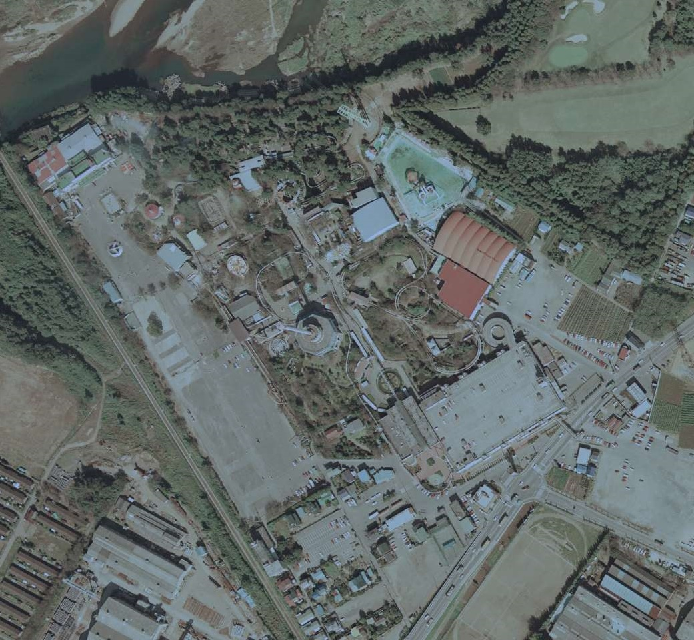
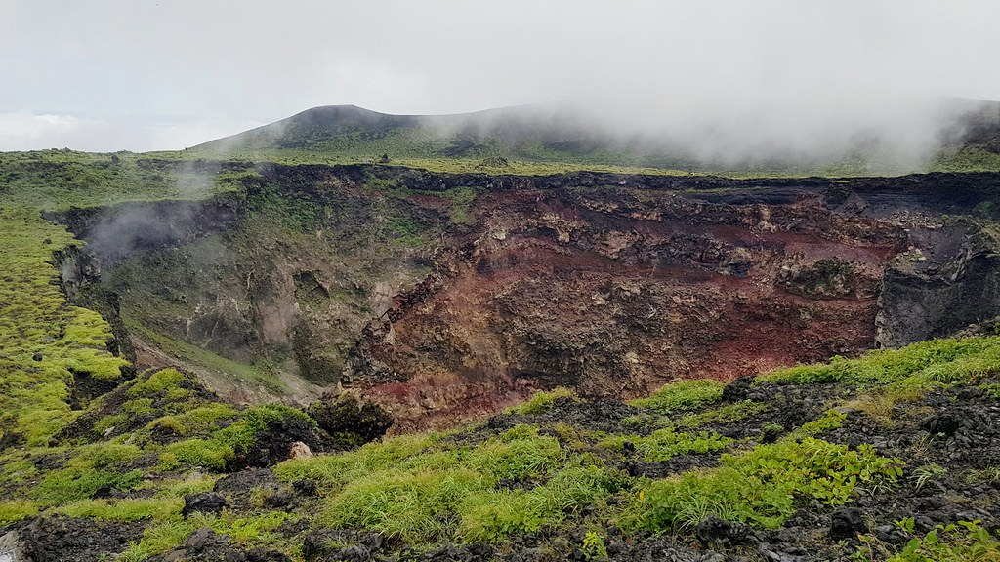
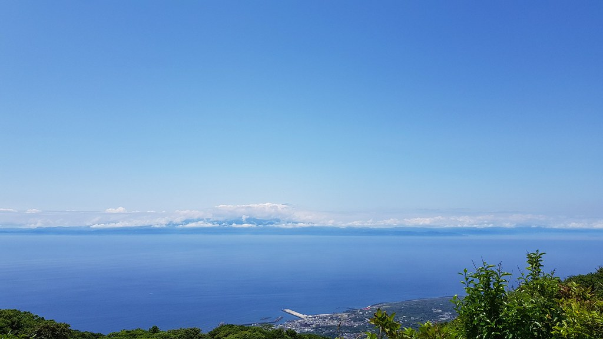

40年前の今日、1986年11月15日午後5時25分ごろ、東京都の伊豆大島にある三原山が12年ぶりに噴火しました。当初は火口内にとどまる見物客向けの噴火とみられていましたが、わずか6日後に事態は暗転し、島民と観光客ら1万人以上が島を離れる前代未聞の全島避難へと発展しました。

## 御神火と畏れられた三原山と過去の教訓

伊豆大島は島全体が火山島であり、島の中央には標高758メートルの三原新山を最高峰とする三原山がそびえています。島民たちは古くからその火山活動を「御神火」と呼び、畏れ敬いながら共生してきました。三原山は100年から200年ごとに大噴火を繰り返す活火山として知られています。

20世紀に入ってからも活動は活発で、1950年から1951年にかけての噴火では三原新山が形成されました。しかし、1957年の小規模な噴火では火山弾によって1人が死亡し、53人が負傷する被害が出ています。この際、大島町役場の避難指示が遅れたとして厳しい批判を浴びることとなり、この時の苦い記憶が後の危機管理へとつながっていきます。

## 11月15日の噴火開始と束の間の楽観ムード

1986年11月15日午後5時25分ごろ、三原山の竪坑状火孔の南壁から噴火が始まりました。深さ約230メートル、直径約300メートルあった火孔は噴出物で次第に埋め尽くされ、11月19日午前10時35分ごろには火口の北西縁を越えて溶岩流がカルデラ床へと流れ下りました。

この珍しい自然現象を一目見ようと、島には本土から5000人を超える観光客が押し寄せました。その後、噴火活動は一時的に小康状態を見せ始めます。立ち入り禁止区域に指定されたことで営業ができなくなった商店が営業再開の許可を求めて町役場に陳情に訪れるなど、島内には楽観的なムードすら漂っていました。

*Oyama Amusement Park, CKT863-C5-49 — 写真: Geographical Survey Institute of Japan / Attribution*

## 事態急変：想定外の割れ目噴火と迫る溶岩

しかし、本当の恐怖は地下で静かに進行していました。噴火開始から6日後の11月21日昼過ぎ、カルデラ北部で有感地震が頻発し始めます。そして午後4時15分、カルデラ床から一連の活動で最大級となる割れ目噴火が発生し、噴煙は高度8000メートルにまで達しました。

揺れと噴火の異常さに直面した大島町役場は直ちに対策本部を設置し、植村秀正町長は1957年の噴火を経験していた秋田壽助役を本部長に指名しました。さらに午後5時46分、誰も想定していなかった外輪山の外側、北西山腹からも割れ目噴火が始まりました。吹き出した溶岩は急斜面を流れ下り、島最大の集落でおよそ3000人が暮らす元町地区の人家から数百メートルの地点にまで迫ったのです。

*Mount Mihara crater, Izu Oshima — 写真: blondinrikard / CC BY 2.0*

## 深夜の決断：1万226人史上最大の脱出作戦

当初は島南部への避難が進められましたが、地震活動が南東部へと移動し、南部にある波浮港周辺でも地面に開口割れ目が確認されました。島全体が引き裂かれかねない危機を前に、午後10時50分、対策本部は全島避難を正式に決定します。

この危機に民間と政府が一体となって動きました。東海汽船は自主判断で高速船シーホークを走らせて観光客を脱出させた後、東京港にいたすべての所有船を大島へ向かわせました。定期船に乗っていた一般客に頭を下げて下船してもらい、空船でピストン輸送を行ったのです。政府も安全保障会議設置法を初適用し、後藤田正晴官房長官の指揮のもと、海上保安庁の巡視船8隻や海上自衛隊の護衛艦、さらには南極へ向けて出港したばかりだった観測艦「しらせ」まで救助に加わりました。

*View from Mount Mihara, Izu Oshima — 写真: blondinrikard / CC BY 2.0*

## 島に残った男たちと1か月におよぶ避難生活

11月22日午前5時10分、最後まで現場に残っていた大島支庁と町役場の職員が退去し、島民と観光客ら合わせて1万226人全員の救出が完了しました。暗夜の荒波の中、一人の犠牲者も出さずに全員を脱出させた救難劇でした。

全島民が島を離れる中、島のライフラインを守るため東京電力の火力発電所職員3人が島内に残留し、秋田助役も島に留まり続けました。島民たちは東京都内や静岡県の避難所で約1か月間の不自由な避難生活を余儀なくされましたが、12月20日に島外避難指示が正式に解除され、埠頭で秋田助役に迎えられながら懐かしい故郷の島へと帰還を果たしました。

## 大噴火が残した爪痕と現代への教訓

火口周辺はその後、1996年11月までおよそ10年間にわたり立ち入り禁止が続きました。一方で、山頂の三原神社が溶岩流を奇跡的に免れたことは島の七不思議として語り継がれ、冷え固まった溶岩が怪獣のような姿を見せる「ゴジラ岩」は新たな名所となりました。

この未曾有の大脱出作戦は、2000年5月30日にNHKのドキュメンタリー番組『プロジェクトX〜挑戦者たち〜』でも「全島一万人 史上最大の脱出作戦」として取り上げられ、大きな反響を呼びました。1957年の教訓を生かし、迅速な政治判断と民間の献身的な協力によって成し遂げられた犠牲者ゼロの全員脱出は、日本の防災と危機管理の原点として今も色褪せることはありません。

### 参考資料

- <https://ja.wikipedia.org/wiki/%E4%BC%8A%E8%B1%86%E5%A4%A7%E5%B3%B6>
- <https://commons.wikimedia.org/wiki/File:Fujioka_city_center_area_Aerial_photograph.1986.jpg>
- <https://commons.wikimedia.org/wiki/File:Oyama_Amusement_Park,_CKT863-C5-49.jpg>
- <https://www.flickr.com/photos/44093058@N06/48320287732>
- <https://www.flickr.com/photos/44093058@N06/48320241387>
