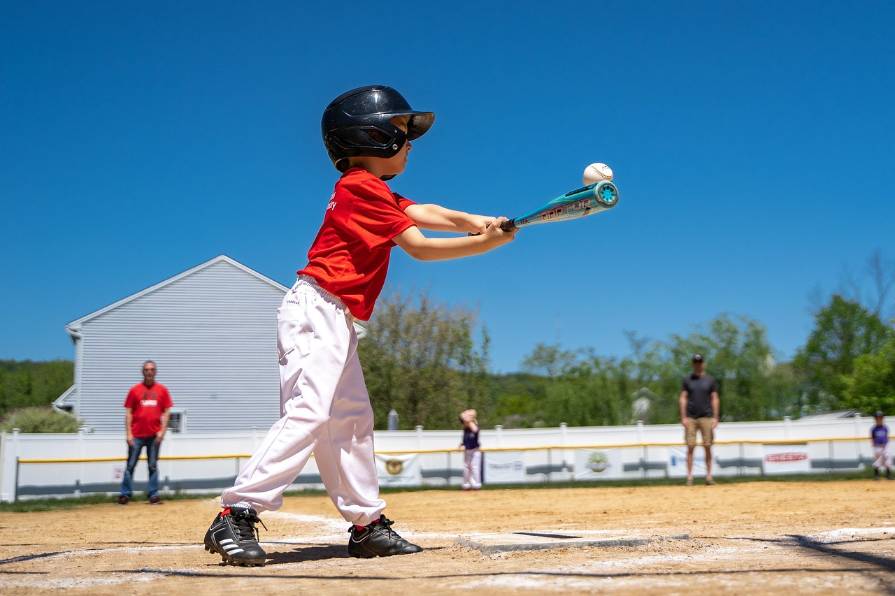
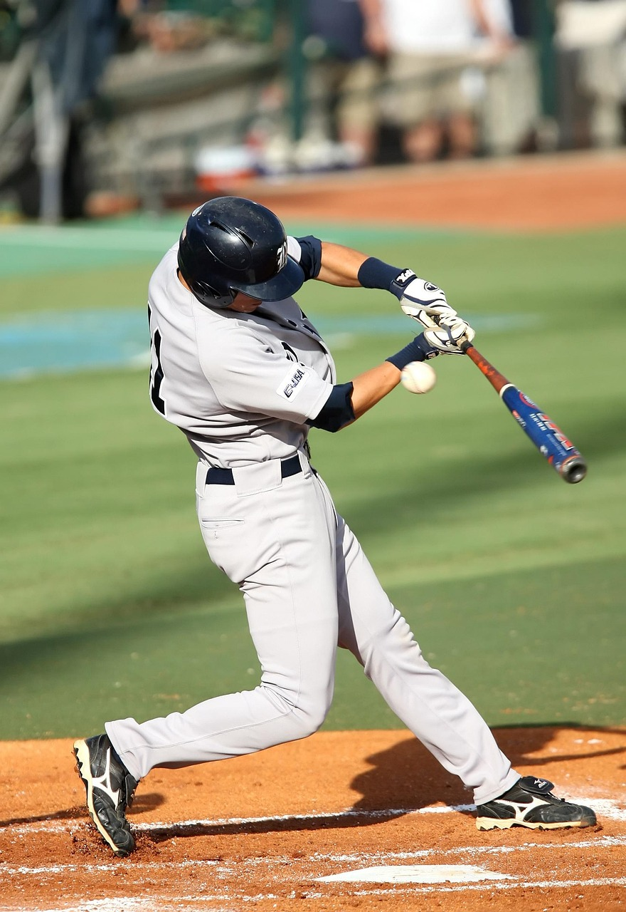
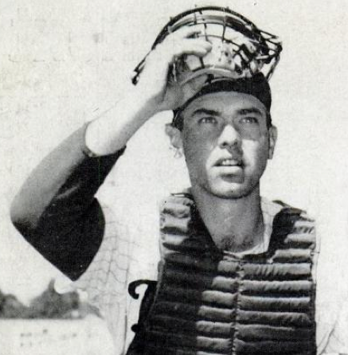

46年前の今日、1980年11月15日。プロ野球の野村克也選手が、現役引退を発表しました。南海ホークス、ロッテオリオンズ、西武ライオンズの3球団を渡り歩き、27年間にわたって第一線でマスクをかぶり続けた大打者が、ついにグラウンドに別れを告げた瞬間でした。

## 極貧の少年時代とテスト生からの入団

野村克也さんは1935年6月29日、京都府竹野郡網野町（現・京丹後市）に生まれました。父は日中戦争に出征し、1938年11月26日に戦病死。母も1943年に子宮癌、翌1944年に大腸癌を患うなど、一家は深刻な耐乏生活を強いられました。家計を助けるため、小学3年生の頃から兄とともに新聞配達やアイスキャンディー売りのアルバイトに励みました。

金銭的な余裕がないなか、古雑誌の写真を見て川上哲治選手や大下弘選手の打撃フォームを研究し、バット代わりに海水を詰めた一升瓶で素振りを続けました。京都府立峰山高校では1年生から正捕手を務めたものの、甲子園には手が届きませんでした。野球部長が各球団に送った推薦状をきっかけに、南海ホークスの鶴岡一人監督が入団テストを案内。1954年、野村さんは契約金なしのテスト生として南海へ入団し、背番号60を与えられました。

## 世界初の快挙、捕手による三冠王の達成

1954年5月31日に支配下選手として登録された野村さんは、日々の猛練習で頭角を現し、強肩強打の捕手としてチームに欠かせない存在へと成長しました。当時歴代最多となるシーズン52本塁打を放つなど長打力を発揮し、NPB戦後初、そして世界のプロ野球史上でも捕手として前人未到となる三冠王を達成しました。

現役生活を通じて本塁打王を9回、打点王を7回獲得し、シーズン最優秀選手（MVP）に5回選出されました。ベストナイン選出19回、オールスターゲーム出場21回は歴代最多記録です。通算安打、通算本塁打、通算打点、通算塁打の各記録において歴代2位に名を連ね、打撃のスペシャリストとしても球史に不滅の足跡を刻みました。

*当日の写真ではありません · 事件当時の写真ではありません · イメージ写真 — 写真: jatocreate / Pixabay Content License*

## 選手兼任監督としての奮戦と現役引退

1970年、野村さんは35歳で南海ホークスの選手兼任監督に就任しました。初年度の1970年には全試合に出場して42本塁打、114打点を記録。1972年には101打点で7度目の打点王に輝き、1973年にはパ・リーグ優勝を果たして選手としても5度目のMVPを受賞しました。プレイングマネージャーを務めた8年間だけでも、200本の本塁打を積み上げています。

その後、ロッテオリオンズ、西武ライオンズへと移籍し、実働26年、現役生活は27年間に及びました。数多くの大記録を打ち立てた名捕手は、1980年11月15日に現役引退を表明し、長かった選手生活に区切りをつけました。

*当日の写真ではありません · 事件当時の写真ではありません · イメージ写真 — 写真: KeithJJ / Pixabay Content License*

## 知将として刻んだ平成の金字塔

現役引退後は野球解説者として、テレビ中継で打者の心理や配球を分かりやすく解説する「野村スコープ」を創出。1990年からはヤクルトスワローズの監督を務め、9年間で4度のリーグ優勝、3度の日本一に導きました。その後、阪神タイガースの監督を3年間、シダックスの監督を経て、2006年から2009年まで東北楽天ゴールデンイーグルスの監督を務めました。

平成の時代に積み上げた通算1053勝は同時代における最多記録です。監督として通算3204試合に出場し、1565勝を記録。プロ野球史において選手と監督の両方で通算3000試合出場を達成した人物は、野村克也さんただ一人です。

*Clay Dalrymple 1962 — 写真: Unknown authorUnknown author / Public domain*

## 今も球界の礎として生き続ける遺産

2020年2月11日に亡くなるまで、野村さんは著作の執筆や講演を通じて野球の理論と技術の発展に尽力し続けました。生前に語った数多くの名言や、相手の配球や心理を論理的に分析する「ID野球」の考え方は、今も球界の指導者や選手たちに受け継がれています。

無名のテスト生から出発し、世界のプロ野球史上初となる捕手三冠王へ。ひたむきな努力と研ぎ澄まされた洞察力で球史を塗り替えた野村克也さんの27年間に及ぶ現役生活は、日本のスポーツ界における不滅の金字塔として輝き続けています。

### 参考資料

- <https://ja.wikipedia.org/wiki/%E9%87%8E%E6%9D%91%E5%85%8B%E4%B9%9F>
- <https://pixabay.com/photos/baseball-little-league-youth-kids-7985433/>
- <https://pixabay.com/photos/baseball-little-league-youth-kids-7985432/>
- <https://pixabay.com/photos/baseball-baseball-player-batter-1462413/>
- <https://commons.wikimedia.org/wiki/File:Clay_Dalrymple_1962.png>
